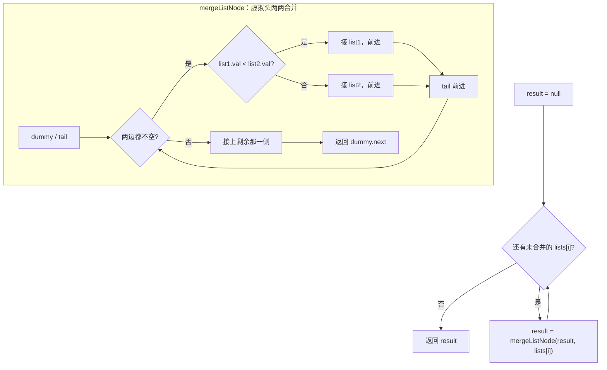
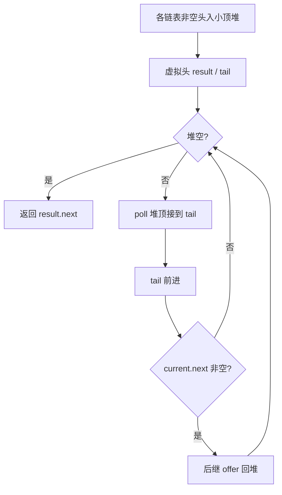

# 虚拟头 - 合并 K 个有序链表

> [LeetCode 23. 合并 K 个升序链表](https://leetcode.cn/problems/merge-k-sorted-lists/)

## 题目说明

给你一个链表数组，每个链表都已经按升序排列。请你将所有链表合并到一个升序链表中，返回合并后的链表。

**示例 1：**

- 输入：`lists = [[1,4,5],[1,3,4],[2,6]]`
- 输出：`[1,1,2,3,4,4,5,6]`
- 解释：链表数组合并为 `1 → 1 → 2 → 3 → 4 → 4 → 5 → 6`

**示例 2：**

- 输入：`lists = []`
- 输出：`[]`

**示例 3：**

- 输入：`lists = [[]]`
- 输出：`[]`

## 解题思路

两种常见写法，按场景选：

| 写法 | 核心 | 时间 | 空间 | 什么时候讲 |
|------|------|------|------|------------|
| **两两合并** | 循环调用「合并两条」 | O(K · N) | O(1) | 先会 LC21，口述最顺 |
| **小顶堆** | 每次从堆顶取全局最小 | O(N log K) | O(K) | K 大、要最优解 |

记法：两两合并 = LC21 循环 K 次；堆 = K 个头进堆，谁小接谁、后继再进堆。

---

## 写法一：两两合并

核心就一句话：**会合并两条有序链表，就会合并 K 条**——拿一个 `result` 当「当前已合并结果」，依次和数组里每一条链表做两两合并。

- 外层循环：`result` 初始为 `null`，遍历 `lists`，每次 `result = mergeListNode(result, lists[i])`
- 内层 `mergeListNode`：就是「合并两个有序链表」那一套——虚拟头 + 双指针，谁小接谁，剩下一截整段挂上
- 空链表、`null`、`result` 一开始是空：合并函数都能兜住，不用单独特判

### 过程

1. `result = null`
2. 对 `i = 0 .. lists.length - 1`：
   - `result = mergeListNode(result, lists[i])`
3. 返回 `result`

`mergeListNode(list1, list2)` 内部：

1. 虚拟头 `dummy`，`tail` 指向已合并尾部
2. 两边都不空时，比较队头，较小的接到 `tail` 后，对应指针前进，`tail` 前进
3. 一边走完后：`tail.next` 接到另一边剩余
4. 返回 `dummy.next`

以 `[[1,4,5],[1,3,4],[2,6]]` 为例：

| 轮次 | result（合并前） | 当前 lists[i] | 合并后 result |
|------|------------------|---------------|---------------|
| 0 | `null` | `1 → 4 → 5` | `1 → 4 → 5` |
| 1 | `1 → 4 → 5` | `1 → 3 → 4` | `1 → 1 → 3 → 4 → 4 → 5` |
| 2 | `1 → 1 → 3 → 4 → 4 → 5` | `2 → 6` | `1 → 1 → 2 → 3 → 4 → 4 → 5 → 6` |



### 复杂度

设共有 K 条链表，全部节点总数为 N。

| 类型 | 复杂度 | 说明 |
|------|------|------|
| 时间复杂度 | O(K · N) | 第 i 次合并时，已合并长度随 i 增长，总体偏平方量级 |
| 空间复杂度 | O(1) | 除返回链表外只用常数指针（原地拼接节点） |

### 代码

```java
class Solution {
    public ListNode mergeKLists(ListNode[] lists) {
        ListNode result = null;
        for (int i = 0; i < lists.length; i++) {
            result = mergeListNode(result, lists[i]);
        }
        return result;
    }

    public ListNode mergeListNode(ListNode list1, ListNode list2) {
        ListNode dummy = new ListNode(0);
        ListNode tail = dummy;
        ListNode current1 = list1;
        ListNode current2 = list2;
        while (current1 != null && current2 != null) {
            if (current1.val < current2.val) {
                tail.next = current1;
                current1 = current1.next;
            } else {
                tail.next = current2;
                current2 = current2.next;
            }
            tail = tail.next;
        }
        // 一边先跑完，剩下一侧整段接上
        tail.next = current1 == null ? current2 : current1;
        return dummy.next;
    }
}
```

---

## 写法二：小顶堆（优先队列）

每条链表本身有序，所以**任意时刻真正参与竞争的只有各链表的「当前头」**。用小顶堆维护这 K 个头，每次弹出全局最小接到结果上，再把它的后继丢回堆里。

- 堆里放的是 `ListNode`，比较器按 `val` 排：`(a, b) -> a.val - b.val`（小顶堆）
- 先把每条非空链表的头 `offer` 进堆
- 虚拟头 `result` + `tail` 拼结果：`poll` 一个、接到 `tail` 后，若有 `next` 再 `offer` 回去
- 堆空就结束，返回 `result.next`

### 过程

1. 建小顶堆，把 `lists` 里每个非空头节点放进去
2. 虚拟头 `result`，`tail = result`
3. 堆非空时：
   - `current = queue.poll()`，接到 `tail` 后，`tail` 前进
   - 若 `current.next != null`，把后继再 `offer` 进堆
4. 返回 `result.next`

以 `[[1,4,5],[1,3,4],[2,6]]` 为例（堆顶是当前最小）：

| 步骤 | 堆里节点 val | poll | 接到结果 | 后继进堆 |
|------|--------------|------|----------|----------|
| 初始化 | 1, 1, 2 | — | — | — |
| 1 | 1, 2, 4 | 1（第一条） | `1` | 4 |
| 2 | 1, 2, 4 | 1（第二条） | `1 → 1` | 3 |
| 3 | 2, 3, 4 | 2 | `1 → 1 → 2` | 6 |
| 4 | 3, 4, 6 | 3 | `… → 3` | 4 |
| 5 | 4, 4, 6 | 4 | `… → 4` | 5 |
| 6 | 4, 5, 6 | 4 | `… → 4` | — |
| 7 | 5, 6 | 5 | `… → 5` | — |
| 8 | 6 | 6 | `… → 6` | — |



记法：堆里始终最多 K 个「当前头」；每次取最小接上，后继进堆——相当于多路归并。

### 复杂度

| 类型 | 复杂度 | 说明 |
|------|------|------|
| 时间复杂度 | O(N log K) | 每个节点进堆、出堆各一次，堆大小 ≤ K |
| 空间复杂度 | O(K) | 堆里最多 K 个节点指针 |

### 代码

```java
class Solution {
    public ListNode mergeKLists(ListNode[] lists) {
        // 小顶堆：按节点 val 比较，堆顶永远是当前最小
        PriorityQueue<ListNode> queue = new PriorityQueue<>((a, b) -> a.val - b.val);
        for (int i = 0; i < lists.length; i++) {
            if (lists[i] != null) {
                queue.offer(lists[i]);
            }
        }
        ListNode result = new ListNode(0);
        ListNode tail = result;
        while (!queue.isEmpty()) {
            ListNode current = queue.poll();
            tail.next = current;
            tail = tail.next;
            if (current.next != null) {
                queue.offer(current.next);
            }
        }
        return result.next;
    }
}
```

> 比较器正式写法可换成 `Comparator.comparingInt(a -> a.val)`，避免 `a.val - b.val` 溢出；题里 `val` 范围通常没事。

## 参考

- 两两合并题解：[青驰](https://leetcode.cn/problems/merge-k-sorted-lists/solutions/4041316/sheng-xu-lian-biao-he-bing-by-vigilant-p-1osr/)
- 来源：[力扣（LeetCode）](https://leetcode.cn/problems/merge-k-sorted-lists/)
