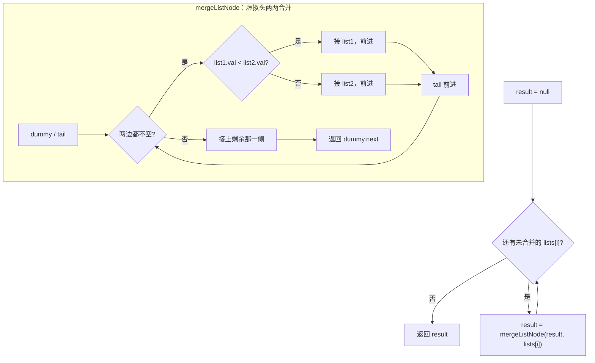

# 虚拟头 - 合并 K 个有序链表

> [LeetCode 23. 合并 K 个升序链表](https://leetcode.cn/problems/merge-k-sorted-lists/)

## 题目说明

给你一个链表数组，每个链表都已经按升序排列。请你将所有链表合并到一个升序链表中，返回合并后的链表。

**示例 1：**

- 输入：`lists = [[1,4,5],[1,3,4],[2,6]]`
- 输出：`[1,1,2,3,4,4,5,6]`
- 解释：链表数组合并为 `1 → 1 → 2 → 3 → 4 → 4 → 5 → 6`

**示例 2：**

- 输入：`lists = []`
- 输出：`[]`

**示例 3：**

- 输入：`lists = [[]]`
- 输出：`[]`

## 解题思路

核心就一句话：**会合并两条有序链表，就会合并 K 条**——拿一个 `result` 当「当前已合并结果」，依次和数组里每一条链表做两两合并。

- 外层循环：`result` 初始为 `null`，遍历 `lists`，每次 `result = mergeListNode(result, lists[i])`
- 内层 `mergeListNode`：就是「合并两个有序链表」那一套——虚拟头 + 双指针，谁小接谁，剩下一截整段挂上
- 空链表、`null`、`result` 一开始是空：合并函数都能兜住，不用单独特判

和「优先队列 / 小顶堆」解法比：堆可以做到整体更优（每次取全局最小），但两两合并写法更直白，直接复用 LC21 的合并逻辑，面试口述也好讲。

### 过程

1. `result = null`
2. 对 `i = 0 .. lists.length - 1`：
   - `result = mergeListNode(result, lists[i])`
3. 返回 `result`

`mergeListNode(list1, list2)` 内部：

1. 虚拟头 `dummy`，`tail` 指向已合并尾部
2. 两边都不空时，比较队头，较小的接到 `tail` 后，对应指针前进，`tail` 前进
3. 一边走完后：`tail.next` 接到另一边剩余
4. 返回 `dummy.next`

以 `[[1,4,5],[1,3,4],[2,6]]` 为例：

| 轮次 | result（合并前） | 当前 lists[i] | 合并后 result |
|------|------------------|---------------|---------------|
| 0 | `null` | `1 → 4 → 5` | `1 → 4 → 5` |
| 1 | `1 → 4 → 5` | `1 → 3 → 4` | `1 → 1 → 3 → 4 → 4 → 5` |
| 2 | `1 → 1 → 3 → 4 → 4 → 5` | `2 → 6` | `1 → 1 → 2 → 3 → 4 → 4 → 5 → 6` |



记法：K 条 = 循环调用「合并两条」；虚拟头把「结果链表还没第一个节点」的麻烦一次性抹平。

## 复杂度

设共有 K 条链表，全部节点总数为 N，平均每条长度约 N/K。

| 类型 | 复杂度 | 说明 |
|------|------|------|
| 时间复杂度 | O(K · N) | 第 i 次合并时，已合并长度约随 i 增长，总体偏平方量级；堆解法约 O(N log K) 更优 |
| 空间复杂度 | O(1) | 除返回链表外只用常数指针（原地拼接节点） |

## 代码

```java
/**
 * Definition for singly-linked list.
 * public class ListNode {
 *     int val;
 *     ListNode next;
 *     ListNode() {}
 *     ListNode(int val) { this.val = val; }
 *     ListNode(int val, ListNode next) { this.val = val; this.next = next; }
 * }
 */
class Solution {
    public ListNode mergeKLists(ListNode[] lists) {
        ListNode result = null;
        for (int i = 0; i < lists.length; i++) {
            result = mergeListNode(result, lists[i]);
        }
        return result;
    }

    public ListNode mergeListNode(ListNode list1, ListNode list2) {
        ListNode dummy = new ListNode(0);
        ListNode tail = dummy;
        ListNode current1 = list1;
        ListNode current2 = list2;
        while (current1 != null && current2 != null) {
            if (current1.val < current2.val) {
                tail.next = current1;
                current1 = current1.next;
            } else {
                tail.next = current2;
                current2 = current2.next;
            }
            tail = tail.next;
        }
        tail.next = current1 == null ? current2 : current1;
        return dummy.next;
    }
}
```

## 参考

- 作者：[vigilant-bhabhaijq](https://leetcode.cn/problems/merge-k-sorted-lists/solutions/4041316/sheng-xu-lian-biao-he-bing-by-vigilant-p-1osr/)
- 来源：[力扣（LeetCode）](https://leetcode.cn/problems/merge-k-sorted-lists/)
