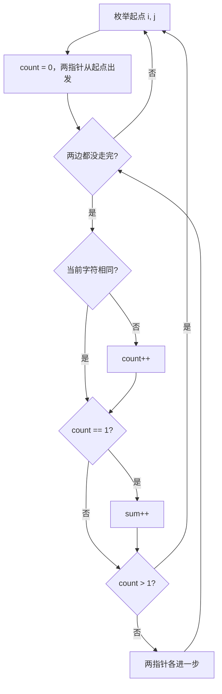

# 双指针 - 统计只差一个字符的子串

> [LeetCode 1638. 统计只差一个字符的子串数目](https://leetcode.cn/problems/count-substrings-that-differ-by-one-character/)

## 题目说明

给你两个字符串 `s` 和 `t`，都由小写字母组成。

统计有多少对**等长子串**，一对分别取自 `s` 和 `t`，并且**恰好有一个位置字符不同**。起点不同算不同的对，空串不算。

例如：

- `s = "ab"`，`t = "bb"` → `3`
  - `"a"` 对 `t[0]` 的 `"b"`
  - `"a"` 对 `t[1]` 的 `"b"`
  - `"ab"` 对 `"bb"`（只有第一位不同）
- `s = "aba"`，`t = "baba"` → `6`，这 6 对都是长度为 1 的单字符

## 解题思路

枚举 `s` 的起点 `i` 和 `t` 的起点 `j`。两个指针从这一对起点同步往右走，手里记当前窗口已经有几处不同。

- 走到某一格，不同的次数刚好是 **1**：从起点到这里这一段算一对，`sum++`
- 不同的次数变成 **2**：再往右只会更多，这条起点可以停
- 还是 **0**：整段相同，先不加；后面某一步变成 1 处不同时，会从那时开始连续计数

同一对起点上，第一次出现不同之后，后面每多配上一个相同字符，就多出一条更长的子串，所以 `count == 1` 时要按长度逐次加，不能只加一次。

更短、起点更靠后的子串，会在外层枚举到那个新起点时再算，不会漏。

记法：固定两个起点同步走，**差一个就加，差两个就停**。

### 过程

1. `i` 从 `0` 到 `s.length() - 1`，`j` 从 `0` 到 `t.length() - 1`
2. `count = 0`，`starts = i`，`startt = j`
3. 两边都没走完：
   - 字符不同：`count++`
   - `count == 1`：`sum++`
   - `count > 1`：结束这对起点
   - 否则两个指针各加 1
4. 返回 `sum`

以 `s = "ab"`、`t = "bb"` 为例：

| 起点 i, j | 对齐过程 | count | 计入的子串 | sum |
|-----------|----------|-------|------------|-----|
| 0, 0 | `a/b`，再 `b/b` | 1 → 1 | `"a"`/`"b"`，`"ab"`/`"bb"` | 2 |
| 0, 1 | `a/b`，右边到头 | 1 | `"a"`/`"b"` | 3 |
| 1, 0 | `b/b` | 0 | 相同，不加 | 3 |
| 1, 1 | `b/b` | 0 | 相同，不加 | 3 |

`"ab"` 对 `"bb"` 能加上，是因为第一位不同之后，第二位仍然相同，`count` 停在 1。



## 复杂度

| 类型 | 复杂度 | 说明 |
|------|--------|------|
| 时间复杂度 | O(\|s\| · \|t\| · min(\|s\|, \|t\|)) | 每对起点最多同步走到较短串的末尾 |
| 空间复杂度 | O(1) | 只用几个计数器 |

本题字符串长度不超过 100，三重循环可以接受。

## 代码

```java
class Solution {
    public int countSubstrings(String s, String t) {
        // 固定起始位置逐步对比，不一样则 +1，超过则返回
        int sum = 0;
        for (int i = 0; i < s.length(); i++) {
            for (int j = 0; j < t.length(); j++) {
                int count = 0;
                int starts = i;
                int startt = j;
                while (starts < s.length() && startt < t.length()) {
                    char chars = s.charAt(starts);
                    char chart = t.charAt(startt);
                    if (chars != chart) {
                        count++;
                    }
                    if (count == 1) {
                        sum++;
                    }
                    if (count > 1) {
                        break;
                    }
                    starts++;
                    startt++;
                }
            }
        }
        return sum;
    }
}
```

> `count` 只属于当前这一对起点。第二处不同时立刻 `break`，后面的字符不用再看。全相同的窗口 `count` 一直是 0，不会被加进答案。

## 参考

- 题解：[青驰](https://leetcode.cn/problems/count-substrings-that-differ-by-one-character/solutions/4053109/mei-ju-shuang-zhi-zhen-tong-ji-zhi-chai-2vhz2/)
- 来源：[力扣（LeetCode）](https://leetcode.cn/problems/count-substrings-that-differ-by-one-character/)
