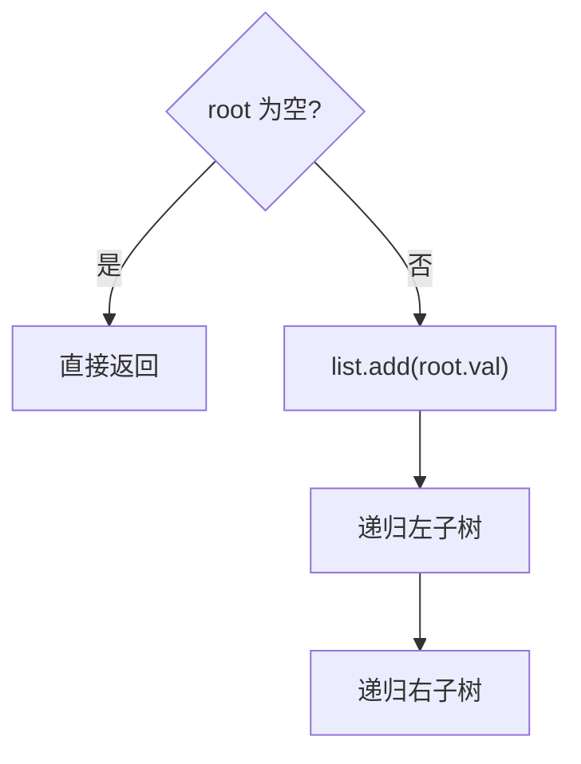

# 递归 - 二叉树的前序遍历

> [LeetCode 144. 二叉树的前序遍历](https://leetcode.cn/problems/binary-tree-preorder-traversal/)

## 题目说明

给你二叉树的根节点 `root`，返回它节点值的 **前序遍历**。

前序 = **根 → 左 → 右**：先访问自己，再递归左子树，再递归右子树。

例如：

```
    1
     \
      2
     /
    3
```

输出：`[1, 2, 3]`

## 解题思路

二叉树遍历题，递归最直观：对每个节点做同一件事——**先记自己，再处理左，再处理右**。

- 空节点：直接返回，什么都不加
- 非空：把 `val` 放进结果列表，再递归左、右

和中序（左根右）、后序（左右根）只差「`add` 这一行放在哪」：

| 遍历 | 访问顺序 | `list.add` 放哪 |
|------|----------|-----------------|
| 前序 | 根 → 左 → 右 | 递归左右**之前** |
| 中序 | 左 → 根 → 右 | 两段递归**中间** |
| 后序 | 左 → 右 → 根 | 递归左右**之后** |

### 过程

1. `root == null`：返回
2. `list.add(root.val)`
3. 递归左子树
4. 递归右子树

以 `1` 右连 `2`、`2` 左连 `3` 为例：

| 调用 | 动作 | 当前 list |
|------|------|-----------|
| `1` | 先加 1，再进左（空），再进右 | `[1]` |
| `2` | 先加 2，再进左 | `[1, 2]` |
| `3` | 加 3，左右皆空 | `[1, 2, 3]` |
| 回到 `2` | 再进右（空） | `[1, 2, 3]` |



记法：前序就是「自己先报到，再派左、再派右」。

## 复杂度

| 类型 | 复杂度 | 说明 |
|------|------|------|
| 时间复杂度 | O(n) | 每个节点访问一次 |
| 空间复杂度 | O(h) | 递归栈深度为树高，最坏链状为 O(n)；结果列表另计 O(n) |

## 代码

```java
/**
 * Definition for a binary tree node.
 * public class TreeNode {
 *     int val;
 *     TreeNode left;
 *     TreeNode right;
 *     TreeNode() {}
 *     TreeNode(int val) { this.val = val; }
 *     TreeNode(int val, TreeNode left, TreeNode right) {
 *         this.val = val;
 *         this.left = left;
 *         this.right = right;
 *     }
 * }
 */
class Solution {
    public List<Integer> preorderTraversal(TreeNode root) {
        List<Integer> list = new ArrayList<>();
        readNode(root, list);
        return list;
    }

    private void readNode(TreeNode root, List<Integer> list) {
        if (root == null) {
            return;
        }
        list.add(root.val);
        readNode(root.left, list);
        readNode(root.right, list);
    }
}
```

> 左、右为空时递归进去会立刻 `return`，所以不必再写 `if (root.left != null)`；写上也不影响正确性。

## 参考

- 题解：[青驰](https://leetcode.cn/problems/binary-tree-preorder-traversal/solutions/4043356/di-gui-er-cha-shu-de-qian-xu-bian-li-by-n874l/)
- 来源：[力扣（LeetCode）](https://leetcode.cn/problems/binary-tree-preorder-traversal/)
