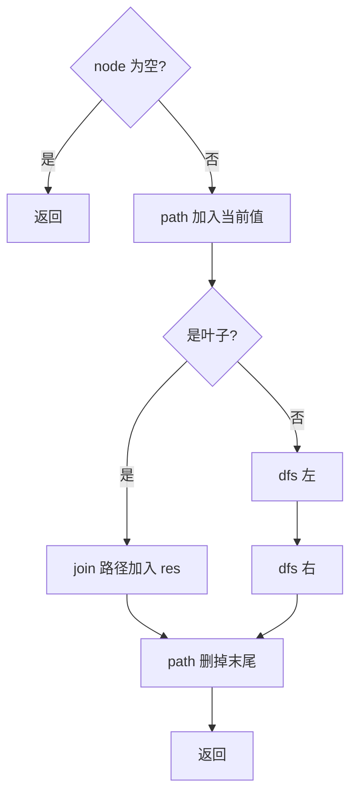

# 递归 - 二叉树的所有路径

> [LeetCode 257. 二叉树的所有路径](https://leetcode.cn/problems/binary-tree-paths/)

## 题目说明

给你一棵二叉树的根节点 `root`，按任意顺序，返回所有从根节点到叶子节点的路径。

路径用 `"->" ` 连接节点值，例如 `"1->2->5"`。

例如：

```
    1
   / \
  2   3
   \
    5
```

路径为 `["1->2->5","1->3"]`。

## 解题思路

从根往下走，边走边记下当前路径；走到**叶子**就把路径拼成字符串放进结果；往回退时把刚加的节点删掉，再试另一条分支。本质是 **DFS + 回溯**。

两个列表：

- `path`：当前正在走的路径（节点值）
- `res`：所有完整根到叶路径

对每个节点：

1. 把当前值加入 `path`
2. 若是叶子：`String.join("->", path)` 加入 `res`
3. 否则：递归左、右孩子
4. 函数返回前：`path` 末尾删掉（回溯），供兄弟分支复用

记法：进节点就 `add`，出节点就 `remove`；只在叶子收割结果。

### 过程

1. `node == null`：直接返回
2. `path.add(当前值)`
3. 左右都空 → 拼路径进 `res`；否则递归左右
4. `path.remove(最后一个)`，回溯

以上面那棵树为例：

| path | 当前节点 | 动作 |
|------|----------|------|
| `[]` | 1 | 加入 → `[1]`，非叶，进左 |
| `[1]` | 2 | 加入 → `[1,2]`，非叶，进右 |
| `[1,2]` | 5 | 加入 → `[1,2,5]`，叶子，记 `"1->2->5"`，回溯 |
| `[1,2]` | — | 拿掉 2 |
| `[1]` | 3 | 加入 → `[1,3]`，叶子，记 `"1->3"`，回溯 |
| `[1]` | — | 拿掉 1 |



## 复杂度

| 类型 | 复杂度 | 说明 |
|------|------|------|
| 时间复杂度 | O(n²) | 最坏每条路径拼接约 O(n)，路径数最多约 O(n) |
| 空间复杂度 | O(h) | `path` 与递归栈深度为树高，最坏链状为 O(n)（不含结果） |

## 代码

```java
/**
 * Definition for a binary tree node.
 * public class TreeNode {
 *     int val;
 *     TreeNode left;
 *     TreeNode right;
 *     TreeNode() {}
 *     TreeNode(int val) { this.val = val; }
 *     TreeNode(int val, TreeNode left, TreeNode right) {
 *         this.val = val;
 *         this.left = left;
 *         this.right = right;
 *     }
 * }
 */
class Solution {
    List<String> res = new ArrayList<>();
    List<String> path = new ArrayList<>();

    public List<String> binaryTreePaths(TreeNode root) {
        dfs(root);
        return res;
    }

    private void dfs(TreeNode node) {
        if (node == null) {
            return;
        }
        path.add(String.valueOf(node.val));
        if (node.left == null && node.right == null) {
            res.add(String.join("->", path));
        } else {
            dfs(node.left);
            dfs(node.right);
        }
        path.remove(path.size() - 1);
    }
}
```

> 叶子时只收割、不再往下递归，避免空节点白走一层。`path.remove` 必须写在函数末尾，左右分支共享同一份 `path`。

## 参考

- 题解：[青驰](https://leetcode.cn/problems/binary-tree-paths/)
- 来源：[力扣（LeetCode）](https://leetcode.cn/problems/binary-tree-paths/)
