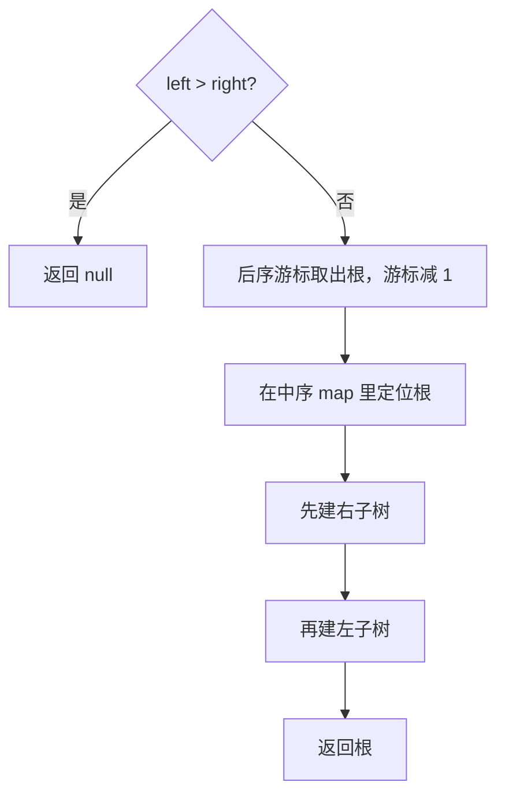

# 递归 - 从中序与后序遍历序列构造二叉树

> [LeetCode 106. 从中序与后序遍历序列构造二叉树](https://leetcode.cn/problems/construct-binary-tree-from-inorder-and-postorder-traversal/)

## 题目说明

给定一棵二叉树的中序遍历 `inorder` 和后序遍历 `postorder`，还原这棵树。节点值互不相同。

两种遍历：

- **中序**：左子树 → 根 → 右子树
- **后序**：左子树 → 右子树 → 根

例如：

```
    3
   / \
  9  20
    /  \
   15   7
```

- 中序：`[9, 3, 15, 20, 7]`
- 后序：`[9, 15, 7, 20, 3]`

空数组还原成空树。

## 解题思路

后序的**最后一个值是当前子树的根**。拿这个值去中序里定位：它左边是左子树，右边是右子树。左右两段再各自按同样的规则还原。

后序从末尾往前消费，用 `postorderIndex` 当游标，所有递归调用共用这一支游标。后序排列是「左、右、根」，倒着读就是「根、右、左」。所以拿到根之后，**先递归右子树，再递归左子树**，游标才会正好落在右子树的根上，接着才是左子树。

中序的值和它的下标先放进 `HashMap`，定位根是 O(1)。递归参数 `left`、`right` 表示当前子树在中序数组里的闭区间。

记法：后序倒着取根，中序切开左右；**先右后左**。

### 过程

1. 把中序每个值映射到下标
2. `postorderIndex` 指到后序末尾
3. `build(0, n - 1)`：
   - `left > right`：这段没有节点，返回 `null`
   - 取出 `postorder[postorderIndex]` 作为根，游标减 1
   - 用 map 找到根在中序的下标 `rootIndex`
   - `root.right = build(rootIndex + 1, right)`
   - `root.left = build(left, rootIndex - 1)`
   - 返回 `root`

以上面那棵树为例，后序消费顺序是 `3 → 20 → 7 → 15 → 9`：

| 中序区间 | 取出的根 | 中序下标 | 下一步 |
|----------|----------|----------|--------|
| `[0, 4]`：9, 3, 15, 20, 7 | 3 | 1 | 先右 `[2, 4]`，再左 `[0, 0]` |
| `[2, 4]`：15, 20, 7 | 20 | 3 | 先右 `[4, 4]`，再左 `[2, 2]` |
| `[4, 4]`：7 | 7 | 4 | 左右都空 |
| `[2, 2]`：15 | 15 | 2 | 左右都空 |
| `[0, 0]`：9 | 9 | 0 | 左右都空 |



## 复杂度

| 类型 | 复杂度 | 说明 |
|------|--------|------|
| 时间复杂度 | O(n) | 每个节点创建一次，map 定位是 O(1) |
| 空间复杂度 | O(n) | map 存 n 个下标；递归栈深度为树高，最坏链状为 O(n) |

## 代码

```java
/**
 * Definition for a binary tree node.
 * public class TreeNode {
 *     int val;
 *     TreeNode left;
 *     TreeNode right;
 *     TreeNode() {}
 *     TreeNode(int val) { this.val = val; }
 *     TreeNode(int val, TreeNode left, TreeNode right) {
 *         this.val = val;
 *         this.left = left;
 *         this.right = right;
 *     }
 * }
 */
import java.util.HashMap;
import java.util.Map;

class Solution {
    private Map<Integer, Integer> inorderMap = new HashMap<>();
    private int postorderIndex;

    public TreeNode buildTree(int[] inorder, int[] postorder) {
        // 将中序的值和位置放入 map
        for (int i = 0; i < inorder.length; i++) {
            inorderMap.put(inorder[i], i);
        }
        postorderIndex = postorder.length - 1;
        return build(inorder, postorder, 0, postorder.length - 1);
    }

    private TreeNode build(int[] inorder, int[] postorder, int left, int right) {
        if (left > right) {
            return null;
        }
        int rootVal = postorder[postorderIndex--];
        TreeNode root = new TreeNode(rootVal);
        int rootIndex = inorderMap.get(rootVal);
        root.right = build(inorder, postorder, rootIndex + 1, right);
        root.left = build(inorder, postorder, left, rootIndex - 1);
        return root;
    }
}
```

> `postorderIndex` 是成员变量，左右递归共用同一支从后往前的游标。`left`、`right` 框住的是中序区间，用来判断这段还有没有节点。节点值唯一，map 里不会撞键。

## 参考

- 题解：[青驰](https://leetcode.cn/problems/construct-binary-tree-from-inorder-and-postorder-traversal/solutions/4053555/zhong-xu-hou-xu-gou-jian-er-cha-shu-by-v-cim9/)
- 来源：[力扣（LeetCode）](https://leetcode.cn/problems/construct-binary-tree-from-inorder-and-postorder-traversal/)
