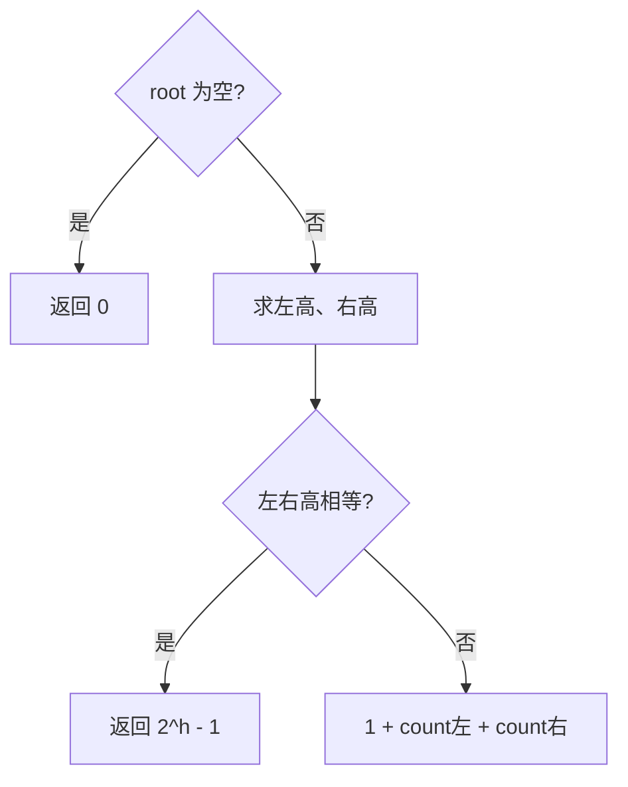

# 递归 - 完全二叉树的节点个数

> [LeetCode 222. 完全二叉树的节点个数](https://leetcode.cn/problems/count-complete-tree-nodes/)

## 题目说明

给你一棵**完全二叉树**的根节点 `root`，求出该树的节点个数。

完全二叉树：除最后一层外，每一层都被完全填满；最后一层的节点从左到右连续排列，可能不满。

例如：

```
      1
    /   \
   2     3
  / \   /
 4   5 6
```

节点个数为 `6`。

## 解题思路

暴力递归每个节点计数是 O(n)。利用完全二叉树性质可以更快：

1. 沿左孩子一路走到头，得到左高 `leftHigh`
2. 沿右孩子一路走到头，得到右高 `rightHigh`
3. 若左右高相等：整棵是**满二叉树**，节点数 = `2^h - 1`（用 `(1 << h) - 1`）
4. 若不相等：不是满树，退回递归：`1 + count(左) + count(右)`

子树本身也是完全二叉树，所以递归时同样能走「满树直接算」的捷径。

记法：**左右高相等 → 满树公式；否则再拆左右子树**。

### 过程

1. `root == null`：返回 `0`
2. 分别求左高、右高
3. `leftHigh == rightHigh`：返回 `(1 << rightHigh) - 1`
4. 否则：返回 `1 + countNodes(left) + countNodes(right)`

以题例为例：

| 当前根 | 左高 | 右高 | 动作 |
|--------|------|------|------|
| 1 | 3 | 2 | 不相等，拆左右 |
| 2 | 2 | 2 | 满树，`2^2 - 1 = 3` |
| 3 | 2 | 1 | 不相等，拆左右 → 最终得 2 |
| 合计 | | | `1 + 3 + 2 = 6` |



## 复杂度

| 类型 | 复杂度 | 说明 |
|------|------|------|
| 时间复杂度 | O((log n)²) | 每层算高 O(log n)，递归深度 O(log n) |
| 空间复杂度 | O(log n) | 递归栈深度为树高 |

## 代码

```java
/**
 * Definition for a binary tree node.
 * public class TreeNode {
 *     int val;
 *     TreeNode left;
 *     TreeNode right;
 *     TreeNode() {}
 *     TreeNode(int val) { this.val = val; }
 *     TreeNode(int val, TreeNode left, TreeNode right) {
 *         this.val = val;
 *         this.left = left;
 *         this.right = right;
 *     }
 * }
 */
class Solution {
    public int countNodes(TreeNode root) {
        if (root == null) {
            return 0;
        }
        // 计算树的高度
        int leftHigh = 0;
        int rightHigh = 0;
        TreeNode left = root;
        TreeNode right = root;
        while (left != null) {
            leftHigh++;
            left = left.left;
        }
        while (right != null) {
            rightHigh++;
            right = right.right;
        }
        // 如果相等说明是满二叉树，节点数 = 2^h - 1
        if (leftHigh == rightHigh) {
            return (1 << rightHigh) - 1;
        }
        return 1 + countNodes(root.left) + countNodes(root.right);
    }
}
```

> `(1 << h) - 1` 等价于 `2^h - 1`。左右高都从根往下数，高度包含根节点本身。

## 参考

- 题解：[青驰](https://leetcode.cn/problems/count-complete-tree-nodes/solutions/4046794/di-gui-wan-quan-er-cha-shu-ji-suan-jie-d-q68s/)
- 来源：[力扣（LeetCode）](https://leetcode.cn/problems/count-complete-tree-nodes/)
