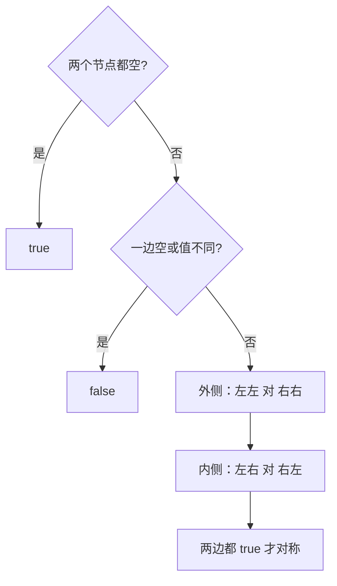

# 递归 - 对称二叉树

> [LeetCode 101. 对称二叉树](https://leetcode.cn/problems/symmetric-tree/)

## 题目说明

给你一棵二叉树的根节点 `root`，判断它是否轴对称。

对称：以根为中轴，左子树和右子树互为镜像。空树视为对称。

例如：

```
      1
    /   \
   2     2
  / \   / \
 3   4 4   3
```

左右镜像，返回 `true`。若把右侧的 `3`、`4` 对调，就不再对称。

## 解题思路

整棵树对称 = **左孩子和右孩子互为镜像**。镜像递归比较两棵树：

- 两个都空：这一对对称
- 只有一边空：不对称
- 值不相等：不对称
- 值相等：继续比「外侧」和「内侧」
  - 外侧：`left.left` 对 `right.right`
  - 内侧：`left.right` 对 `right.left`

两边都成立才算对称。

记法：不是左右都先序再比较，而是**成对走镜像位置**。

### 过程

1. `root == null`：返回 `true`
2. 比较 `root.left` 与 `root.right`
3. 每次比较两个节点：
   - 都空 → `true`
   - 一空一非空，或值不同 → `false`
   - 否则：`isMirror(左的左, 右的右) && isMirror(左的右, 右的左)`

以上面那棵树为例：

| 比较的一对 | 结果 | 下一步 |
|------------|------|--------|
| 左 2 与 右 2 | 值相等 | 外侧 3↔3，内侧 4↔4 |
| 3 与 3 | 相等，孩子都空 | `true` |
| 4 与 4 | 相等，孩子都空 | `true` |



## 复杂度

| 类型 | 复杂度 | 说明 |
|------|------|------|
| 时间复杂度 | O(n) | 每个节点最多参与一次比较 |
| 空间复杂度 | O(h) | 递归栈深度为树高，最坏链状为 O(n) |

## 代码

```java
/**
 * Definition for a binary tree node.
 * public class TreeNode {
 *     int val;
 *     TreeNode left;
 *     TreeNode right;
 *     TreeNode() {}
 *     TreeNode(int val) { this.val = val; }
 *     TreeNode(int val, TreeNode left, TreeNode right) {
 *         this.val = val;
 *         this.left = left;
 *         this.right = right;
 *     }
 * }
 */
class Solution {
    public boolean isSymmetric(TreeNode root) {
        if (root == null) {
            return true;
        }
        return isMirror(root.left, root.right);
    }

    private boolean isMirror(TreeNode left, TreeNode right) {
        if (left == null && right == null) {
            return true;
        }
        if (left == null || right == null) {
            return false;
        }
        if (left.val != right.val) {
            return false;
        }
        return isMirror(left.left, right.right) && isMirror(left.right, right.left);
    }
}
```

> 值已经相等时，直接递归外侧和内侧即可，不必再写一层 `if (left.val == right.val)`。`left == null || right == null` 已覆盖「只有一边为空」。

## 参考

- 题解：[青驰](https://leetcode.cn/problems/symmetric-tree/solutions/4044295/di-gui-dui-cheng-er-cha-shu-by-vigilant-ckgy3/)
- 来源：[力扣（LeetCode）](https://leetcode.cn/problems/symmetric-tree/)
