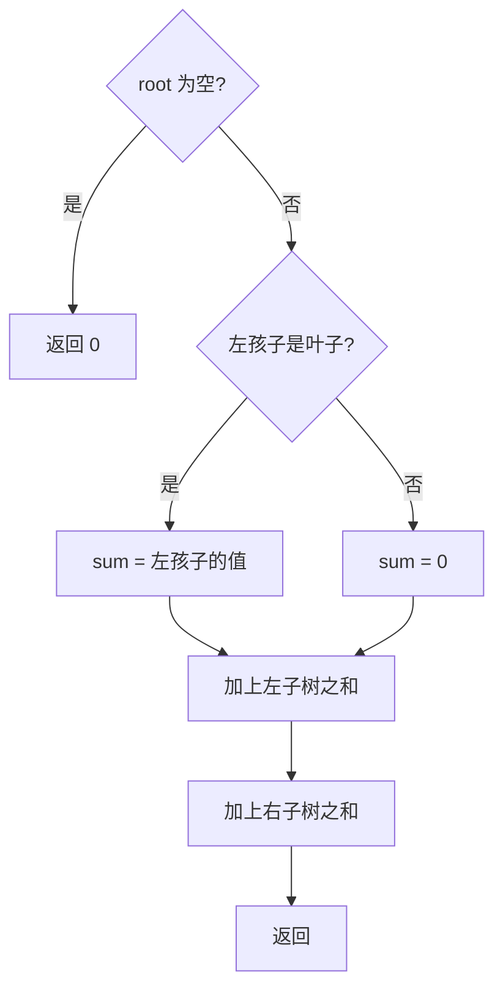

# 递归 - 左叶子之和

> [LeetCode 404. 左叶子之和](https://leetcode.cn/problems/sum-of-left-leaves/)

## 题目说明

给定二叉树的根节点 `root`，返回所有**左叶子**之和。

左叶子：某个节点的**左孩子**，并且这个孩子自己没有左右孩子。

例如：

```
    3
   / \
  9  20
    /  \
   15   7
```

`9` 是 `3` 的左叶子，`15` 是 `20` 的左叶子，`7` 是右叶子不算。答案为 `24`。

只有根、或根没有左孩子时，答案为 `0`。

## 解题思路

站在父节点上看左孩子：左孩子存在，且左右都空，它就是左叶子，把值加进和；然后左右子树各自再算一遍，加总。

当前节点自己是不是左孩子，这一层判断不了，所以判断写在「父节点看 `left`」上，而不是写在「当前节点是叶子」上。右叶子不会被加进来。

记法：只收割**左孩子里的叶子**，左右子树的和再拼回去。

### 过程

1. `root == null`：返回 `0`
2. `root.left` 存在且是叶子：把 `root.left.val` 计入 `sum`
3. 返回 `sum + 左子树之和 + 右子树之和`

以上面那棵树为例：

| 当前节点 | 左孩子 | 动作 |
|----------|--------|------|
| 3 | 9，是叶子 | `sum = 9`，再算左、右 |
| 9 | 空 | 返回 `0` |
| 20 | 15，是叶子 | `sum = 15`，再算左、右 |
| 15、7 | 空 | 返回 `0` |

合计 `9 + 15 = 24`。`7` 挂在 `20` 的右边，这一层不会把它加进去。



## 复杂度

| 类型 | 复杂度 | 说明 |
|------|------|------|
| 时间复杂度 | O(n) | 每个节点访问一次 |
| 空间复杂度 | O(h) | 递归栈深度为树高，最坏链状为 O(n) |

## 代码

```java
/**
 * Definition for a binary tree node.
 * public class TreeNode {
 *     int val;
 *     TreeNode left;
 *     TreeNode right;
 *     TreeNode() {}
 *     TreeNode(int val) { this.val = val; }
 *     TreeNode(int val, TreeNode left, TreeNode right) {
 *         this.val = val;
 *         this.left = left;
 *         this.right = right;
 *     }
 * }
 */
class Solution {
    public int sumOfLeftLeaves(TreeNode root) {
        if (root == null) {
            return 0;
        }
        int sum = 0;
        if (root.left != null && root.left.left == null && root.left.right == null) {
            sum = root.left.val + sum;
        }
        return sum + sumOfLeftLeaves(root.left) + sumOfLeftLeaves(root.right);
    }
}
```

> 左孩子已经是叶子时，仍然会递归进它，但它没有左孩子，返回 `0`，不会重复累加。空孩子进递归也会立刻返回。

## 参考

- 题解：[青驰](https://leetcode.cn/problems/sum-of-left-leaves/)
- 来源：[力扣（LeetCode）](https://leetcode.cn/problems/sum-of-left-leaves/)
