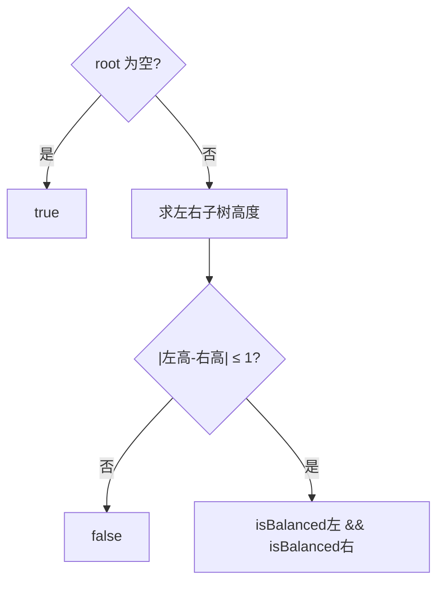

# 递归 - 平衡二叉树

> [LeetCode 110. 平衡二叉树](https://leetcode.cn/problems/balanced-binary-tree/)

## 题目说明

给定一个二叉树，判断它是否是高度平衡的二叉树。

本题中，一棵高度平衡二叉树定义为：一个二叉树**每个节点**的左右两个子树的高度差的绝对值不超过 `1`。

例如：

```
      3
     / \
    9  20
      /  \
     15   7
```

左右高度差不超过 1，且每个子树也满足，返回 `true`。

```
        1
       / \
      2   2
     / \
    3   3
   / \
  4   4
```

根的左子树偏深，返回 `false`。

## 解题思路

平衡 = **当前节点左右高度差 ≤ 1**，且**左右子树各自也是平衡的**。

1. 空树：平衡
2. 求左子树高度、右子树高度
3. `|左高 - 右高| ≤ 1`，并且 `isBalanced(左)`、`isBalanced(右)` 都为真

高度递归：空为 `0`，否则 `1 + max(左高, 右高)`。

记法：先比当前一层高度差，再递归确认整棵子树都合格。

### 过程

1. `root == null`：返回 `true`
2. `leftHigh = maxHigh(root.left)`，`rightHigh = maxHigh(root.right)`
3. 返回 `|rightHigh - leftHigh| ≤ 1 && isBalanced(左) && isBalanced(右)`

以第一棵树为例：

| 当前节点 | 左高 | 右高 | 高度差 | 子树平衡? | 结果 |
|----------|------|------|--------|-----------|------|
| 3 | 1 | 2 | 1 | 左右都平衡 | true |
| 9 | 0 | 0 | 0 | 叶子 | true |
| 20 | 1 | 1 | 0 | 叶子 | true |



## 复杂度

| 类型 | 复杂度 | 说明 |
|------|------|------|
| 时间复杂度 | O(n log n) | 每个节点算一次高度，高度本身又遍历子树；最坏接近 O(n²)（链状） |
| 空间复杂度 | O(h) | 递归栈深度为树高，最坏链状为 O(n) |

## 代码

```java
/**
 * Definition for a binary tree node.
 * public class TreeNode {
 *     int val;
 *     TreeNode left;
 *     TreeNode right;
 *     TreeNode() {}
 *     TreeNode(int val) { this.val = val; }
 *     TreeNode(int val, TreeNode left, TreeNode right) {
 *         this.val = val;
 *         this.left = left;
 *         this.right = right;
 *     }
 * }
 */
class Solution {
    public boolean isBalanced(TreeNode root) {
        if (root == null) {
            return true;
        }
        int leftHight = maxHight(root.left);
        int rightHight = maxHight(root.right);
        return (Math.abs((rightHight - leftHight)) <= 1)
                && isBalanced(root.left)
                && isBalanced(root.right);
    }

    public int maxHight(TreeNode root) {
        if (root == null) {
            return 0;
        }
        return 1 + Math.max(maxHight(root.left), maxHight(root.right));
    }
}
```

> 只比根的高度差不够，必须递归检查每个子树。高度会重复计算，可读性优先；若要优化到 O(n)，可在一次后序遍历里同时返回高度并标记是否失衡。

## 参考

- 题解：[青驰](https://leetcode.cn/problems/balanced-binary-tree/solutions/4046812/di-gui-ping-heng-er-cha-shu-pan-duan-by-x0sqq/)
- 来源：[力扣（LeetCode）](https://leetcode.cn/problems/balanced-binary-tree/)
