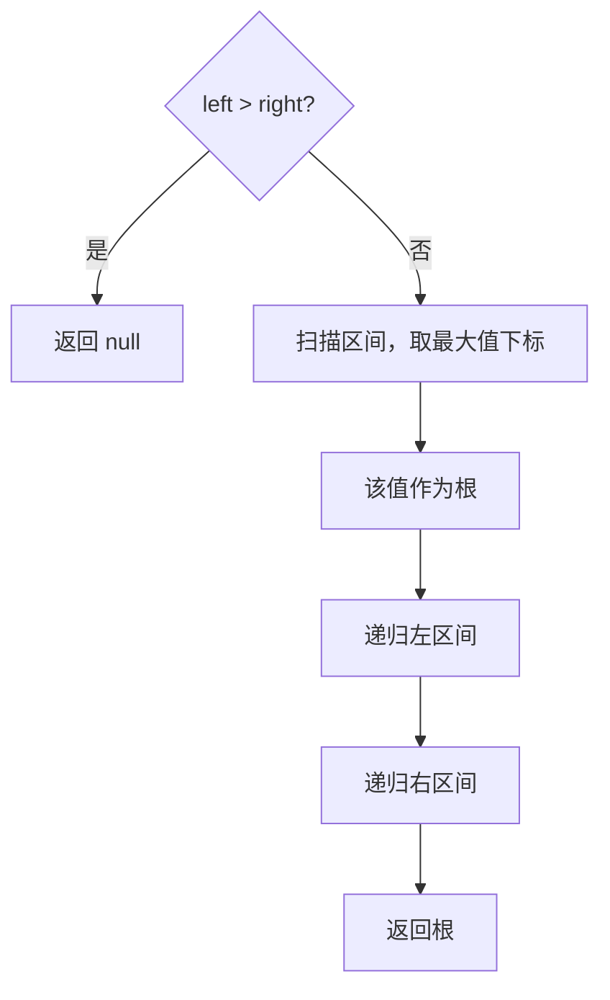
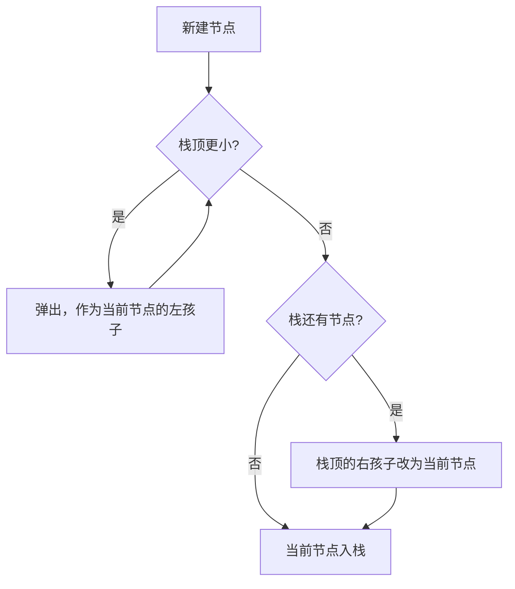

# 递归 - 最大二叉树

> [LeetCode 654. 最大二叉树](https://leetcode.cn/problems/maximum-binary-tree/)

## 题目说明

给定不含重复数字的数组 `nums`，按下述规则构造**最大二叉树**：

1. 根是数组里的最大值
2. 最大值左边的子数组，按同样规则构造左子树
3. 最大值右边的子数组，按同样规则构造右子树

例如 `nums = [3, 2, 1, 6, 0, 5]`：

```
      6
    /   \
   3     5
    \    /
     2  0
      \
       1
```

`6` 是全数组最大。左边 `[3, 2, 1]` 的最大是 `3`，右边 `[0, 5]` 的最大是 `5`。空区间没有节点。

## 解题思路

两套做法都按同一条规则建树：最大值是根，左边构造左子树，右边构造右子树。

- **递归**：每次在当前区间里找出最大值，再切成左右两段
- **单调栈**：从左往右扫一遍，栈从底到顶保持递减。更大的数把栈顶较小的节点收成自己的左子树

下面先写递归。单调栈在后一节，每个节点只进栈、出栈一次，时间是 O(n)。

### 递归

闭区间 `[left, right]` 表示还没处理的一段数组。扫一遍这段，值最大的那个位置就是当前根。根左边再递归 `[left, 下标 - 1]`，根右边再递归 `[下标 + 1, right]`。

`left > right` 说明这段是空的，返回 `null`。只含一个元素时，最大值就是它自己，左右区间都空，它成为叶子。

记法：区间里的最大值做根，一刀切成左右两段。

### 过程

1. `build(0, n - 1)`
2. `left > right`：返回 `null`
3. 在 `[left, right]` 里找到最大值的下标 `maxValueIndex`
4. `nums[maxValueIndex]` 作为根
5. 左子树：`build(left, maxValueIndex - 1)`
6. 右子树：`build(maxValueIndex + 1, right)`

以 `[3, 2, 1, 6, 0, 5]` 为例：

| 区间 | 最大值 | 下标 | 左子树区间 | 右子树区间 |
|------|--------|------|------------|------------|
| `[3, 2, 1, 6, 0, 5]` | 6 | 3 | `[3, 2, 1]` | `[0, 5]` |
| `[3, 2, 1]` | 3 | 0 | 空 | `[2, 1]` |
| `[2, 1]` | 2 | 1 | 空 | `[1]` |
| `[1]` | 1 | 2 | 空 | 空 |
| `[0, 5]` | 5 | 5 | `[0]` | 空 |
| `[0]` | 0 | 4 | 空 | 空 |



### 复杂度

| 类型 | 复杂度 | 说明 |
|------|--------|------|
| 时间复杂度 | O(n²) | 每层都要扫描当前区间。数组有序时树退化成链，扫描代价加总是 O(n²) |
| 空间复杂度 | O(n) | 递归栈深度为树高，最坏链状为 O(n) |

`n` 不超过 1000，直接扫描每个区间可以通过。

### 代码

```java
/**
 * Definition for a binary tree node.
 * public class TreeNode {
 *     int val;
 *     TreeNode left;
 *     TreeNode right;
 *     TreeNode() {}
 *     TreeNode(int val) { this.val = val; }
 *     TreeNode(int val, TreeNode left, TreeNode right) {
 *         this.val = val;
 *         this.left = left;
 *         this.right = right;
 *     }
 * }
 */
class Solution {
    public TreeNode constructMaximumBinaryTree(int[] nums) {
        return build(nums, 0, nums.length - 1);
    }

    private TreeNode build(int[] nums, int left, int right) {
        if (left > right) {
            return null;
        }
        Integer maxValueIndex = maxValueIndex(nums, left, right);
        int rootVal = nums[maxValueIndex];
        TreeNode root = new TreeNode(rootVal);
        root.left = build(nums, left, maxValueIndex - 1);
        root.right = build(nums, maxValueIndex + 1, right);
        return root;
    }

    private Integer maxValueIndex(int[] nums, int left, int right) {
        int maxValueIndex = left;
        for (int i = left; i <= right; i++) {
            if (nums[i] > nums[maxValueIndex]) {
                maxValueIndex = i;
            }
        }
        return maxValueIndex;
    }
}
```

> 比较用的是 `>`，相等时保留靠左的下标。本题数字互不相同，每个最大值只有一个位置。左右递归的区间都不包含根下标，根不会被重复选中。

## 单调栈

从左往右看每个数，维护一个**从栈底到栈顶递减**的单调栈。栈里的节点是「右边还没出现更大值」的右脊柱：下面的更大，上面的更小，上面那个目前挂在下面那个的 `right` 上。

处理当前值 `num` 时做三件事：

1. 栈顶比 `num` 小就弹出，并让它成为 `num` 的左孩子。弹出不止一个时，`left` 会被后来的覆盖，最后留下的是这些节点里最大的那个，也就是左边这段的根。更小的节点早就挂在它的 `right` 上。
2. 栈里还剩节点，说明左边有一个比 `num` 大的值。当前节点落在它的右边，于是 `stack.peek().right = node`。如果这里原来挂过更小的右孩子，那个节点刚刚被弹出，已经变成 `node.left`。
3. 当前节点入栈。

全局最大值不会被任何人弹出，扫完之后它留在栈底。`ArrayDeque` 的 `push` / `peek` / `pop` 操作栈顶，`peekLast()` 才是栈底，返回它就是整棵树的根。

### 过程

仍以 `[3, 2, 1, 6, 0, 5]` 为例。栈写成底 → 顶：

| 读到 | 弹出 | 新的链接 | 栈 |
|------|------|----------|----|
| 3 | 无 | | 3 |
| 2 | 无 | `3.right = 2` | 3, 2 |
| 1 | 无 | `2.right = 1` | 3, 2, 1 |
| 6 | 1，再 2，再 3 | `6.left` 最后写成 3（3 的右边已经是 2 → 1） | 6 |
| 0 | 无 | `6.right = 0` | 6, 0 |
| 5 | 0 | `5.left = 0`，`6.right` 改成 5 | 6, 5 |

`6` 在栈底。它的左边是 `3 → 2 → 1`，右边是 `5`，`5` 的左边是 `0`，和递归建出来的树相同。

`0` 先暂时挂在 `6` 的右边。`5` 比 `0` 大、比 `6` 小，于是把 `0` 收成自己的左孩子，再替换 `6` 的右孩子。右边出现更大值时，旧的右链接会让位。



### 复杂度

| 类型 | 复杂度 | 说明 |
|------|--------|------|
| 时间复杂度 | O(n) | 每个节点最多入栈一次、出栈一次 |
| 空间复杂度 | O(n) | 单调栈，最坏时数组递减，所有节点都留在栈里 |

### 代码

```java
import java.util.ArrayDeque;
import java.util.Deque;

class Solution {
    public TreeNode constructMaximumBinaryTree(int[] nums) {
        // 使用单调栈构建二叉树
        Deque<TreeNode> stack = new ArrayDeque<>();
        for (int num : nums) {
            TreeNode node = new TreeNode(num);
            while (!stack.isEmpty() && stack.peek().val < num) {
                node.left = stack.pop();
            }
            if (!stack.isEmpty()) {
                stack.peek().right = node;
            }
            stack.push(node);
        }
        return stack.peekLast();
    }
}
```

> `peek()` 是栈顶，`peekLast()` 是栈底。栈从底到顶递减，栈底那个最大的节点就是根。数字互不相同，比较用 `<`。

## 参考

- 题解：[青驰](https://leetcode.cn/problems/maximum-binary-tree/solutions/4053955/di-gui-gou-jian-zui-da-er-cha-shu-by-vig-3waw/)
- 来源：[力扣（LeetCode）](https://leetcode.cn/problems/maximum-binary-tree/)
