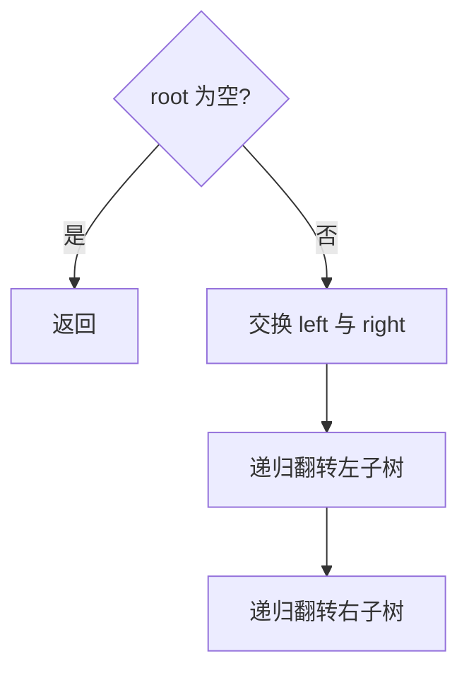

# 递归 - 翻转二叉树

> [LeetCode 226. 翻转二叉树](https://leetcode.cn/problems/invert-binary-tree/)

## 题目说明

给你一棵二叉树的根节点 `root`，翻转这棵二叉树，并返回其根节点。

翻转 = 每个节点的左右孩子对调（整棵树镜像）。

例如：

```
     4               4
   /   \           /   \
  2     7    →    7     2
 / \   / \       / \   / \
1   3 6   9     9   6 3   1
```

## 解题思路

对每个节点做同一件事：**左右指针互换，再递归处理两边**。

- 空节点：不用动
- 非空：`left` 与 `right` 对调，再对「新的左」「新的右」继续翻转

顺序注意：先交换再递归，递归时走的是交换后的孩子；也可以先递归再交换，结果一样，别混着用半截。

记法：整棵树镜像 = 每个节点各自左右对调。

### 过程

1. `root == null`：直接返回
2. 取出 `left`、`right`，对调接到 `root` 上
3. 递归翻转左右子树（此时已是对调后的孩子）
4. 返回原根（根节点不变，只是左右子树镜像）

以根为 `4`，左 `2`、右 `7` 为例：

| 当前节点 | 交换前 | 交换后 | 再递归 |
|----------|--------|--------|--------|
| 4 | 左 2 / 右 7 | 左 7 / 右 2 | 进 7、进 2 |
| 7 | 左 6 / 右 9 | 左 9 / 右 6 | 叶子 |
| 2 | 左 1 / 右 3 | 左 3 / 右 1 | 叶子 |



## 复杂度

| 类型 | 复杂度 | 说明 |
|------|------|------|
| 时间复杂度 | O(n) | 每个节点访问一次 |
| 空间复杂度 | O(h) | 递归栈深度为树高，最坏链状为 O(n) |

## 代码

```java
/**
 * Definition for a binary tree node.
 * public class TreeNode {
 *     int val;
 *     TreeNode left;
 *     TreeNode right;
 *     TreeNode() {}
 *     TreeNode(int val) { this.val = val; }
 *     TreeNode(int val, TreeNode left, TreeNode right) {
 *         this.val = val;
 *         this.left = left;
 *         this.right = right;
 *     }
 * }
 */
class Solution {
    public TreeNode invertTree(TreeNode root) {
        if (root == null) {
            return root;
        }
        invert(root);
        return root;
    }

    private void invert(TreeNode root) {
        if (root == null) {
            return;
        }
        TreeNode left = root.left;
        TreeNode right = root.right;
        root.left = right;
        root.right = left;
        invert(root.left);
        invert(root.right);
    }
}
```

> 交换后再递归时，空孩子进递归会立刻返回，不必再写 `if (root.left != null)`。也可以写成更短的「交换 + 递归左右」单函数版本，思路相同。

## 参考

- 题解：[青驰](https://leetcode.cn/problems/invert-binary-tree/solutions/4043754/di-gui-fan-zhuan-er-cha-shu-by-vigilant-et8ap/)
- 来源：[力扣（LeetCode）](https://leetcode.cn/problems/invert-binary-tree/)
