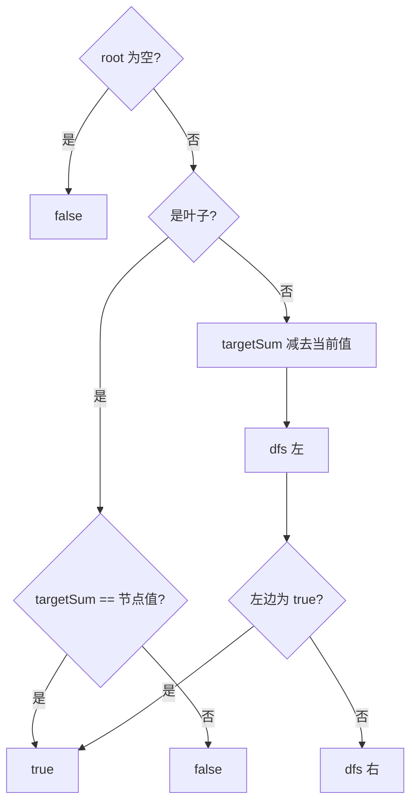

# 递归 - 路径总和

> [LeetCode 112. 路径总和](https://leetcode.cn/problems/path-sum/)

## 题目说明

给你二叉树的根节点 `root` 和一个整数 `targetSum`，判断是否存在一条**从根到叶子**的路径，路径上所有节点值之和等于 `targetSum`。

叶子：左右孩子都为空的节点。空树没有这样的路径，返回 `false`。

例如 `targetSum = 22`：

```
      5
     / \
    4   8
   /   / \
  11  13  4
 /  \      \
7    2      1
```

路径 `5 → 4 → 11 → 2` 的和是 `22`，返回 `true`。`5 → 8 → 4 → 1` 的和是 `18`，不算。

## 解题思路

从根往下做 DFS，手里拿着**还差多少**。进到一个节点，如果它是叶子，就看剩余目标是否刚好等于这个叶子的值；否则把剩余目标减去当前值，再问左右孩子有没有一条能凑上。

左右用 `||` 连接：一条成立就可以停。只在叶子上判定，走到半路即使当前和已经等于目标，也还不算，必须落到叶子。

记法：剩余目标跟着路径往下减，叶子上对一下账。

### 过程

1. `root == null`：这条路断了，返回 `false`
2. 左右都空：返回 `targetSum == root.val`
3. `targetSum -= root.val`
4. 返回 `dfs(左) || dfs(右)`

以上面 `targetSum = 22` 为例，成功的那条：

| 当前节点 | 进入时还差 | 动作 |
|----------|------------|------|
| 5 | 22 | 非叶，还差 `17`，先进左 |
| 4 | 17 | 非叶，还差 `13`，进左 |
| 11 | 13 | 非叶，还差 `2`，左孩子 `7` 对不上，再进右 |
| 2 | 2 | 叶子，`2 == 2`，返回 `true` |

`||` 短路，左边已经为 `true`，右边 `8` 那棵子树不必再走。



## 复杂度

| 类型 | 复杂度 | 说明 |
|------|------|------|
| 时间复杂度 | O(n) | 最坏每个节点访问一次；`||` 找到一条即可提前结束 |
| 空间复杂度 | O(h) | 递归栈深度为树高，最坏链状为 O(n) |

## 代码

```java
/**
 * Definition for a binary tree node.
 * public class TreeNode {
 *     int val;
 *     TreeNode left;
 *     TreeNode right;
 *     TreeNode() {}
 *     TreeNode(int val) { this.val = val; }
 *     TreeNode(int val, TreeNode left, TreeNode right) {
 *         this.val = val;
 *         this.left = left;
 *         this.right = right;
 *     }
 * }
 */
class Solution {

    public boolean hasPathSum(TreeNode root, int targetSum) {
        return dfs(root, targetSum);
    }

    private boolean dfs(TreeNode root, int targetSum) {
        if (root == null) {
            return false;
        }
        if (root.left == null && root.right == null) {
            return targetSum == root.val;
        }
        targetSum -= root.val;
        return dfs(root.left, targetSum) || dfs(root.right, targetSum);
    }

}
```

> `targetSum` 是基本类型，按值传递。当前层减完再传给左右孩子，两条分支拿到的是同一份剩余值，互不影响。空孩子进递归会立刻返回 `false`。

## 参考

- 题解：[青驰](https://leetcode.cn/problems/path-sum/solutions/4052645/dfsji-suan-mu-biao-zhi-lu-jing-zong-he-b-k76t/)
- 来源：[力扣（LeetCode）](https://leetcode.cn/problems/path-sum/)
