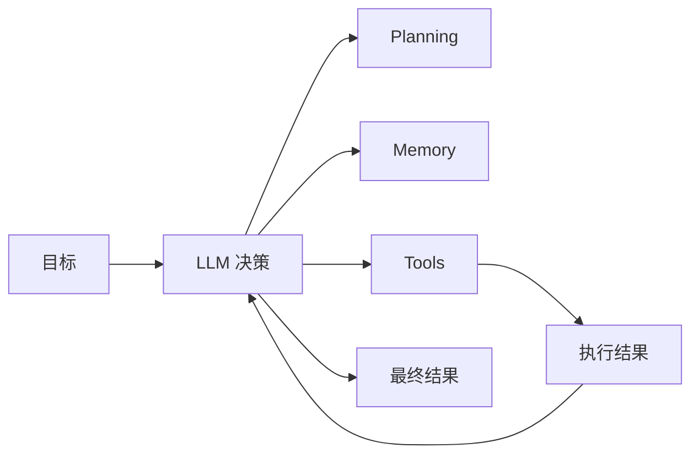
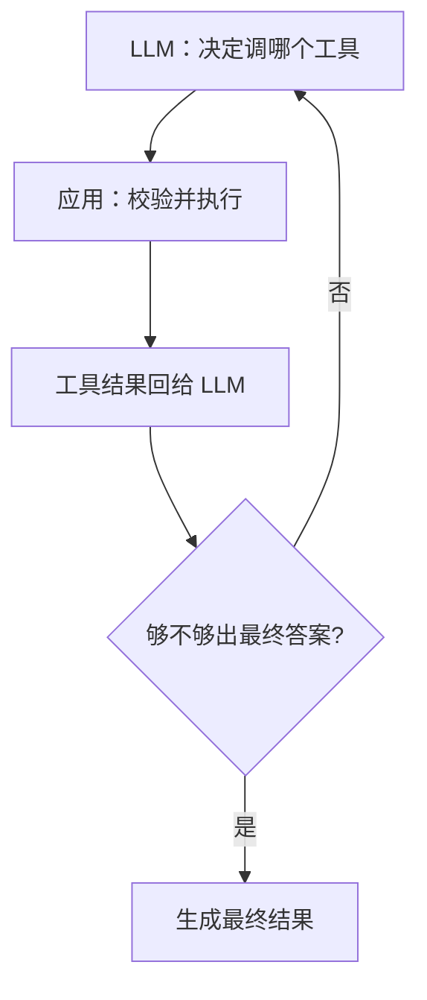

# 如何定义一个基于 LLM 的智能体（Agent）

面向高级 Java / AI。按一条线背：**LLM vs Agent → 四件套（LLM / Planning / Memory / Tools）→ Plan-Execute / ReAct / Reflexion → Function Calling → 工程能力 → 面试收口**。



---

## 一、Agent 是什么？跟普通 LLM 差在哪？

普通 LLM：吃 Prompt，吐文本。有理解、生成、一定推理能力，但**本身不必然**带持续任务状态、工具执行、记忆管理和按结果改行动的闭环。

**Agent**：以 LLM 当大脑，再叠上规划、工具、记忆和执行反馈，能围绕目标**自己选动作、干完事**的系统。

方便记的公式（不是严格定义）：

> **Agent ≈ LLM（大脑）+ Planning（规划）+ Memory（记忆）+ Tools（工具）**

工程里还要编排、状态机、安全控制。简单 Agent 也可以没有独立规划模块或长期记忆。

| 维度 | 普通 LLM 应用 | LLM Agent |
|------|---------------|-----------|
| 目标 | 理解输入并回答 | 围绕目标把事办完 |
| 任务 | 多是单次问答或固定流程 | 可拆步、多步执行 |
| 外部交互 | 可以没有工具，也可以有 | 按需选工具并调用 |
| 记忆 | 看应用有没有管上下文 | 可维护任务状态与历史 |
| 决策 | 预设流程或直接生成 | 可按执行结果动态调整 |

注意：普通应用也能做规划、RAG、Function Calling。**有没有工具 / 向量库，单独不能判定是不是 Agent。**

> 核心差别：Agent 更强调**目标驱动决策 + 实际行动 + 根据结果反馈调整**的闭环。

---

## 二、核心组件

### 1. LLM（大脑）

负责：理解意图、推理决策、制定或改计划、要不要调工具、看工具结果定下一步、整合后给最终答案。

能力上限很大程度取决于模型的推理、指令遵循和工具调用水平。  
**LLM 提决策和调用请求；真正干活的是运行时和外部工具。**

### 2. Planning（规划）

把复杂任务拆步、定顺序，再按结果改策略。常见三类：

#### （1）先计划再执行：Plan-and-Execute

先出整体计划，再逐步执行。例如查订单异常：查订单 → 查支付 → 对比状态 → 分析原因 → 出建议。

- 优点：流程清晰、好管。
- 缺点：中间结果不对时，原计划可能作废，要重规划。

> Plan-and-Execute **不一定无反馈**。支持「中间结果不对就重规划」时，一样有反馈。

#### （2）ReAct：边想边做边看

Reasoning + Acting，循环：

```text
Thought → Action → Observation → Thought → …
```

| 步骤 | 含义 |
|------|------|
| Thought | 看现状，决定下一步 |
| Action | 选工具并执行 |
| Observation | 拿工具结果（**这就是反馈**） |

例：查完订单发现已支付未发货 → 再查履约 → 发现履约任务创建失败 → 继续定位。

**ReAct 有反馈。** 不必一次生成完整计划，每步 Observation 驱动下一步。Thought 本身不碰环境；反馈发生在 Action 之后的 Observation。

#### （3）Reflexion：靠反思改进下次尝试

用执行结果、失败信息或评估反馈做反思，写入经验，下次改策略。更强调**反思与经验积累**，不是互斥于 ReAct，可以叠在一起用。

反思不等于模型一定能发现自己错；工程上常配规则校验、结果验证或独立评估。

| | 强调什么 |
|--|----------|
| ReAct | 推理 ↔ 行动 ↔ 观察的短循环 |
| Reflexion | 对过程 / 结果反思，改进后续尝试 |

### 3. Memory（记忆）

保存任务过程信息，让多步甚至跨会话还能接上。

**短期记忆**：当前会话 / 任务——最近对话、工具调用与结果、执行到哪一步、中间数据。实现上常见对话历史、上下文窗口、任务状态库。上下文太长时用滑动窗口、摘要、筛选。状态也可以不放在模型上下文里，单独落库或工作流状态。

**长期记忆**：跨会话——用户偏好、历史任务、业务经验。可放关系库、KV、文档库、向量库；检索可以是结构化查询、关键词、向量或混合。需要时用 **RAG** 把相关内容塞进上下文。

> **长期记忆 ≠ 向量库；RAG ≠ 记忆。**  
> 向量库只是存储 / 检索选项；RAG 侧重检索外部知识补上下文。完整记忆还要写、更新、删除和有效期管理。

### 4. Tools（工具）

跟外部环境打交道：查库、业务 API、搜索、代码执行、读写文件、发消息等。常见入口是 Function Calling。

#### Function Calling 四步

1. **定义工具**：名称、描述、参数类型与约束（提示词或 API 的 tools 参数）。
2. **LLM 选工具**：根据目标和上下文，生成结构化调用请求，例如 `queryOrder(orderId)`——这是**请求**，查询还没发生。
3. **应用执行**：运行时校验参数、权限，再真正调函数 / DB / API。
4. **结果回灌**：把结果还给 LLM，继续推理、再调工具，或出最终答案。



> LLM 决定调什么 → 应用执行 → 结果回 LLM → 再决定下一步。

---

## 三、工程里还要补什么

### 1. 执行编排与状态管理

协调 LLM / 工具 / 记忆 / 业务：调用顺序、进度、超时重试、最大步数与终止、恢复与持久化。简单用代码；复杂用工作流或 Agent 编排框架。

### 2. 安全与边界

Agent 能自主行动，必须限权：

- 可访问工具与 API 白名单
- 鉴权、参数校验、敏感读写边界
- 退款 / 转账 / 删除等人审
- 防提示注入与越权
- 超时、最大步数、调用预算

**关键权限和业务规则由应用校验，不能只靠模型自觉。**

### 3. 多 Agent

复杂任务可拆：规划 Agent、执行 Agent、审核 Agent，用消息、委派或共享状态协作。  
简单、规则清晰的业务，单 Agent 或固定工作流往往更稳、更好维护。**多 Agent 不是标配。**

### 4. 可观测与调试

记轨迹：请求 / 响应摘要、工具请求与结果、状态流转、耗时、Token / 成本、异常。用日志、Tracing、评估定位失败。  
模型显式计划或简要理由可按需记；不要把「完整内部思维链」当成必须可得的日志，并注意脱敏。

---

## 四、面试标准答案

一个基于 LLM 的 Agent，是以大模型为核心推理引擎，结合规划、记忆和工具，能围绕目标自主选行动、执行任务，并根据执行结果做反馈调整的系统。

和普通 LLM 应用比，Agent 更强调**目标驱动 + 执行闭环**，不单是生成一次回答。普通应用也可以有推理、RAG、工具调用，**不能只看有没有工具**。

四个核心件：

1. **LLM**：理解、推理、选工具、定下一步。
2. **Planning**：拆任务、调策略。Plan-and-Execute 可先计划后执行（也可重规划）；**ReAct 用 Observation 做反馈逐步改行动**；Reflexion 更重反思与经验改进。
3. **Memory**：短期上下文 + 长期信息；长期可用库或向量库；RAG 补知识进上下文。
4. **Tools**：与外部系统交互；Function Calling 让模型提结构化调用，**执行在应用侧**。

工程上再加编排、状态、安全、可观测；复杂场景才考虑多 Agent。

整体流程：

```text
接收目标 → 分析规划 → 选工具 → 执行 → 拿结果 → 按反馈继续或结束
```

最关键一句：**不仅能生成答案，还要在受控范围内围着目标行动，并根据结果决定下一步。**

---

## 口述模板

| 问题 | 开口 |
|------|------|
| Agent 是什么 | LLM 大脑 + 规划 + 记忆 + 工具；目标驱动、有行动、有反馈闭环 |
| 和普通 LLM 区别 | 不是有没有工具，而是有没有围绕目标的决策—执行—反馈闭环 |
| ReAct 有无反馈 | 有，Observation 就是反馈；Thought → Action → Observation 循环 |
| Plan-and-Execute | 先计划后执行；支持重规划时也有反馈 |
| Reflexion | 对失败 / 结果反思，改进下次；可与 ReAct 叠加 |
| Function Calling | 模型提请求，应用执行，结果回模型 |
| 记忆 | 短=当前任务；长=跨会话；向量库 / RAG 只是手段不是记忆本身 |
| 工程必备 | 编排状态、安全限权、可观测；多 Agent 按需 |
