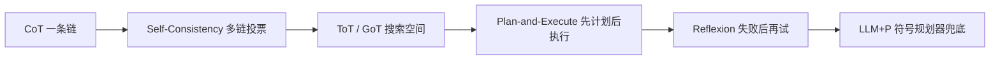

# LLM 规划能力主流方法

面向高级 Java / AI。按一条线背：**为什么要规划 → CoT / Self-Consistency / ToT / GoT / Plan-and-Execute / Reflexion / LLM+P → 对照表 → 现在系统怎么组合**。

Agent 四件套见 [Agent 智能体](./agent)，单步交互见 [ReAct](./react)。这篇讲「规划」本身有哪些路线。

---

## 一、为什么要单独谈规划

LLM 本质是下一个词预测器，局部推理强，长任务容易露馅：

| 缺口 | 表现 |
|------|------|
| 长程拆解 | 「做一次市场调研」直接开写，没有先拆步 |
| 错误恢复 | 中间一步错了，后面顺着错放大 |
| 探索回溯 | 贪心解码只有一条路，没法比方案 |
| 外部交互 | 调工具、看结果、改策略，需要规划—执行—反馈闭环 |

下面七种是代表性路线，不是互斥菜单。

---

## 二、七种方法

### 1. CoT（思维链）

Wei et al., 2022。提示里要求「一步一步想」，把单跳答案拆成多跳中间步骤。

| | |
|--|--|
| 场景 | 数学、逻辑、常识问答；后面很多方法的底座 |
| 优点 | 只改 prompt；准确率明显上去；过程能看 |
| 缺点 | 单条线性路径，一步错后面跟着错；没有真正的状态；不适合要搜索的多解问题 |

### 2. Self-Consistency（自洽 / 多数投票）

Wang et al., 2022。同一题用温度采样出 N 条 CoT，对**最终答案**多数投票。假设：对的路可以有多条，错的路往往散开，正确答案票数更高。

| | |
|--|--|
| 场景 | 有唯一客观答案：计算、选择、事实问答；离线、愿意用算力换精度 |
| 优点 | 常在 CoT 上再抬一截；可并行；不依赖外部环境 |
| 缺点 | 成本约 N 倍；仍是一次性生成，中间不能改；开放写作、规划无法投票；模型系统性错时，投票会把错放大 |

### 3. ToT（思维树）

Yao et al., 2023。推理是一棵树：节点是部分解。每层生成多个候选，再用模型打分或投票，BFS / DFS 搜索，可剪枝、可回溯。

| | |
|--|--|
| 场景 | 能评估中间状态的探索题：24 点、填字、先列大纲再选优 |
| 优点 | 有前瞻和回溯。论文里 24 点从 CoT 约 4% 到 ToT 约 74% |
| 缺点 | 节点随深度涨，调用很贵；每个任务要自己定状态和评估函数；模型给中间状态打分也不总靠谱 |

### 4. GoT（思维图）

Besta et al., 2023。把思维从树扩成图。ToT 做不到的三件事：

- **聚合**：多条思路合成一条更好的
- **循环精修**：同一思路反复改
- 生成和评分仍可沿用 ToT

| | |
|--|--|
| 场景 | 多线索综合：摘要合并、方案对比、写作润色、代码改进 |
| 优点 | 表达最强：CoT 是链，ToT 是树，都是图的特例 |
| 缺点 | 调度和 prompt 解析最重；贵；同样依赖自我评估 |

### 5. Plan-and-Execute（规划与执行分开）

BabyAGI、Plan-and-Solve、LangChain Plan-and-Execute 等，大约 2023 年集中出现。

1. **Planner**（通常强模型）先出完整分步计划
2. **Executor** 逐步执行，可调工具
3. 可选 **Replanner**：按中间结果改后面的计划

变体：BabyAGI 用任务队列重排优先级；LLMCompiler 把子任务排成 DAG 并行。

| | |
|--|--|
| 场景 | 长程 Agent：数据分析、报告、多工具且步骤有依赖 |
| 优点 | 规划用强模型、执行可用弱模型或工具；计划可给人审；有 replan 就能应对变化 |
| 缺点 | 一开始看不到执行中的真实信息，计划越细越容易过时；执行理解偏了会沿计划传错；replan 太勤会反复推倒 |

> 有 replan 时**有反馈**；一次写死计划、不再改，才接近无反馈。展开见 [Agent · Planning](./agent#2-planning规划)。

### 6. Reflexion（语言化反思）

Shinn et al., 2023。失败之后用文字总结教训，写入记忆，下一轮带着经验再试。

1. **Actor**：用 ReAct 或 CoT 执行
2. **Evaluator**：测试是否通过、环境奖励，或模型自评
3. **Self-Reflection**：写成改进建议（「上次漏了边界」）
4. 写入情景记忆，下次注入上下文

| | |
|--|--|
| 场景 | 有明确对错信号：代码测试、ALFWorld、HotPotQA；允许同一题重试 |
| 优点 | 不更新权重，用自然语言做轻量「强化学习」；常作为外层循环包住 ReAct |
| 缺点 | 没有可靠评价信号时，自评容易自我感觉良好；可能在同一类错误里打转；多轮贵，反思文本胀上下文；不负责事前规划，常和 Plan-and-Execute 搭配 |

论文常被引用的点：GPT-4 + Reflexion 在 HumanEval 上通过率到约 91%。没有测试用例时不要指望同样效果。

### 7. LLM+P（LLM + 经典规划器）

Liu et al., 2023。神经负责语言，符号负责搜索。

1. LLM 把自然语言译成 **PDDL**（规划领域定义语言）
2. 经典规划器（如 Fast Downward）在状态空间里搜出可执行计划
3. LLM 再把计划译回自然语言或动作序列

| | |
|--|--|
| 场景 | 规则能写成形式化模型：机器人、游戏、要保证计划合法的流程 |
| 优点 | 模型写对时，计划有完备性 / 最优性 / 可验证性；长程强约束比纯 LLM 稳 |
| 缺点 | 开放任务写不出 PDDL；LLM 生成的 PDDL 也会错，要校验；现实常部分可观测、连续、动态，和封闭世界假设打架；要维护符号系统 |

---

## 三、横向对比

| 方法 | 核心 | 多路径 | 外部反馈 | 正确性保证 | 成本 | 典型场景 |
|------|------|--------|----------|------------|------|----------|
| CoT | 线性逐步推理 | 否 | 否 | 否 | 低 | 数学 / 逻辑 |
| Self-Consistency | 多链采样后投票 | 事后聚合 | 否 | 否 | 中（约 N 倍） | 有唯一答案 |
| ToT | 树搜索 + 评估 | 显式搜索 | 自评估 | 否 | 高 | 可评估中间状态 |
| GoT | 图 + 聚合 / 精修 | 最灵活 | 自评估 | 否 | 高 | 多线索综合 |
| Plan-and-Execute | 规划 / 执行分离，可 replan | 计划通常单线 | 执行结果（有 replan 时） | 否 | 中 | 长程 Agent |
| Reflexion | 失败后写反思进记忆 | 跨轮重试 | 依赖评价信号 | 否 | 中高 | 代码、可重试任务 |
| LLM+P | 翻译 + 符号求解 | 规划器搜索 | 形式化校验 | 领域模型正确时有 | 中 | 可形式化领域 |

演进可以记成：一条链 → 多链投票 → 树 / 图搜索 → 时间上分步执行 → 失败后再试 → 符号系统兜底正确性。

---

## 四、现在系统实际怎么用

工业界很少只用一种，而是拼成 Agent。

### 1. 推理模型把 CoT 吃进权重

o 系列、DeepSeek-R 一类推理模型，用强化学习把长思维链训进模型，不必手写「Let's think step by step」。一部分 Self-Consistency、搜索和自我纠错在训练里完成。手搓 ToT / GoT prompt 的必要性下降，它们更多是框架思想。

### 2. 骨架是 Planner + Executor + Reflector

LangGraph、AutoGen、CrewAI，以及编程 / 深度研究类产品，常见组合：

- **Plan-and-Execute** 做骨架：先出任务清单或 DAG，必要时 replan
- **[ReAct](./react)** 做单步：看 Observation 再决定下一动作
- **Reflexion** 做容错：工具失败或测试不过就反思重试，并设最大次数
- 复杂系统再拆 Planner、Researcher、Coder、Critic，本质是多 Agent 版的规划—执行

### 3. ToT / GoT 很少原样上线

显式树 / 图搜索太贵。思想留下两种工程形态：

- **Best-of-N**：候选采样多份再择优（Self-Consistency 的工程版）
- **推理模型内部搜索**：训练过程里已经有回溯，不在业务 prompt 里展开整棵树

### 4. LLM+P 留在垂直场景

机器人、强约束工作流、要可验证的企业自动化，仍是「LLM 懂语义 + 符号或代码执行保证正确」。代码测试通过，有时就充当比 PDDL 更轻的正确性检查。

> 当下主流：**推理模型（内化思维链）+ Plan-and-Execute（任务骨架）+ ReAct（交互）+ Reflexion（失败重试）**。ToT / GoT 融进训练和采样；LLM+P 留在能形式化的领域。

---

## 口述模板

| 问题 | 开口 |
|------|------|
| 为什么要规划 | 拆长任务、拦住错误放大、能试多条路、能按工具结果改策略 |
| CoT | 一步一步写出来；单路径，错了回不来 |
| Self-Consistency | N 条 CoT 投最终答案；只适合能对齐的唯一答案 |
| ToT / GoT | 树能回溯，图还能合并和反复改；贵，要自己写评估 |
| Plan-and-Execute | 先出计划再执行；有 replan 才有反馈 |
| Reflexion | 失败后用文字记教训再试；要有靠谱的对错信号 |
| LLM+P | 模型翻译成 PDDL，规划器保证计划合法 |
| 现在怎么落地 | 推理模型 + 计划骨架 + ReAct 单步 + 反思重试，不是七选一 |
