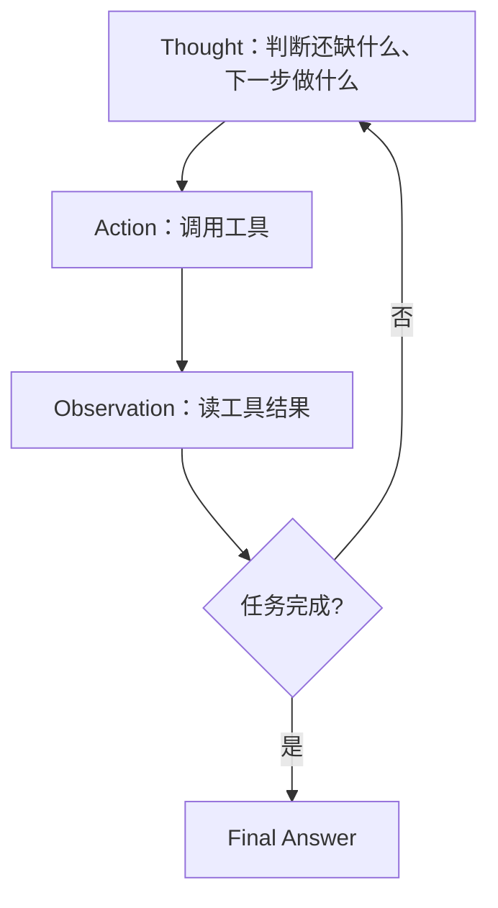

# ReAct 核心原理

面向高级 Java / AI。按一条线背：**是什么 → Thought / Action / Observation → 例子 → 和 Prompt 的关系 → 优劣与工程兜底 → 现代演进 → 面试收口**。

Agent 四件套见 [Agent 智能体](./agent)。这里只盯 ReAct 这一条决策循环。



---

## 一、ReAct 是什么？

**ReAct = Reasoning（推理）+ Acting（行动）**：让大模型用「思考 → 调工具 → 读结果」循环把任务做完的一种 Agent 方法。

注意：这里是 **ReAct**，不是前端的 **React**。

和纯 Prompt 问答不同：模型不只在脑子里编答案，而是**行动拿真实信息，再根据 Observation 改决策**。所以 **ReAct 有反馈**，反馈就是 Observation。

---

## 二、核心流程：三个词

```text
Thought → Action → Observation → （循环）→ Final Answer
```

| 步骤 | 干什么 |
|------|--------|
| **Thought** | 目标是什么、还缺什么信息、下一步做什么 |
| **Action** | 调搜索、数据库、计算器或业务 API |
| **Observation** | 读工具执行结果，据此决定下一步 |

循环到任务完成，再输出最终答案。

> 一句话：先判断，再行动；根据结果，继续判断。

| | 有没有环境反馈 |
|--|----------------|
| Thought | 无（纯推理，不改环境） |
| Action → Observation | 有（工具结果回灌上下文） |

---

## 三、例子：订单是否超时？

用户问：「订单是否超时？」

1. **Thought**：需要承诺送达时间和当前物流状态。
2. **Action**：调订单查询、物流查询。
3. **Observation**：拿到下单/承诺时间与物流节点。
4. **Thought**：用结果判断是否超时。
5. **Final Answer**：结论 + 处理建议。

重点：不是凭空猜，而是**工具取数 → 观察 → 再决策**。一步不够就再进下一轮 Thought。

---

## 四、和 Prompt、执行器的关系

| 角色 | 职责 |
|------|------|
| **Prompt** | 告诉模型目标、规则、可用工具与输出格式 |
| **ReAct 循环** | 按 Thought → Action → Observation 推进 |
| **工具执行器** | 真正执行模型发起的调用，把结果写回 Observation |

只有 Prompt 不够：还要**可调用的工具** + **外层执行循环**（解析 Action、调工具、拼 Observation、控制最大步数）。

现代接口里 Action 常落成 **Function Calling / Tool Calling** 的结构化请求；循环逻辑仍是 ReAct 那一套。

---

## 五、优势与局限

| | 内容 |
|--|------|
| **优势** | 能拿外部信息；能多步任务；能按结果改行动 |
| **局限** | 可能选错工具、陷入死循环；多轮调用抬延迟和成本 |

工程上要配：

- 最大步数 / 调用预算
- 参数与权限校验
- 超时、重试与失败处理
- 日志 / Tracing，方便查「想错了还是工具错了」

---

## 六、在现代 Agent 里怎么演进

ReAct 仍是**核心决策循环**。框架通常在上面加：

- **结构化工具调用**：模型按 schema 选工具
- **状态管理**：记进度、中间结果
- **工作流编排**：分支、重试、恢复
- **权限与监控**：可控、可追踪

复杂任务可多 Agent 分工，但协调成本上升，**不是越多越好**。和 Plan-and-Execute、Reflexion 的对比见 [Agent](./agent#2-planning规划)。

---

## 七、面试标准答案

ReAct 是 Reasoning 与 Acting 的组合，把大模型推理和工具调用绑在一起的 Agent 方法。它用 **Thought → Action → Observation** 循环：先判断下一步做什么，再调工具拿真实结果，再用 Observation 调整决策，直到任务完成。能支持外部查询和多步任务，但也可能错调、死循环、费时费钱，所以要配步数限制、权限校验、超时和日志。

> 最终记忆：**ReAct = 思考下一步 → 调用工具 → 观察结果 → 再决定下一步。**

---

## 口述模板

| 问题 | 开口 |
|------|------|
| ReAct 是什么 | Reasoning + Acting；不是前端 React |
| 三步 | Thought → Action → Observation，循环到 Final Answer |
| 有无反馈 | 有，Observation 就是反馈 |
| 和 Prompt | Prompt 定规则；ReAct 是循环；执行器真干活 |
| 优劣 | 能多步、能取外部信息；怕错工具、死循环、贵、慢 |
| 工程 | 限步数、校验权限、超时日志 |
