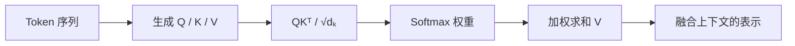
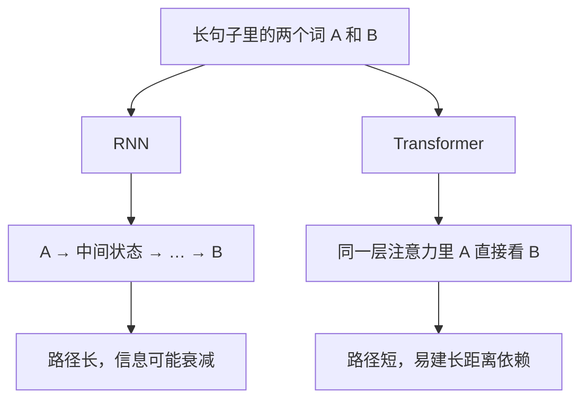
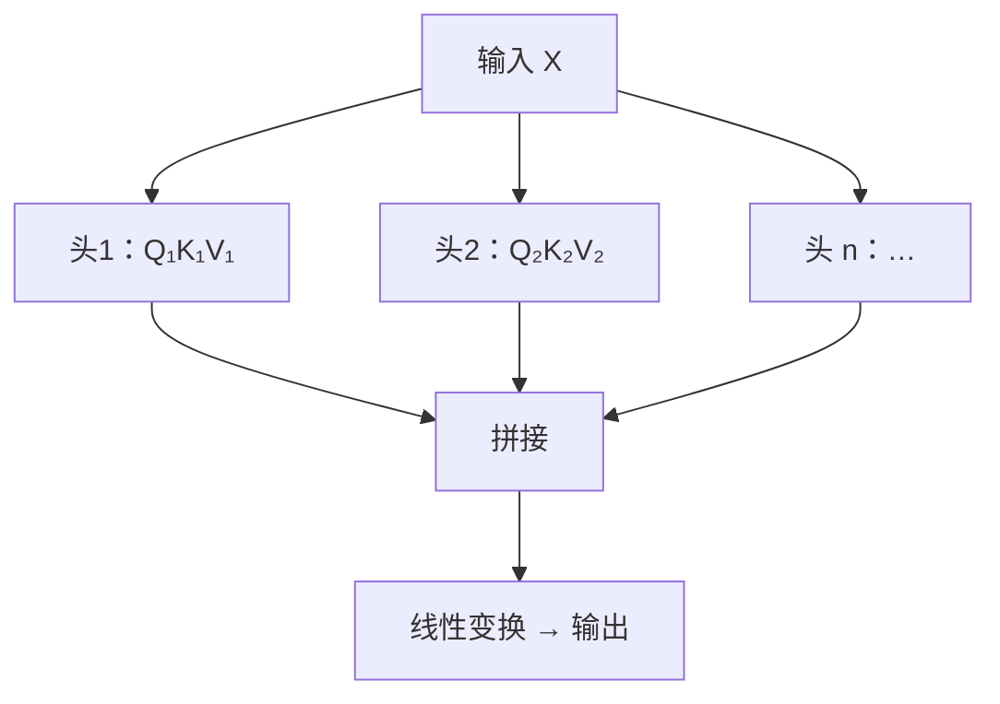

# Transformer 与自注意力

面向高级 Java / AI。按一条线背：**RNN 记笔记 → Transformer 直接交流 → QKV 五步 → 多头 → 长序列优势与代价 → 掩码 / 位置编码 / KV Cache**。



---

## 一、RNN 和 Transformer 怎么理解

### 1. RNN：按顺序读，边读边记

RNN（循环神经网络）可以想成：**按顺序阅读，每读一个词就更新一份记忆**。

例句：我昨天在餐厅吃饭，因为那里的牛肉面特别好吃，所以今天我还想去那里。

模型依次读「我」→「昨天」→「在餐厅」……每一步都是：

```text
当前词 + 上一步记忆 → 更新记忆 → 处理下一个词
```

| | 说明 |
|--|------|
| 优点 | 符合文本自然顺序；能用到前文信息；顺序性强的任务直观 |
| 缺点 | 时间步有依赖，整段不好并行；长距离信息要层层传递，容易衰减；普通 RNN 还容易梯度消失 / 爆炸 |

LSTM、GRU 用门控缓解了长期记忆问题，但**顺序计算的限制还在**：一般仍要先算 t-1，再算 t。

### 2. Transformer：用注意力直接对上号

Transformer 以**注意力**为核心。不必把信息一站站往后传，序列里各个位置可以在同一层里直接算彼此相关程度。

例句：小明把书放进了箱子，因为它太重了。

「它」指书还是箱子？注意力可以同时看「小明 / 书 / 箱子」，按相关程度加权汇总，而不是只靠一路传下来的摘要。

| | 说明 |
|--|------|
| 优点 | 同层多位置可并行，训练效率通常更高；远距离位置可直接交互；多层注意力 + FFN 能学复杂上下文 |
| 注意 | 不天生带顺序，要加位置编码；全量自注意力大约 O(n²)；不是所有任务、规模、硬件下都一定比 RNN 更好 |

### 3. 一张表记住差异

| 对比点 | RNN | Transformer |
|--------|-----|-------------|
| 核心思路 | 按序读，每步更新记忆 | 用注意力算位置之间的关联 |
| 信息传递 | 靠隐藏状态逐步传 | 一层内可直接连远距离位置 |
| 并行 | 时间维通常难并行 | 训练时同层多位置通常可并行 |
| 长距离依赖 | 多步传递，可能衰减 | 可直接建注意力联系 |
| 顺序信息 | 天然按序 | 通常要位置编码 |
| 长序列成本 | 顺序开销明显，单步成本较低 | 全量注意力计算 / 空间约随 n² 增长 |
| 常见变体 | LSTM、GRU | 多头、稀疏 / 线性注意力等 |



> 记忆：RNN 记笔记往下传；Transformer 翻书直接对照。

---

## 二、自注意力怎么算

Self-Attention：序列里每个 token 看当前序列里的其他 token，算相关程度，再对它们的信息**加权汇总**，得到融合上下文的新表示。

### 1. 五步流程

1. **输入向量**：token → 向量，再叠加位置信息。
2. **生成 Q、K、V**：三组可训练线性变换，得到 Query / Key / Value。
3. **算分数**：当前 token 的 Q 与各 token 的 K 做点积。
4. **缩放 + Softmax**：分数除以 √dₖ，再 Softmax 成权重。缩放是为了点积别太大，避免 Softmax 过尖、梯度变小。
5. **加权求和**：用权重对 V 求和，得到当前 token 的上下文表示。

核心公式：

```text
Attention(Q, K, V) = Softmax(QKᵀ / √dₖ) · V
```

直观理解：

| 符号 | 角色 |
|------|------|
| **Q** | 我想找什么 |
| **K** | 我能提供什么线索 |
| **V** | 真正被取用、汇总的信息 |
| **dₖ** | Key 向量维度 |

### 2. 生活化例子（帮助理解，不是语法推理）

句子：小猫追着球跑，因为它滚到了沙发下面。

处理「它」时：

- **Q**：当前「它」在找能解释指代的信息
- **K**：「小猫 / 球 / 沙发」等位置提供的匹配特征
- **V**：这些位置实际贡献的语义
- **权重**：Q 和各 K 的匹配分，决定从哪些 V 吸多少信息

注意力权重是模型算出的关联，**不等于**人类口中的「重要性」或完整决策解释。

### 3. 为什么要三套向量？

| | 干什么 |
|--|--------|
| Q 与 K | 算匹配程度 |
| V | 承载最后被加权汇总的内容 |

三者来自**不同的可训练矩阵**，所以模型能分别学「怎么问」「怎么被匹配」「传什么信息」。它们不是输入文本里现成的三个字段。

### 4. 为什么除以 √dₖ？

维度变大时，点积数值往往变大；Softmax 后分布过尖，梯度变差。除以 √dₖ 把分数尺度压住，训练更稳。

### 5. 多头注意力

单个头只有一套投影视角。多头把输入投到多个子空间，并行算多套注意力，再拼接 + 线性变换。

可以想成多人从不同角度读同一段：一个头偏指代，另一个偏邻近词或别的语义关系——这是直觉，**不要把每个头钉死成某一种语言学功能**。



---

## 三、为什么更适合很多长序列任务

### 1. 长距离依赖更容易建

RNN 里 A 要经很多中间状态才到 B，容易被压缩、覆盖。Transformer 里 A、B 可在同一层自注意力里直接交互。

### 2. 训练更易并行

RNN 第 t 步依赖 t-1。标准 Transformer 训练时可同时算同层多位置的 QKV 和注意力，更吃得满 GPU。

注意：**自回归生成**时，下一个 token 仍依赖已生成前文，通常还是**逐 token**；并行优势主要在训练和对整段已给定序列的处理。

### 3. 信息路径更短

远距离两词：RNN 跨很多递归步；全量自注意力一层内就能对上。

### 4. 代价：平方级成本

全量注意力要算约 n×n 的分数矩阵。n 翻倍，这块大约涨到约 4 倍。超长文本会撞显存和算力墙。工程上用分块、稀疏注意力、滑动窗口、线性注意力、**KV Cache** 等降本。

> 一句话：长距离可直接交互、训练好并行；但标准全量注意力约 O(n²)，超长序列要优化。

---

## 四、扩展追问

### Self-Attention 和普通 / Cross-Attention

计算思想一样：用 Q–K 匹配，对 V 加权。差别在来源：

| | Q | K、V |
|--|---|------|
| **Self-Attention** | 同一序列 | 同一序列 |
| **Cross-Attention** | 常来自 Decoder | 常来自 Encoder 输出 |

### Encoder vs Decoder 的 Self-Attention

- **Encoder**：通常双向，能看整段输入。
- **自回归 Decoder**：加**因果掩码**，不能看未来 token。
- Decoder 还可做交叉注意力读 Encoder；纯 Decoder 大语言模型一般没有 Encoder–Decoder 交叉注意力。

### 为什么要位置编码？

自注意力核心计算本身不自带「第几个 token」。不注入位置信息，很难区分词序。常见：正弦位置编码、可学习位置嵌入、**RoPE**（旋转位置编码）等。

### Softmax 干什么？

把分数变成归一化权重（通常非负、对一个 Query 求和为 1），再对 V 加权。权重大 ≠ 人类意义上的因果解释。

### 为什么要多头？

不同子空间并行学多种关系，再合并；表示更灵活，也增加算力和参数。

### LSTM / GRU 改善了，为什么还说 RNN 不擅长长序列？

门控改善了长期记忆和梯度，但时间步依赖还在，训练难像 Transformer 那样并行；远距离仍要沿状态路径传。不是「完全不能」，是**路径长 + 难并行**。

### 复杂度怎么说？

长度 n、维度 d：标准自注意力分数计算大约 **O(n²d)**，注意力矩阵空间大约 **O(n²)**。再加上 QKV 投影、FFN、层数等。具体看实现和内核优化。

### 长序列为什么吃显存？

每个 Query 对每个 Key，矩阵随 n² 涨；训练还要存 / 重算中间量做反传。FlashAttention 等减少中间读写，但不会把「全量配对次数」变成线性。

### 因果掩码

屏蔽当前位置之后的分数，预测时看不到未来，和「根据前文预测下一个 token」一致，避免泄漏。

### KV Cache

自回归生成时，历史 token 的 K、V 通常不变。缓存已生成部分的 K、V，新 token 只算自己那份，避免整段历史反复算。省算力，缓存本身随上下文变长占显存。

### 注意力权重高 = 模型更「关注」吗？

不能简单等同。权重只是某层、某头、某 Query 下的加权关系；最终输出还有残差、FFN、多层堆叠，不能单靠权重解释决策。

### 生成时是一次处理所有 token 吗？

**训练**因果 LM 可用掩码并行算整段各位置；**推理生成**通常逐 token。KV Cache 降低逐步生成的重复计算。

### Transformer 一定比 RNN 好吗？

不一定。大规模训练、并行、长依赖上通常有优势；全量注意力成本高。数据少、资源紧、低延迟流式、序列短时，RNN / LSTM / GRU 仍可能合适。按任务、数据、延迟、硬件选。

---

## 五、口述模板与易错点

### 一句话收尾

Self-Attention 为每个 token 生成 Q、K、V；用 Q 和所有 K 算分，除以 √dₖ 后 Softmax 得权重，再对 V 加权求和。远距离位置可直接交互；相对 RNN 逐步传状态，长依赖和训练并行通常更强；标准全量注意力约随 n² 涨，超长序列要优化。

### 开口骨架

| 问题 | 开口第一句 |
|------|------------|
| RNN vs Transformer | 一个按序记笔记，一个同层直接对照；后者要位置编码，全量注意力约 n² |
| 自注意力 | 五步：向量化 → QKV → 点积 → 缩放 Softmax → 加权 V |
| 为何适合长序列 | 路径短、训练可并行；代价是平方级显存 / 算力 |
| 因果掩码 | 不看未来，对齐 next-token 训练与生成 |
| KV Cache | 缓存历史 K/V，只算新 token，省重复计算、占显存 |
| Self vs Cross | Self 同源；Cross 的 Q 与 K/V 常来自不同序列 |

### 容易说错的地方

1. 别说「Transformer 完全没顺序」——要说靠位置编码注入。
2. 别说「RNN 不能处理长序列」——说传播路径和并行受限，LSTM/GRU 做过改善。
3. 别说「Transformer 所有阶段都能并行」——自回归生成通常仍逐 token。
4. 别把 Q、K、V 说成三个业务字段——是可训练线性变换学出来的。
5. 别把注意力权重当成绝对重要性或完整解释。
6. 别说 Transformer 一切场景必胜——看长度、任务、资源和延迟。

### 建议掌握顺序

1. 能用「记笔记 vs 直接交流」讲清两者。
2. 不看资料复述 QKV 五步。
3. 能写出并解释 `Softmax(QKᵀ / √dₖ) V`。
4. 能讲清：长依赖、并行、平方级成本。
5. 练熟：因果掩码、位置编码、多头、KV Cache、Self vs Cross。
