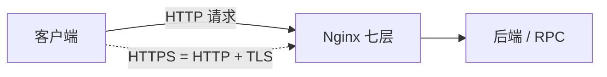
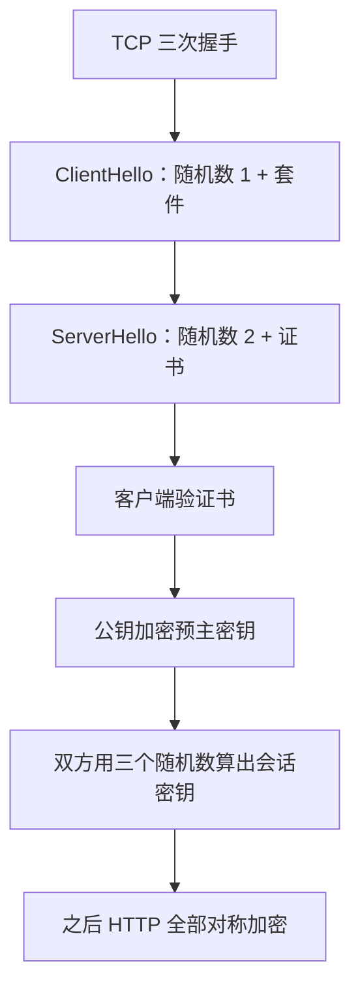

# 应用层面试题

面向高级 Java。按一条线背：**HTTP 特点与报文 → 方法与幂等 → 状态码 → 版本演进 → Cookie / Session / JWT → TLS 与 HTTPS → 跨域与 REST → RPC → Nginx**。

分层、DNS、三次握手的传输侧见 [网络传输场景](./transmission)。



---

## 一、HTTP 基础

### 1. HTTP 有什么特点？

无状态、请求-响应、明文、可扩展的应用层协议，可靠传输靠底下的 TCP。

1. **无状态**：服务器默认不记得上一次请求，所以要 Cookie / Session / Token。
2. **明文**：内容能被看见，所以要 HTTPS。
3. **请求-响应**：客户端主动问，服务器答。
4. **可扩展**：Header 随便加，Body 用 `Content-Type` 区分类型。
5. **可靠**：跑在 TCP 上。HTTP/1.0 默认短连接；「无连接」常被拿来形容 1.0，别和「无状态」混成一件事。

### 2. 报文怎么切？

```text
起始行
头部（每行 \r\n）
空行（\r\n\r\n）
正文 Body
```

- 请求起始行：`GET /index.html HTTP/1.1`
- 响应起始行：`HTTP/1.1 200 OK`
- Body 多长看 `Content-Length`，或 `Transfer-Encoding: chunked`（分块，长度事先未知）

### 3. 默认端口

| 协议 | 端口 |
|------|------|
| HTTP | 80 |
| HTTPS | 443 |
| FTP | 21 |
| SSH | 22 |
| DNS | 53 |

### 4. 方法

| 方法 | 作用 |
|------|------|
| GET | 取资源 |
| POST | 提交 / 创建 |
| PUT | 整份替换 |
| PATCH | 改一部分 |
| DELETE | 删除 |
| HEAD | 只要响应头，探测在不在 |
| OPTIONS | 问服务器支持哪些方法，CORS 预检用它 |

### 5. 安全和幂等

- **安全**：不改服务器资源（只读约定）
- **幂等**：做 1 次和做 N 次，资源最终状态一样

| 方法 | 安全 | 幂等 |
|------|------|------|
| GET / HEAD / OPTIONS | 是 | 是 |
| PUT | 否 | 是（反复替换结果一样） |
| DELETE | 否 | 是（删一次和十次，资源都不在） |
| POST | 否 | 否（可能创建多份） |
| PATCH | 否 | 不一定 |

### 6. GET 和 POST

| | GET | POST |
|--|-----|------|
| 语义 | 取资源 | 提交数据 |
| 参数 | URL query，可见 | Body |
| 缓存 | 可以 | 默认不缓存 |
| 幂等 | 是 | 否 |
| 长度 | URL 有上限 | 基本不限 |
| 刷新 / 后退 | 一般无害 | 刷新常提示重复提交 |

**GET 并不保证安全。** 「安全」只是规范约定。有人用 GET 做删除，爬虫、预加载、浏览器预取都可能打出去。参数在 URL 里，会进历史和访问日志，密码不要放 query。

### 7. HTTP 和 HTTPS

| | HTTP | HTTPS |
|--|------|-------|
| 内容 | 明文 | TLS 加密 |
| 端口 | 80 | 443 |
| 证书 | 不需要 | 要 CA 证书 |
| 建连 | TCP 三次握手后就能发 | TCP 后再 TLS，多几轮 RTT |
| 身份 | 易被冒充、篡改 | 证书核服务器身份，并校验完整性 |

> HTTPS = HTTP + TLS（加密 + 身份认证 + 完整性）。

---

## 二、状态码与连接

### 8. 状态码

| 类 | 含义 | 常背 |
|----|------|------|
| 1xx | 提示 | 101 切协议（WebSocket） |
| 2xx | 成功 | 200；201 已创建；204 无正文；206 部分内容（断点续传） |
| 3xx | 重定向 | 301 永久；302 / 307 临时；304 协商缓存未改 |
| 4xx | 客户端 | 400 参数；401 未认证；403 无权限；404 没有；405 方法不允许 |
| 5xx | 服务端 | 500 内部错；502 网关；503 不可用；504 网关超时 |

### 9. 502

**502 Bad Gateway**：Nginx 这类网关没拿到上游的合法响应，或根本连不上。

常见：进程挂了、端口错、防火墙拦了、上游回了不合协议的内容、PHP-FPM / Node 崩了。

> 先看进程在不在，再看端口通不通，再看 Nginx error log。

### 10. 504

**504 Gateway Timeout**：网关连上了上游，但等太久。

| | 502 | 504 |
|--|-----|-----|
| 含义 | 没收到正常响应 | 等超时了 |

慢 SQL、死锁、接口太慢、下游超时。方向：查慢请求，必要时调 `proxy_read_timeout`，先治根因而不是只把超时调大。

### 11. 重定向

都是 **3xx**。

| | 码 | 行为 | 场景 |
|--|----|------|------|
| 永久 | **301**（方法不变用 **308**） | 浏览器和搜索引擎会记住，下次直达新地址；SEO 权重跟过去 | 换域名、HTTP 跳 HTTPS |
| 临时 | **302**（方法不变用 **307**） | 每次仍先打原地址再跳；权重留在原 URL | 维护页、短链、登录跳转 |

301 / 302 历史上可能把 POST 改成 GET。307 / 308 保持原方法。

### 12. 长连接还是短连接？

- HTTP/1.0 默认短连接：一个请求一次 TCP。
- HTTP/1.1 起默认长连接：`Connection: keep-alive`，一条 TCP 传多个请求。
- 「无状态」说的是请求之间不记人；长连接是 TCP 复用，两件事分开说。

### 13. 1.0 / 1.1 / 2 / 3

| 版本 | 记住什么 |
|------|----------|
| 1.0 | 短连接，一问一答一次 TCP |
| 1.1 | keep-alive、Host（虚拟主机）、缓存协商更完整；管道化几乎没人用 |
| 2 | 二进制分帧、**多路复用**（一条连接并行多个请求，缓解 HTTP 层队头阻塞）、HPACK 压头部、服务器推送（实际用得少） |
| 3 | 底下换成 **QUIC（UDP）**：握手可到 0-RTT / 1-RTT，解决 TCP 队头阻塞，换网络（Wi-Fi 切蜂窝）连接还能迁 |

> 1.1 少建连接；2 少 HTTP 队头阻塞；3 少 TCP 队头阻塞，握手更快。

HTTP/2 仍跑在一条 TCP 上，一个包丢了，这条 TCP 上的流都要等重传。HTTP/3 的流在 QUIC 里独立，丢包不拖其他流。

---

## 三、无状态与会话

### 14. 怎么认出同一个人？

协议本身无状态。要认人，靠应用自己带凭证：**Cookie + Session**，或 **Token / JWT**。

### 15. Cookie、Session、Token、JWT

| | 是什么 | 放哪 |
|--|--------|------|
| Cookie | 浏览器存储，请求时自动带上 | 客户端 |
| Session | 服务端会话数据，用 sessionId 对上 | 内存 / Redis |
| Token | 客户端自带的凭证 | Header 或本地存储 |
| JWT | Token 的一种格式：`Header.Payload.Signature`，自带声明，可验签 | 客户端 |

两条路：

1. **Cookie + Session（有状态）**：登录后服务端把 sessionId 放进 Cookie，数据放 Redis。集群必须共享这份 Session。
2. **JWT（无状态）**：签发后客户端放 `Authorization: Bearer`。服务端只验签，不存会话。好横向扩展；签发后不好立刻作废，要黑名单或短过期 + 刷新。

> Cookie 是搬运工，Session 是服务端账本，Token 是通行证，JWT 是带签名的通行证。

---

## 四、握手、跨域、REST

### 16. TCP 三次握手和 TLS

TCP：

1. 客户端 SYN（seq=x）
2. 服务端 SYN+ACK（seq=y, ack=x+1）
3. 客户端 ACK（ack=y+1）

两次不够：服务端还没确认客户端能收；也挡不住过期的 SYN 突然到达。第三次等于客户端说「这次连接是新的，我能收」。传输侧更细的过程见 [网络传输场景](./transmission)。

TLS 1.2 大约 2 个 RTT（四次主要消息往返）：

1. ClientHello：版本、套件、**随机数 1**
2. ServerHello：选定套件、**随机数 2**、证书
3. 客户端验证书，用服务器公钥加密 **预主密钥（随机数 3）**，双方算出会话密钥，发 Finished
4. 服务端 Finished 之后改走对称加密

TLS 1.3 压到 1 RTT，会话恢复可以 0-RTT。

### 17. 跨域

同源 = 协议 + 域名 + 端口全一样。

- `http://a.com` 打 `http://api.a.com`：域名不同
- `http` 打 `https`：协议不同
- `:80` 打 `:8080`：端口不同

这是**浏览器**限制脚本读响应。curl、服务之间没有这套同源策略。

| 办法 | 说明 |
|------|------|
| CORS | 响应头 `Access-Control-Allow-Origin`；非简单请求先 OPTIONS 预检 |
| Nginx 反向代理 | 浏览器只打同源路径，由 Nginx 转到真实后端 |
| JSONP | 只适合 GET，基本不用了 |

### 18. RESTful

用 URL 定位资源，用 HTTP 方法表示动作，用状态码表示结果。

1. 路径用名词：`GET /users/1`，不要 `GET /getUser?id=1`
2. 动作用方法：`POST /users`、`PUT /users/1`、`DELETE /users/1`
3. 层级走路径：`/users/1/orders`
4. 过滤、分页放 query：`/users?page=2&size=10`

---

## 五、HTTPS

### 19. 对称和非对称

| | 对称 | 非对称 |
|--|------|--------|
| 密钥 | 同一把 | 公钥加密、私钥解密（签名则相反） |
| 速度 | 快，适合大数据 | 慢很多，适合短数据 |
| 难点 | 钥匙怎么安全交到对方手里 | 计算贵 |
| 算法 | AES、ChaCha20（DES / 3DES 过时） | RSA、ECC、DH / ECDH |

另外：**哈希**（SHA-256，MD5 已不安全）做完整性；**数字签名**是私钥签、公钥验，用来认身份。

### 20. 大文件用哪种加密？

用**对称加密（AES）**。非对称慢，而且 RSA 一次只能加密很短的一块，不适合未知长度的大文件。对称可以流式边读边加密。

工程上是混合：文件用随机 AES 密钥加密，AES 密钥再用对方公钥传过去。HTTPS 也是这个思路。

### 21. 连接怎么建？握手为什么用非对称？



对称快，但钥匙不能在明文网络里直接送。非对称只做两件事：**验身份、安全地把会话密钥材料交过去**。之后每条业务数据都走对称加密。

### 22. 为什么要三个随机数？

客户端随机数、服务端随机数、预主密钥一起派生会话密钥。

1. 每次会话密钥都不同，降低重放价值。
2. 两边都贡献随机性，避免只信一端的随机数生成器。

### 23. 几次 RTT？

- TCP：1 RTT
- TLS 1.2：再 2 RTT
- 合计大约 **3 RTT** 才发出第一个应用字节

更快的做法：

1. **TLS 1.3**：握手 1 RTT
2. **TLS 1.3 会话恢复 / 0-RTT**：老连接用票据，第一包就能带数据；有重放风险，只适合幂等请求
3. **QUIC / HTTP/3**：传输和加密握手合一，新连接 1 RTT，恢复 0 RTT

### 24. 非对称几次，对称几次？

握手里非对称主要两处用途，对称贯穿之后每一条应用数据：

1. 用 **CA 公钥验**证书上的签名
2. 用**服务器公钥加密**预主密钥，服务器私钥解开

> 非对称解决身份和发钥匙，只在握手；对称解决速度，用在整段通信。

### 25. URL 会被加密吗？

- **路径和 query 会**：它们在 HTTP 报文里，整段被 TLS 包住。
- **域名往往仍暴露**：DNS 查询、目标 IP、TLS 的 **SNI**（明文带域名）能看出你访问哪个站。

窃听者知道「哪个网站」，看不到「哪个路径、什么正文」。

### 26. CA 怎么证明这台服务器？

1. 服务器把公钥、域名等交给 CA
2. CA 用**自己的私钥**签名，做成证书
3. 浏览器预装受信任的 CA 根公钥
4. 握手时用 CA 公钥验签，再对域名、有效期、吊销状态
5. 证书里的公钥可信之后，只有对应私钥能解开预主密钥

中间人换一张自己的证书，验签过不了。

### 27. 地址栏「绿色」

早期 **EV 证书**（扩展验证）会显示绿色公司名，表示 CA 核过营业主体。现在 Chrome / Safari 基本只留锁图标，EV 和只验证域名的 DV 看起来差不多。

### 28. 自己编一张证书行不行？

行，叫**自签名**。浏览器不在信任链里，会警告。内网和本地开发可以手动信任。

公网要找受信任 CA：Let's Encrypt（免费 DV，自动续期），或 DigiCert、GlobalSign 等（DV / OV / EV，审核一级比一级严）。

---

## 六、RPC

RPC 让调远程方法看起来像调本地函数，序列化、寻址、传输由框架包掉。

和 HTTP 不是严格的上下层对立。常拿来比的是 **HTTP REST** 和 **gRPC / Dubbo 这类 RPC**。

| | HTTP REST | RPC 框架 |
|--|-----------|----------|
| 序列化 | JSON，大、解析慢 | Protobuf 等二进制，小、快 |
| 传输 | HTTP/1.1 文本头冗余 | 长连接、多路复用，协议更瘦 |
| 治理 | 自己搭 | 常带注册发现、负载均衡、熔断、监控 |
| 调用 | 拼 URL | 生成 stub，像本地方法 |
| 适合 | 对外、浏览器 | 内部微服务高频调用 |

> 对外 REST，对内 RPC。

---

## 七、Nginx

### 1. 在哪一层？

做 HTTP 反向代理时在**应用层（第 7 层）**，能看 URL、Header、Cookie。`stream` 模块做 TCP / UDP 转发时在**传输层（第 4 层）**。

### 2. 负载均衡

| 算法 | 说明 |
|------|------|
| 轮询 | 默认，按顺序分 |
| weight | 机器不均时按权重 |
| ip_hash | 同一客户端 IP 固定到一台，会话粘住；机器挂了会话会丢，负载也可能不均 |
| least_conn | 分给当前连接最少的，适合耗时不均 |
| fair / url_hash | 第三方：按响应时间，或按 URL 哈希提高缓存命中 |

### 3. 正向代理和反向代理

| | 正向 | 反向 |
|--|------|------|
| 代理谁 | 客户端 | 服务器 |
| 谁配置 | 客户端 | 服务端（Nginx） |
| 客户端看见谁 | 知道真正的目标站 | 以为 Nginx 就是服务器 |
| 用途 | 出网、访问受限网络 | 负载均衡、藏后端、缓存、SSL 卸载 |

> 正向藏客户端，反向藏服务器。

### 4. 四层和七层负载均衡

| | 四层 | 七层 |
|--|------|------|
| 层 | TCP / UDP | HTTP 等 |
| 看什么 | IP + 端口 | URL、Header、Cookie |
| 速度 | 快，不解应用内容 | 要解析 HTTP，相对慢 |
| 路由 | 粗 | 细，例如 `/api` 和 `/static` 走不同集群 |
| 代表 | LVS、F5、Nginx stream | Nginx、HAProxy |

---

## 口述模板

| 问题 | 开口 |
|------|------|
| HTTP 特点 | 无状态、明文、请求响应、Header 可扩展，可靠靠 TCP |
| 报文 | 起始行 + 头 + 空行 + Body；长度看 Content-Length 或 chunked |
| 幂等 | GET / PUT / DELETE 幂等；POST 不幂等；安全只是约定，GET 也能被写成删数据 |
| HTTPS | HTTP + TLS；443；混合加密 |
| 502 / 504 | 502 上游没正常应答；504 连上了但超时 |
| 301 / 302 | 永久会缓存跳转；临时每次再问；要保方法用 308 / 307 |
| 版本 | 1.1 长连接；2 多路复用；3 用 QUIC 解决 TCP 队头阻塞 |
| 会话 | Cookie 搬运，Session 服务端账本，JWT 自带签名、难即时吊销 |
| 跨域 | 协议域名端口任一不同；浏览器限制；CORS 或反代 |
| RTT | TLS 1.2 大约 TCP 1 + TLS 2；1.3 可 1 RTT，恢复可 0-RTT |
| URL 加密 | 路径和参数加密；域名常被 DNS / SNI 暴露 |
| RPC | 对外 REST，对内二进制 RPC 加治理 |
| Nginx | HTTP 在七层，stream 在四层；反向代理藏的是服务器 |
