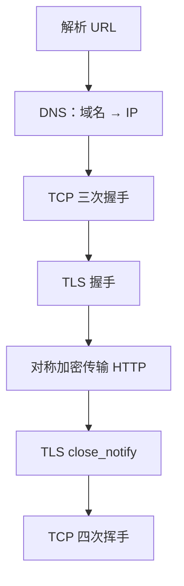
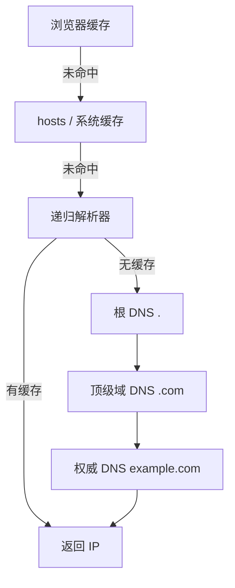
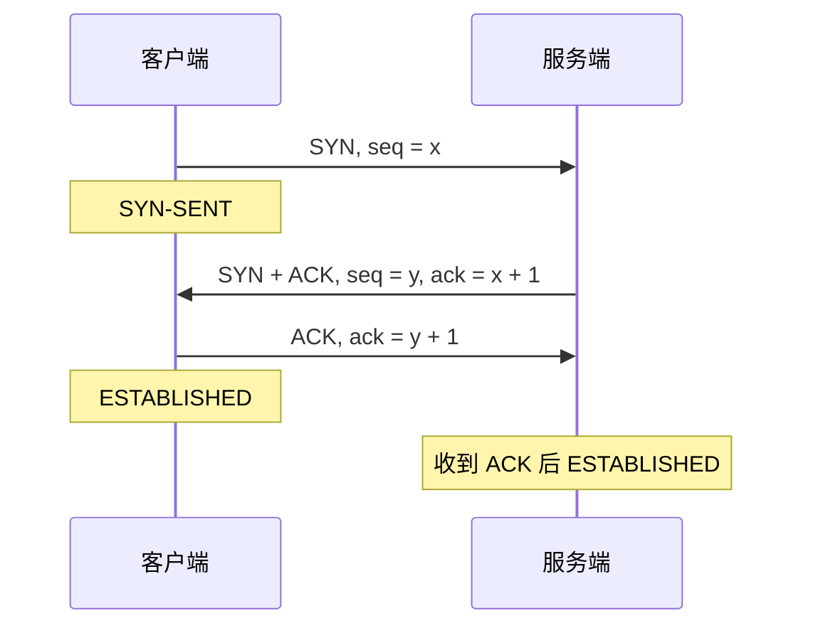
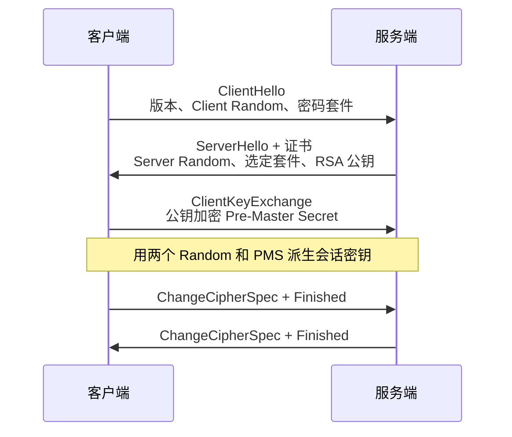
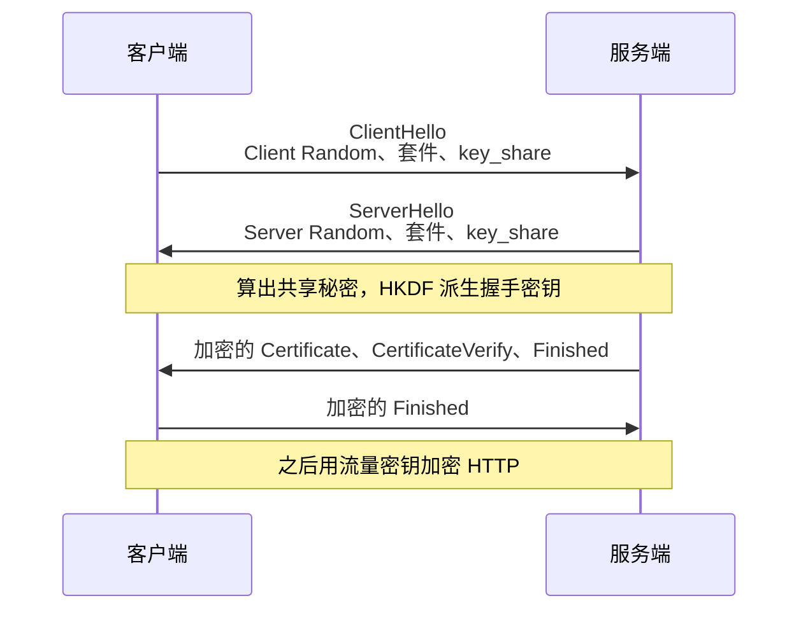
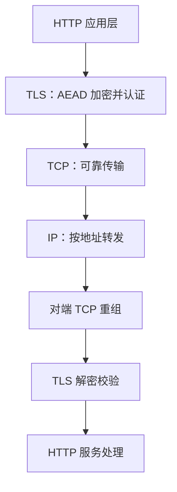
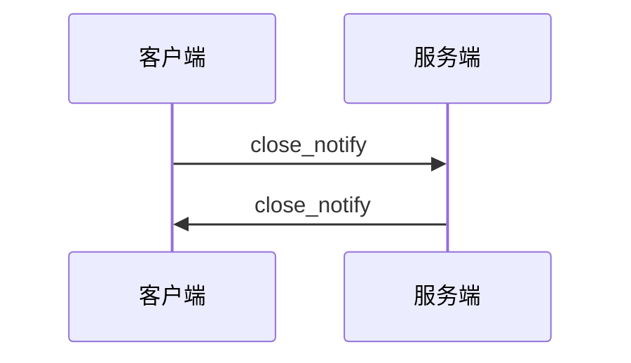
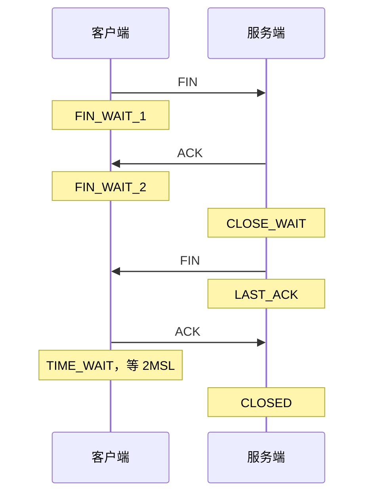
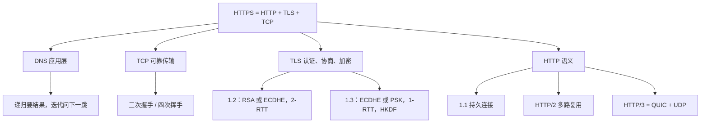

# HTTPS 详细过程

面向高级 Java。按一条链路背：**URL → DNS → TCP 三次握手 → TLS 握手 → 加密的 HTTP → TLS close_notify → TCP 四次挥手**。

HTTPS = **HTTP + TLS + TCP**。HTTP 负责报文语义，TLS 负责身份、密钥和加密，TCP 负责可靠传输。默认端口 **443**。

这是首次访问、HTTP/1.1 或 HTTP/2 over TCP 的典型路径。浏览器经常复用 DNS 缓存、TCP 连接和 TLS 会话。HTTP/3 走 QUIC（UDP），传输握手和 TLS 1.3 合在一起，见第八节。

分层、DNS 记录类型见 [网络传输场景](./transmission)。方法、状态码、Cookie 见 [应用层面试题](./application)。



---

## 一、整体在干什么

浏览器打开 `https://www.example.com/user/info` 时，按这个顺序：

1. **解析 URL**：协议 `https`、主机 `www.example.com`、端口 `443`、路径 `/user/info`。
2. **DNS**：把域名解析成服务器 IP。
3. **TCP 三次握手**：和 `IP:443` 建立可靠连接。
4. **TLS 握手**：验证服务器身份，协商出同一把会话密钥。
5. **HTTP**：请求和响应都交给 TLS 加密后再交给 TCP。
6. **TLS 关闭**：`close_notify` 告诉对方「我这边不再发 TLS 数据」。
7. **TCP 四次挥手**：释放底层连接。

长连接（HTTP/1.1 Keep-Alive、HTTP/2）会把第 6、7 步推迟，同一条连接上继续发后续请求。

---

## 二、DNS 域名解析

访问前要先知道服务器 IP。`www.example.com` 可能被解析成 `93.184.216.34`。

DNS 是域名到 IP 的查询系统，属于**应用层**。它常用 UDP 传报文，层还是应用层。

### 查找顺序

1. 浏览器 DNS 缓存
2. 操作系统：先看 **hosts**，再看系统 DNS 缓存
3. 向配置的递归解析器查询
4. 递归解析器没有缓存时，再去问根、顶级域、权威服务器
5. 把结果按 TTL 缓存后返回



两个查询方式：

| | 谁问谁 | 要什么 |
|--|--------|--------|
| **递归查询** | 客户端 → 递归解析器 | 直接给我最终 IP |
| **迭代查询** | 递归解析器 → 根 / 顶级域 / 权威 | 告诉我下一步问谁 |

### 用什么协议

| 方式 | 端口 | 场景 |
|------|------|------|
| UDP | 53 | 普通查询，一问一答 |
| TCP | 53 | 响应太大被截断后重查，以及区域传送 |
| DNS over TLS（DoT） | 853 | 用 TLS 包住 DNS |
| DNS over HTTPS（DoH） | 443 | 用 HTTPS 包住 DNS |

> 口诀：DNS 在应用层；普通查询 UDP 53，过大或区域传送改 TCP 53。

---

## 三、TCP 三次握手

拿到 IP 之后，客户端连服务器的 **443**。三次握手用来确认双方发送、接收都正常，并同步初始序列号。



1. **客户端 SYN**：带上初始序列号 `seq = x`，进入 `SYN-SENT`。
2. **服务端 SYN + ACK**：确认客户端的 SYN，`ack = x + 1`；同时带上自己的 `seq = y`。
3. **客户端 ACK**：`ack = y + 1`。客户端发出后进入 `ESTABLISHED`；服务端**收到**这个 ACK 后进入 `ESTABLISHED`。

两次不够：服务端还没确认客户端能收，也挡不住过期 SYN 突然到达后把连接建出来。第三次等于客户端声明「这是一次新连接，我能收」。

客户端可以在第三次 ACK 里带上 TLS 的 ClientHello，TCP 和 TLS 在时间上接在一起。丢包之后谁重传、两个队列分别在等什么，见 [TCP / UDP 传输层](./tcp-udp)。

---

## 四、TLS 握手

TCP 通了之后做 TLS。它做三件事：

1. **身份认证**：用证书确认对面是这个域名的服务器。
2. **密钥协商**：两边算出相同的会话密钥。
3. **加密通信**：之后的 HTTP 用对称加密，并带完整性校验。

### TLS 版本

| 版本 | 状态 | 记住什么 |
|------|------|----------|
| TLS 1.0 | 已废弃 | 从 SSL 3.0 演进而来，已知攻击面大 |
| TLS 1.1 | 已废弃 | 补过 CBC 的部分问题，算法仍然过时 |
| TLS 1.2 | 仍广泛使用 | 支持 RSA 密钥交换和 ECDHE；完整握手 **2-RTT**；密钥派生用 PRF |
| TLS 1.3 | 当前推荐 | 去掉静态 RSA 密钥交换；默认前向安全；完整握手 **1-RTT**；密钥派生用 HKDF |

1.0 和 1.1 在 RFC 8996 里被要求停用。新系统按 1.2 兼容、1.3 优先来配。

### TLS 1.2：RSA 密钥交换

历史上客户端生成 Pre-Master Secret，用证书里的 RSA 公钥加密后发出去。服务器用长期私钥解开。



1. **ClientHello**：支持的 TLS 版本、Client Random、密码套件。
2. **ServerHello**：选定版本和套件、Server Random、服务器证书（里面有 RSA 公钥）。
3. **客户端**：校验 CA 签名、有效期、域名；生成 Pre-Master Secret；用 RSA 公钥加密后放入 ClientKeyExchange。双方用 Client Random、Server Random、Pre-Master Secret 算出 Master Secret，再派生通信密钥。然后发 ChangeCipherSpec 和 Finished。
4. **服务端**：用 RSA 私钥解开 Pre-Master Secret，算出同一套密钥，校验客户端 Finished，再回 ChangeCipherSpec 和 Finished。

这把长期私钥既能签名，又能解开历史上录下来的 Pre-Master Secret。私钥一旦事后泄露，旧流量也能被解开，**没有前向安全**。现代配置使用 ECDHE，静态 RSA 密钥交换应关掉。

### TLS 1.2：ECDHE 密钥交换

两边各自生成临时椭圆曲线密钥，交换公钥后算出共享秘密。服务器长期私钥只给这个临时公钥**签名**，不参与共享秘密的计算。

1. **ClientHello**：版本、Client Random、密码套件、支持的椭圆曲线。
2. **ServerHello**：版本、Server Random、选定套件、证书、ServerKeyExchange（临时公钥 + 用证书私钥做的签名）、ServerHelloDone。
3. **客户端**：校验证书，再验 ServerKeyExchange 的签名；生成自己的临时密钥；把公钥放进 ClientKeyExchange。用「自己的私钥 + 服务端临时公钥」算出共享秘密，把它当作 Pre-Master Secret，再和两个 Random 派生 Master Secret 和通信密钥。然后 ChangeCipherSpec、Finished。
4. **服务端**：用「自己的临时私钥 + 客户端公钥」算出同一个共享秘密，派生同一套密钥，校验 Finished，再回 ChangeCipherSpec 和 Finished。

| | RSA 密钥交换 | ECDHE |
|--|----------------|-------|
| 密钥材料从哪来 | 客户端单独生成 Pre-Master Secret | 双方用临时公钥算出共享秘密 |
| 证书公钥做什么 | 加密 Pre-Master Secret | 临时公钥用来协商；证书公钥用来验签 |
| 服务器长期私钥做什么 | 解密 Pre-Master Secret | 只签名，不进入 ECDHE 计算 |
| 前向安全 | 不具备 | 具备 |

> 口诀：RSA 密钥交换是「公钥加密一把预主密钥」；ECDHE 是「临时密钥协商共享秘密，长期私钥只负责签名」。

### TLS 1.3

1.3 把握手压成 **1-RTT**，并去掉静态 RSA 密钥交换。客户端在第一包里就带上 ECDHE 公钥。



1. **ClientHello**
   - `supported_versions`：声明支持 TLS 1.3
   - Client Random、密码套件
   - `supported_groups`：支持的椭圆曲线
   - `key_share`：客户端临时公钥
2. **ServerHello**：确认 TLS 1.3、Server Random、选定套件、服务端 `key_share`。两边用自己的临时私钥和对方公钥算出共享秘密，再用 **HKDF** 派生握手密钥和后续流量密钥。
3. **服务端加密握手消息**（ServerHello 之后已经加密）
   - EncryptedExtensions：其余扩展
   - Certificate：服务器证书
   - CertificateVerify：用证书私钥对握手上下文签名
   - Finished：校验到目前为止的握手消息
4. **客户端**：校验证书和 CertificateVerify，校验服务端 Finished，发送自己的 Finished。握手完成，HTTP 走流量密钥。

客户端猜的曲线服务端不支持时，服务端会先回 HelloRetryRequest，握手多一轮。正常命中 `key_share` 就是 1-RTT。

会话恢复用 PSK。带着之前的票据，第一包就可以发早期数据，这叫 **0-RTT**。早期数据可能被重放，只适合幂等请求。

### TLS 1.2 和 TLS 1.3

| 对比项 | TLS 1.2 | TLS 1.3 |
|--------|---------|---------|
| 密钥交换 | RSA、ECDHE、DH 等 | ECDHE、PSK |
| 客户端 ECDHE 公钥 | 第三段才发 | 第一段 ClientHello 就发 |
| 服务端证书 | 明文 | ServerHello 之后加密 |
| Finished | ChangeCipherSpec 之后 | 用握手密钥加密 |
| ChangeCipherSpec | 正常流程要发 | 协议本身不再用它；中间盒兼容模式可能仍发一个空的 |
| 密钥派生 | PRF | HKDF |
| 对称算法 | 还有 CBC 等旧套件 | 只留 AEAD（AES-GCM、ChaCha20-Poly1305 等） |
| 完整握手 | 2-RTT | 1-RTT |

TLS 1.3 的套件名字变了。`TLS_AES_128_GCM_SHA256` 只表示对称加密和 HKDF 用的哈希。密钥交换看 `key_share`，身份认证看签名算法，不能再从套件名里读出 `ECDHE_RSA`。

标准文本：[RFC 5246](https://www.rfc-editor.org/rfc/rfc5246)（TLS 1.2）、[RFC 8446](https://www.rfc-editor.org/rfc/rfc8446)（TLS 1.3）。

校验证书时看这几项：证书链能追到浏览器信任的根 CA、签名正确、有效期覆盖当前时间、域名对得上（SAN）、必要时再查吊销（OCSP / CRL）。

---

## 五、HTTP 数据怎么被加密

握手完成后，两边持有相同的通信密钥，HTTP 才开始传。

明文 HTTP 里，中间人能直接看见：

```http
GET /user/info HTTP/1.1
Host: www.example.com
```

HTTPS 里，这段报文先进入 TLS 记录层：

1. 浏览器生成 HTTP 请求。
2. TLS 用协商好的对称密钥加密，并用 AEAD（如 AES-GCM）同时做完整性校验。
3. 密文交给 TCP，分段、排序、按需重传。
4. 服务端 TCP 重组后，TLS 解密并验真，再把原始 HTTP 交给 Web 服务器。
5. 响应按同一条路加密回来。



非对称计算贵，只放在握手里做认证和密钥协商。对称加密快，用来保护全部业务数据。ECDHE 负责协商出共享秘密，它本身不加密 HTTP。

| 内容 | 是否被 TLS 加密 |
|------|-----------------|
| 路径、query | 是 |
| 请求头、请求体 | 是 |
| 响应头、响应体 | 是 |
| 目标 IP、目标端口 | 否，在 IP / TCP 头里 |
| 域名 | ClientHello 里的 SNI 默认仍是明文；TLS 1.3 会加密证书。ECH 可以再把 SNI 藏起来。明文 DNS 也会暴露域名 |

窃听者通常知道「访问了哪台机器、哪个域名」，看不到路径和正文。

---

## 六、TLS 怎么关闭

HTTP 传完，TCP 不一定马上断。Keep-Alive 和 HTTP/2 会把连接留着复用。确定不用了，先关 TLS，再关 TCP。这是两层各自的事。

TLS 用 **close_notify** 警报声明：我的发送方向已经结束，后面不会再有新的 TLS 数据。



每一侧都要通知自己的发送方向。收到对方的 close_notify，只说明对方不再发；自己有数据仍可以继续发，直到自己也发出 close_notify。

TCP 直接断开、却没有 close_notify 时，接收方无法确认数据是不是被截断。TLS 1.3 要求关闭写方向之前发送 close_notify，此前已经发过错误警报的除外。

---

## 七、TCP 四次挥手

TLS 写方向关掉之后，TCP 再释放。TCP 是全双工，两个发送方向各自关闭。



1. **客户端 FIN**：自己没有数据要发了，进入 `FIN_WAIT_1`。
2. **服务端 ACK**：确认这个 FIN。客户端进入 `FIN_WAIT_2`，服务端进入 `CLOSE_WAIT`。此时连接还在，服务端仍可以向客户端发数据。
3. **服务端 FIN**：应用也关闭后发出，服务端进入 `LAST_ACK`。
4. **客户端 ACK**：进入 `TIME_WAIT`，等待 **2MSL** 再变成 `CLOSED`。服务端收到 ACK 后直接 `CLOSED`。

服务端如果没有剩余数据，第 2 步的 ACK 和第 3 步的 FIN 可以放在同一个报文里，抓包有时看到三次，两边的发送方向仍然各自关闭了一次。

等 2MSL 有两个原因：

1. 最后一个 ACK 如果丢了，服务端会重发 FIN，客户端还在 `TIME_WAIT`，可以再回 ACK。
2. 让旧连接的迟到报文从网络里消失，避免串进同一四元组的新连接。

MSL 是报文最大生存时间。Linux 上 `TIME_WAIT` 常见大约 60 秒。

| 状态 | 含义 |
|------|------|
| ESTABLISHED | 连接已建立，可以传数据 |
| FIN_WAIT_1 | 主动关闭方已发 FIN，在等 ACK |
| FIN_WAIT_2 | 已收到自己 FIN 的 ACK，在等对方 FIN |
| CLOSE_WAIT | 收到对方 FIN，等本机应用关闭 |
| LAST_ACK | 被动关闭方已发 FIN，在等最后的 ACK |
| TIME_WAIT | 主动关闭方等待 2MSL |
| CLOSED | 连接已释放 |

> `CLOSE_WAIT` 堆积，先查应用有没有及时关 Socket。`TIME_WAIT` 多，通常是主动关闭后的正常等待。原因和排查见 [TCP / UDP 传输层](./tcp-udp)。

---

## 八、HTTP/1.0、HTTP/1.1、HTTP/2、HTTP/3

正式版本是 **HTTP/1.0、HTTP/1.1、HTTP/2、HTTP/3**。口头说的 1.2、1.3，指的就是 **HTTP/2** 和 **HTTP/3**，标准里没有 HTTP/1.2、HTTP/1.3 这两个名字。

方法、状态码、Header 的含义从 1.1 一直沿用。后面两版改的是帧格式、连接和传输，不是重新定义 GET / 200。

| 对比项 | HTTP/1.0 | HTTP/1.1 | HTTP/2 | HTTP/3 |
|--------|----------|----------|--------|--------|
| 依据 | RFC 1945 | RFC 9112 | RFC 9113 | RFC 9114 |
| 传输 | TCP | TCP | TCP | QUIC（UDP） |
| 默认连接 | 短连接，一个请求一次 TCP | 持久连接 | 一条连接上多路复用 | 一条 QUIC 连接上多路复用 |
| 并发 | 多开 TCP | 浏览器常对同一主机开大约 6 条 TCP | 多个 Stream 交错在一条 TCP 上 | 多个 Stream，丢包互不影响 |
| 队头阻塞 | 必须等上一个响应 | 同连接仍按顺序等响应 | HTTP 层解开了；TCP 丢一个包，整条连接上的流都要等 | 流独立重传，其他流继续交付 |
| 报文 | 文本 | 文本，支持分块 | 二进制帧 | QUIC 帧 |
| 头部 | 每次原文重发 | 每次原文重发，且必须带 Host | HPACK 压缩 | QPACK |
| 服务器推送 | 无 | 无 | 规范里有，浏览器已基本停用 | 实际也很少用 |
| 加密 | 可选用 TLS | 可选用 TLS | 浏览器只实现 `h2`，必须 TLS | 强制 TLS 1.3，做进 QUIC 握手 |
| 建连 | 每次 TCP 握手 | 可复用 TCP 和 TLS 会话 | 同 1.1，仍是先 TCP 再 TLS | 连接建立和 TLS 1.3 一次完成；新连接 1-RTT，恢复可 0-RTT |
| 换网络 | 四元组一变就断 | 同左 | 同左 | Connection ID，地址变了连接还能迁 |

### HTTP/1.0

一个请求配合一次 TCP：发完响应就关连接。`Keep-Alive` 是后来的扩展，默认行为仍是短连接。

没有强制 `Host`，一台机器上挂多个站点很别扭。缓存主要靠 `Expires`、`Last-Modified`。没有标准的分块传输，发送方通常要事先知道正文长度。

### HTTP/1.1

默认持久连接，除非写 `Connection: close`。一条 TCP 可以串多个请求，省掉重复的三次握手和 TLS 握手。

`Host` 变成必填，虚拟主机才站得住。正文可以 `Transfer-Encoding: chunked`，边生成边发。缓存补全了 `Cache-Control`、`ETag`、`If-None-Match`、`If-Modified-Since`，也有 Range 和 `100 Continue`。

管道化允许连续把多个请求发出去，但响应必须按请求顺序回来。前一个响应慢，后面的全部堵住；中间代理实现也不稳，浏览器基本不用。所以 1.1 的并行主要靠**多开几条连接**。同主机大约 6 条是浏览器的常见做法，协议本身没有规定这个数字。

### HTTP/2

把报文拆成二进制帧，每帧属于一个 Stream。多个 Stream 可以交错写在同一条 TCP 上，不再为了等上一个响应而停住后面的请求。头部用 HPACK，静态表加动态表，Cookie 这类重复头会小很多。

浏览器通过 ALPN 协商 `h2`，并且要求 TLS。明文的 `h2c` 在规范里存在，浏览器不用。

服务器推送曾经用来让服务器提前塞 CSS、JS。Chrome 等已经移除，面试里提一句「规范有、线上基本不用」即可。

它仍然坐在一条 TCP 上。TCP 按字节流交付，中间丢一个包，这条连接里**所有 Stream** 都要等这个包重传成功。HTTP 层的队头阻塞解开了，TCP 层的还在。

### HTTP/3

传输换成 **QUIC**，QUIC 跑在 UDP 上。可靠、拥塞控制、流和 TLS 1.3 都在 QUIC 里。没有单独的「先三次握手，再 TLS 握手」。

每个 Stream 自己确认、自己重传。一个流丢包，其他流的数据可以继续交给 HTTP。头部压缩换成 QPACK，避免 HPACK 那种「动态表必须按顺序处理」再把流卡住。

连接用 Connection ID 标识，不绑死 IP 和端口。笔记本从 Wi-Fi 切到蜂窝，四元组变了，QUIC 连接还可以继续。

新连接一般 1-RTT。有会话票据时可以 0-RTT 带上早期数据，和 TLS 1.3 一样要防重放。

标准文本：[RFC 9112](https://www.rfc-editor.org/rfc/rfc9112)、[RFC 9113](https://www.rfc-editor.org/rfc/rfc9113)、[RFC 9114](https://www.rfc-editor.org/rfc/rfc9114)、[RFC 9000](https://www.rfc-editor.org/rfc/rfc9000)。

### 队头阻塞记三层

| 层 | 谁会堵 | 哪一版还没解开 |
|----|--------|----------------|
| HTTP | 同一条连接上，下一个响应要等前一个 | 1.0、1.1 |
| TCP | 一个丢失的段挡住这条连接上的后续字节 | 1.0、1.1、HTTP/2 |
| QUIC | 只重传丢失的那条流 | HTTP/3 在这里避开了 TCP |

### 对前面那条链路的影响

| 协议 | 这条 HTTPS 链路变成什么 |
|------|-------------------------|
| HTTP/1.0 | 每个请求往往重新做 TCP + TLS，响完就关 |
| HTTP/1.1 | TCP 和 TLS 留着，请求一个接一个；并行靠多条连接 |
| HTTP/2 | 仍然是 TCP 三次握手 + TLS，然后在这一条连接上并行多个 Stream |
| HTTP/3 | 不先建 TCP。QUIC 在 UDP 上同时完成连接和 TLS 1.3 |

> 1.1 少建连接；HTTP/2 少 HTTP 队头阻塞；HTTP/3 少 TCP 队头阻塞，握手和换网络也更轻。

---

## 九、面试口述

问「输入 HTTPS 地址后发生了什么」，按这个顺序说：

1. 解析 URL，得到协议、域名、端口和路径。
2. DNS：浏览器缓存、hosts 和系统缓存，再问递归解析器，把域名变成 IP。
3. 对 443 做 TCP 三次握手。
4. TLS 握手。1.2 协商套件和证书，用 RSA 密钥交换或 ECDHE 得到会话密钥，完整握手 2-RTT。1.3 第一包就带 ECDHE 公钥，第二包算出共享秘密，证书和 Finished 加密传输，完整握手 1-RTT。
5. HTTP 请求交给 TLS，用对称密钥和 AEAD 加密后走 TCP。
6. 服务端解密、处理，再把响应加密送回来。
7. 连接不再使用时，双方发 `close_notify`，然后 TCP 四次挥手。主动关闭方进入 `TIME_WAIT`。

追问版本时补一句：1.0 短连接，1.1 长连接，HTTP/2 在一条 TCP 上多路复用，HTTP/3 改走 QUIC。

---

## 十、总图和易混点



| 问题 | 答案 |
|------|------|
| HTTPS 默认端口 | 443 |
| DNS 在哪一层 | 应用层 |
| TCP 在哪一层 | 传输层 |
| TLS 放在哪 | TCP 之上、HTTP 之下；HTTP/3 里做进 QUIC |
| 谁加密 HTTP 正文 | 对称加密，配合 AEAD |
| RSA 在握手里做什么 | 旧的密钥交换里加密 Pre-Master Secret；证书场景里更多是签名 |
| ECDHE 做什么 | 协商共享秘密，提供前向安全 |
| CA 做什么 | 用自己的私钥给服务器证书签名，浏览器用预装的 CA 公钥核验 |
| TLS 1.3 为什么少一轮 | 客户端第一包就送出 ECDHE 公钥 |
| TLS 关闭和 TCP 关闭 | 先 `close_notify`，再四次挥手；HTTP/3 则关闭 QUIC 连接 |
| 1.2、1.3 是哪一版 HTTP | 指 HTTP/2 和 HTTP/3 |

重点背四块：DNS 的递归和迭代、TCP 三次握手和四次挥手、TLS 1.2 与 1.3、RSA 密钥交换和 ECDHE。版本差异按「连接、队头阻塞、传输层」三列记。
