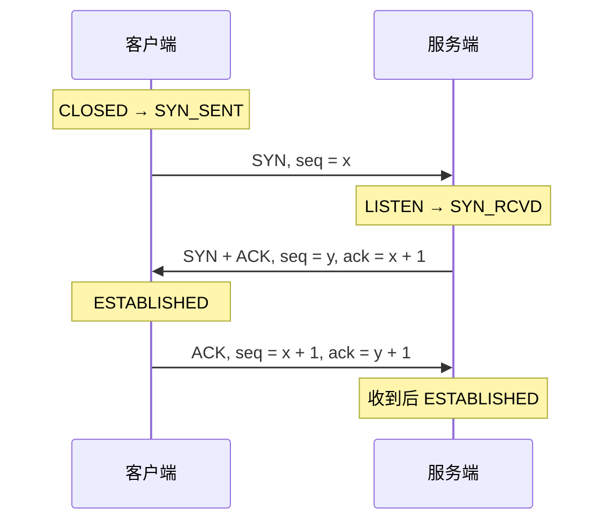
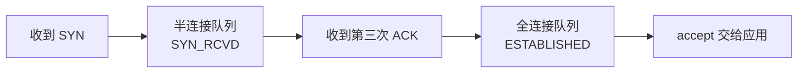
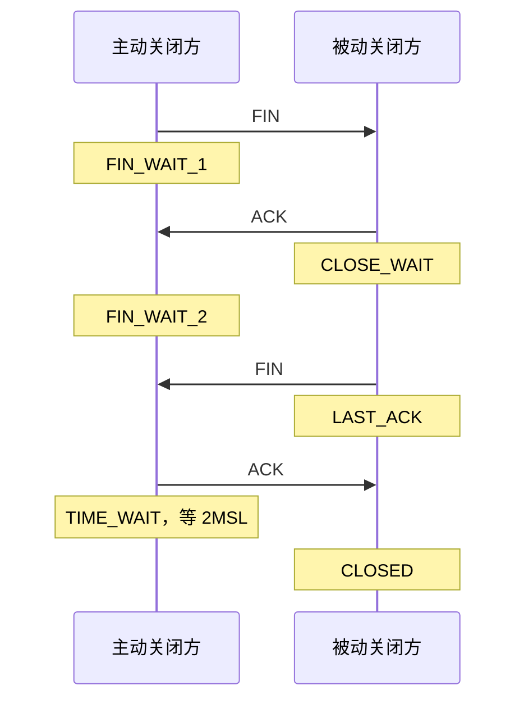
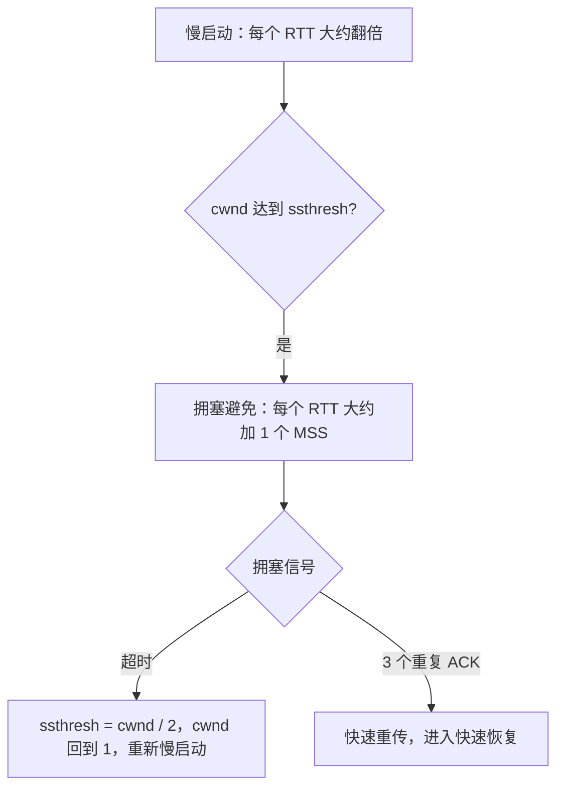

# TCP / UDP 传输层

面向高级 Java。按六条线背：**头部 → 三次握手与队列 → 四次挥手与 TIME_WAIT / CLOSE_WAIT → TCP 和 UDP 怎么选 → 可靠传输、流量控制、拥塞控制**。

HTTPS 里三次握手、四次挥手嵌在整条链路中的位置见 [HTTPS 详细过程](./https)。从输入网址到页面的时间线见 [网络传输场景](./transmission)。

---

## 一、TCP 基础

### 1. TCP 头部有哪些字段？

TCP 头部最小 **20** 字节，带选项时最大 **60** 字节。首部长度以 4 字节为单位，最大 15，所以是 60。

| 字段 | 作用 |
|------|------|
| 源端口 / 目的端口 | 标识两端的应用程序 |
| 序列号 | 本报文段数据第一个字节的序号 |
| 确认号 | 期望收到的下一个字节序号，它之前的字节都已收到 |
| 首部长度 | 头部有多长，用来找到数据从哪开始 |
| 标志位 | 控制连接：SYN、ACK、FIN、RST、PSH、URG |
| 窗口大小 | 接收方还能收多少字节，给流量控制用 |
| 校验和 | 覆盖伪首部、TCP 头和数据，发现损坏 |
| 紧急指针 | 配合 URG，标出紧急数据的位置 |
| 选项 | MSS、窗口扩大、时间戳、SACK 等 |

面试时把六个标志位说全：

| 标志 | 作用 |
|------|------|
| SYN | 发起连接，同步初始序列号。占一个序号 |
| ACK | 确认号字段有效。纯 ACK 不占序号 |
| FIN | 我这个方向的数据发完了。占一个序号 |
| RST | 重置连接，常见于连到未监听端口，或对端已经不认这条连接 |
| PSH | 提示接收方尽快把数据交给应用。实现里经常在一次发送的最后一段带上 |
| URG | 紧急数据，现在很少用 |

窗口字段只有 16 位，最大 65535 字节。选项里的窗口扩大因子用来突破这个上限。

### 2. 说一下 TCP 三次握手的过程？

三次握手让双方确认彼此都能发、都能收，并同步初始序列号。初始序列号要难以猜测，避免别人伪造报文插进连接。



1. **第一次**：客户端发 SYN，序列号 `x`，进入 `SYN_SENT`。
2. **第二次**：服务端回 SYN+ACK，自己的序列号 `y`，确认号 `x + 1`，进入 `SYN_RCVD`。Linux 的 `ss` 里写成 `SYN-RECV`。
3. **第三次**：客户端回 ACK，确认号 `y + 1`，序列号 `x + 1`。客户端发出后进入 `ESTABLISHED`；服务端**收到**这个 ACK 才进入 `ESTABLISHED`。

SYN 占了一个序号，所以确认号是 `x + 1`，第三次的序列号也从 `x + 1` 开始。FIN 同样占一个序号。

### 3. 为什么需要三次握手？两次行不行？

两次不够，有两件事没做完。

1. **服务端还没确认客户端能收。** 服务端发出 SYN+ACK 之后，如果不再等 ACK，它不知道自己的报文有没有到。
2. **过期的旧 SYN 会建出一条没人要的连接。** 客户端早就放弃的 SYN 延迟到达，服务端回了 SYN+ACK 就认为连接已建立，随后给一个并不准备通信的对端分配资源。第三次 ACK 等于客户端声明：这是我现在要的连接，我收到了你的 SYN。

### 4. 如果第一次握手丢包会发生什么？

客户端发了 SYN，等不到 SYN+ACK，就停在 `SYN_SENT`，超时后重传 SYN。服务端根本没看到这次请求，不会留下半连接。多次重传仍失败，客户端放弃，连接超时。Linux 上重传次数看 `tcp_syn_retries`。

### 5. 第二次握手丢包会发生什么？

服务端已经收到 SYN，发出 SYN+ACK，自己进入 `SYN_RCVD`，这条请求躺在半连接队列里。客户端没收到 SYN+ACK，仍是 `SYN_SENT`。

两边都会再试：

- 客户端超时，重传 SYN
- 服务端等 ACK 超时，重传 SYN+ACK（`tcp_synack_retries`）

服务端收到重复 SYN，会再回一次 SYN+ACK。一直完不成，半连接超时后被清掉。

### 6. 第三次握手丢包会发生什么？

客户端已经进入 `ESTABLISHED`，ACK 在路上丢了。服务端还停在 `SYN_RCVD`。

服务端超时后重传 SYN+ACK。客户端收到重复的 SYN+ACK，再回一次 ACK。服务端收到后进入 `ESTABLISHED`。

客户端如果已经开始发数据，数据报文本身也带着确认号，同样能把服务端带进 `ESTABLISHED`。一直完不成时，服务端清掉半连接；客户端之后写数据或探测失败，再把本地连接关掉。

### 7. TCP 半连接队列和全连接队列了解过吗？

服务端把「还在握手」和「握手完成、等应用来取」分成两个队列。



| | 半连接队列 | 全连接队列 |
|--|------------|------------|
| 又叫 | SYN Queue | Accept Queue |
| 什么时候进去 | 收到 SYN、发出 SYN+ACK | 收到第三次 ACK，连接已建立 |
| 状态 | `SYN_RCVD` | `ESTABLISHED`，等 `accept()` |
| 相关参数 | `net.ipv4.tcp_max_syn_backlog` | `listen()` 的 backlog，上限是 `net.core.somaxconn` |

队列满了：

- **半连接队列满**：新的 SYN 可能被丢掉。Linux 上 `tcp_syncookies = 1` 时，可以用 SYN Cookie 把状态编进序列号，不占队列也能把握手做完。
- **全连接队列满**：默认丢掉最后的 ACK，客户端会重传，表现为连接变慢或超时。`tcp_abort_on_overflow = 1` 时，内核直接回 RST。

容量算法和内核版本有关，面试说出这两个队列各自卡在哪一步即可。

排查：

- `ss -lnt`：监听套接字上，`Recv-Q` 是全连接队列里还没被 `accept` 的数量，`Send-Q` 是 backlog 上限。`Recv-Q` 顶到 `Send-Q` 就是全连接队列满了。
- `netstat -s` 或 `/proc/net/netstat`：看 `ListenOverflows`、`ListenDrops`，以及 SYN 被丢的计数。
- 对照 `somaxconn`、`tcp_max_syn_backlog` 和应用里 `listen(backlog)`。应用取连接太慢时，先扩处理能力，再考虑加大 backlog。

---

## 二、TCP 四次挥手

### 8. TCP 四次挥手的过程？

TCP 是全双工，两个发送方向各自关闭。下面按客户端主动关闭来写；谁先关，谁就是主动关闭方。



1. 客户端发 FIN，表示自己不再发数据，进入 `FIN_WAIT_1`。
2. 服务端回 ACK，进入 `CLOSE_WAIT`。客户端收到 ACK 后进入 `FIN_WAIT_2`。此时服务端还可以继续把剩余数据发完。
3. 服务端应用关闭后发 FIN，进入 `LAST_ACK`。
4. 客户端回 ACK，进入 `TIME_WAIT`，等 **2MSL** 再变 `CLOSED`。服务端收到 ACK 后直接 `CLOSED`。

两边同时发 FIN 时，各自会经过 `CLOSING`，最后都进 `TIME_WAIT`。

### 9. 为什么需要四次挥手？三次行不行？

客户端的 FIN 只关闭「客户端 → 服务端」这个发送方向。服务端收到 FIN 时，自己的发送方向可能还有数据，所以先回 ACK，数据发完再单独发 FIN。

服务端刚好没有剩余数据时，ACK 和 FIN 可以放在同一个报文里。抓包会看到三次报文，两个方向仍然各自关闭了一次。

### 10. TIME_WAIT 是如何产生的？

主动关闭方收到对方的 FIN，发出最后一个 ACK 之后，进入 `TIME_WAIT`。

它留在这里做两件事：

- 最后一个 ACK 如果丢了，还能再回一次
- 让旧连接的报文从网络里消失，避免撞上同一四元组的新连接

### 11. 为什么 TIME_WAIT 之后需要等待 2MSL？

MSL（Maximum Segment Lifetime）是报文允许在网络里存活的最长时间。

**最后一个 ACK 要有机会重传。** 服务端没收到 ACK，会重发 FIN。客户端必须还停在 `TIME_WAIT` 里才能再回 ACK。ACK 走到对端最多一个 MSL，对端的 FIN 再回来又是一个 MSL，所以是 2MSL。

**旧报文要先过期。** 连接刚关就用同一组源 IP、源端口、目的 IP、目的端口建新连接时，迟到的旧数据可能被新连接收下。等够 2MSL，旧报文已经不可能再出现。

2MSL 是协议上的等待时间。Linux 里 `TIME_WAIT` 常见大约 60 秒（按 MSL = 30 秒计）。`tcp_fin_timeout` 管的是 `FIN_WAIT_2`，不是 `TIME_WAIT`。

### 12. TIME_WAIT 过多有什么危害？

`TIME_WAIT` 本身是正常关闭，不是故障。数量很大时才会挤占资源：

1. 每个状态都占一个传输控制块
2. 主动关闭方的本地端口和四元组被占住
3. 本机作为客户端频繁建短连接时，临时端口用尽，新连接失败

高并发短连接最容易踩到。服务端只是被动关闭时，`TIME_WAIT` 在对端，本机压力小得多。

### 13. 怎么解决 TIME_WAIT 过多的问题？

先少制造短连接，让连接复用起来：

1. HTTP Keep-Alive，一条连接传多个请求
2. 数据库、HTTP、RPC 用连接池
3. 由客户端主动关闭，把 `TIME_WAIT` 留在客户端；服务端只在空闲超时等必要场景下关
4. 出站连接很多时，可以评估 `tcp_tw_reuse`（配合时间戳，复用处于 `TIME_WAIT` 的出站四元组）。它不负责把监听套接字上的 `TIME_WAIT` 清掉

`tcp_tw_recycle` 在 Linux 4.12 已经删除。它依赖时间戳判断旧连接，经过 NAT 时不同主机的时间戳会互相干扰，不能再当成优化手段。

`TIME_WAIT` 是关闭流程的一部分，目标是少创建短连接，而不是把它从协议里抹掉。

### 14. 服务端产生大量 TIME_WAIT 状态的原因？

`TIME_WAIT` 在**主动关闭**的一方。服务端堆积，说明服务端在主动关连接。

常见来源：

- HTTP 短连接，响应后由服务端关
- 服务端自己当客户端，访问下游时每次新建连接再关掉
- 连接池没有复用
- 空闲连接由服务端超时回收
- 和下游之间全是短连接

先看本地地址和远端地址，确认堆在哪些端口、哪些下游，再追连接是谁创建、谁关闭的。

### 15. 服务端产生大量 CLOSE_WAIT 状态的原因？

`CLOSE_WAIT` 表示：对端的 FIN 已经收到，ACK 也回了，**本机应用还没关 Socket**。内核在等应用调用 `close`。

常见原因：

1. 异常分支没有关流、没有关 Socket
2. HTTP 客户端没把响应体读完或没释放连接
3. 线程堵在别的调用上，迟迟走不到关闭逻辑
4. 没处理对端已经挂断的事件

排查：`ss -antp` 找到进程，再用 `jstack` 看线程堵在哪，然后查 Socket、HTTP 客户端、数据库连接的释放路径。`try-with-resources` 或 `finally` 里关闭，避免只在正常返回时关闭。

> `TIME_WAIT`：主动关闭方在等 2MSL。`CLOSE_WAIT`：被动关闭方的应用还没关 Socket。

---

## 三、TCP 与 UDP

### 16. TCP 与 UDP 有什么区别？

| 对比项 | TCP | UDP |
|--------|-----|-----|
| 连接 | 先握手，再传数据 | 直接发数据报 |
| 可靠性 | 确认、重传、按序交给应用 | 尽最大努力交付，可能丢、重、乱序 |
| 数据形态 | 字节流，没有报文边界 | 数据报，一次发送是一个报文 |
| 流量控制 | 有，看接收窗口 | 没有 |
| 拥塞控制 | 有 | 没有 |
| 头部 | 最小 20 字节 | 固定 8 字节：源端口、目的端口、长度、校验和 |
| 传输开销 | 控制多，吞吐稳定 | 开销小，延迟更低 |

TCP 是面向连接的可靠字节流。UDP 是无连接的数据报，发出去之后协议本身不再管结果。

### 17. 什么时候用 TCP，什么时候用 UDP？

要完整、按序到达时用 TCP：HTTP/HTTPS、数据库、文件、邮件。

更在意时延、可以丢一点时用 UDP：直播、语音、在线游戏、普通 DNS 查询。可靠性和实时性要自己在 UDP 上面补，QUIC 就是这样做的。

### 18. 此时此刻视频面试用的是 TCP 还是 UDP？

看软件走的哪条传输，不能只看「是不是视频」。

| 场景 | 常见传输 |
|------|----------|
| WebRTC 音视频 | UDP 上的 SRTP。UDP 不通时，经 TURN 用 TCP/TLS 中继 |
| 点播、文件下载、HLS | TCP（HTTP/HTTPS） |
| 会议软件自有协议 | 可能是 UDP，也可能是 TCP，以实际抓包为准 |

实时音视频优先 UDP：丢了一个包不必让后面的帧都停下来等重传。丢包恢复、拥塞控制放在 UDP 之上自己做。

### 19. UDP 怎么改造变为可靠传输？

UDP 只负责把数据报送出去。可靠性加在它上面：

| 机制 | 作用 |
|------|------|
| 序列号 | 标出顺序，发现缺口 |
| ACK | 告诉发送方哪些已经收到 |
| 超时重传 | 没收到确认就再发 |
| 滑动窗口 | 一次在途多段数据，同时限制发送量 |
| 排序缓冲 | 乱序到达后按序交给应用 |
| 去重 | 重传造成的重复包只留一份 |
| 拥塞控制 | 网络拥塞时放慢发送 |

QUIC 在 UDP 上做了可靠传输、多路复用和拥塞控制，HTTP/3 用的就是它，见 [HTTPS 详细过程](./https)。KCP 是另一套基于 UDP 的可靠传输协议，用更积极的重传换低延迟。

### 20. TCP 和 UDP 可以共用一个端口吗？

可以。端口空间按协议分开，一条连接的标识是 **协议 + 源 IP + 源端口 + 目的 IP + 目的端口**。

TCP 8080 跑 HTTP，UDP 8080 同时跑别的服务，互不占用。同一个 TCP 端口不能再绑第二个 TCP 监听（`SO_REUSEPORT` 是另一套负载分担机制）。

---

## 四、TCP 可靠性机制

### 21. TCP 如何保证可靠性？

1. **序列号**：每个字节都有编号，接收方按序交给应用
2. **确认应答**：收到数据后回 ACK，确认号是下一个期望字节
3. **超时重传**：一段时间内没有 ACK，发送方重传
4. **快速重传**：连续收到多个重复 ACK，认为后面的段丢了，不必等到超时
5. **校验和**：损坏的段直接丢掉，等重传
6. **滑动窗口**：窗口内连续发送，收到确认再往前滑
7. **流量控制**：接收窗口限制发送量，保护接收方
8. **拥塞控制**：拥塞窗口限制发送量，保护网络

序列号、ACK 和重传负责可靠有序；流量控制和拥塞控制负责别把接收方或网络打满。

### 22. TCP 流量控制和拥塞控制的区别？

| | 流量控制 | 拥塞控制 |
|--|----------|----------|
| 解决什么 | 接收方处理不过来 | 网络路径承载不了 |
| 保护谁 | 接收方缓冲区 | 沿途的网络 |
| 窗口 | 接收窗口 `rwnd`，写在 TCP 头里 | 拥塞窗口 `cwnd`，发送方自己维护 |

接收方把还能收的字节数放进窗口字段。发送方再根据丢包、时延调整 `cwnd`。

实际能发多少，取两者里更小的那个：

```text
发送窗口 = min(rwnd, cwnd)
```

### 23. 滑动窗口怎么设计的？解决什么问题？

两件事：

1. 不必每发一个段就停下来等 ACK，窗口里的数据可以连续发出去
2. 窗口有上限，发送量不会超过接收方和网络还能承受的范围

发送方眼里的数据分成三段：已经确认的、窗口内已发送或可发送的、窗口右侧还不能发的。ACK 到了，左边界往右移，右侧就腾出新的可发送字节。

下面用字节序号示意，窗口大小为 5：

```text
字节:  1  2  3  4  5  6  7  8
窗口: [1  2  3  4  5]

连续发出 1～5，收到对前 3 个字节的确认后：

字节:  1  2  3  4  5  6  7  8
窗口:          [4  5  6  7  8]
```

TCP 的窗口按**字节**计，不是按报文个数计。一个段里可以带很多字节，确认号也按字节前进。

### 24. TCP 协议拥塞控制是怎么实现的？

发送方用 `cwnd` 控制在途数据。传统 Reno 分成这几段，面试先把这个骨架说清：



1. **慢启动**：初始窗口现在常见大约 10 个 MSS。每收到一批确认，窗口大约翻倍，指数增长。
2. **拥塞避免**：到了阈值 `ssthresh` 之后改为线性，每个 RTT 大约增加 1 个 MSS。
3. **超时**：认为拥塞比较重。`ssthresh` 降为当前 `cwnd` 的一半，`cwnd` 回到 1 个 MSS，重新慢启动。
4. **快速恢复**：连续 3 个重复 ACK 说明后面还有段在到达，多半只丢了一段。立刻重传丢失的那段（快速重传），`ssthresh` 和 `cwnd` 降到大约一半，然后进入拥塞避免，不必退回慢启动。

Linux 默认算法是 **CUBIC**，窗口按距离上次拥塞的时间做三次曲线增长，带宽利用比 Reno 的线性更好。**BBR** 则估计带宽和最小 RTT，不以丢包作为唯一的拥塞信号。说实现时补一句「线上具体行为看当前算法」即可。

> 慢启动指数涨，拥塞避免线性涨，超时就大幅降速，3 个重复 ACK 走快速重传。

### 25. TCP 的延迟应答和累计应答是什么？

两者都是少发控制报文。

**延迟应答**：收到数据后不立刻回 ACK，短等一会儿。这段时间里应用如果写出了响应，ACK 可以搭在数据包上一起发；也可以等第二个段到了再一起确认。等待有上限，Linux 上常见大约 40 毫秒，不会一直拖着。

它和 Nagle 叠在一起时要留意。Nagle 在还有未确认数据时不急着发新的小段，延迟 ACK 又不马上确认，小请求可能多等一个延迟 ACK 的时间。低延迟的交互场景会关掉 Nagle（`TCP_NODELAY`）。

**累计应答**：确认号以前的字节视为全部收到。连续收到字节 1～5，回 ACK = 6 就够了，不必五个段各确认一次。

中间丢了一段时，确认号停在缺口处。后面的段即使到了，重复 ACK 仍然报同一个确认号，用来触发快速重传。

**SACK** 在重复 ACK 之外，额外告诉发送方哪些不连续的块已经到了。发送方只重传真正的缺口，不必把缺口后面已经到达的数据再发一遍。

---

## 五、面试前重点记忆

| 主线 | 开口就说 |
|------|----------|
| TCP 头部 | 端口、序列号、确认号、六个标志位、窗口、校验和；最小 20 字节 |
| 三次握手 | SYN → SYN+ACK → ACK。确认双方收发，并挡掉过期 SYN |
| 两个队列 | 半连接等第三次 ACK；全连接等 `accept`。满了分别丢 SYN 或丢最后的 ACK |
| 四次挥手 | FIN → ACK → FIN → ACK。没有剩余数据时，中间的 ACK 和 FIN 可以合成一段 |
| 两个状态 | `TIME_WAIT` 在主动关闭方，等 2MSL。`CLOSE_WAIT` 是应用没关 Socket |
| TCP 与 UDP | TCP 可靠有序的字节流；UDP 是数据报，实时场景自己补可靠性 |
| 可靠性 | 序列号、ACK、超时重传和快速重传、校验和 |
| 两个窗口 | 流量控制看 `rwnd`，拥塞控制看 `cwnd`，发送窗口取较小值 |
