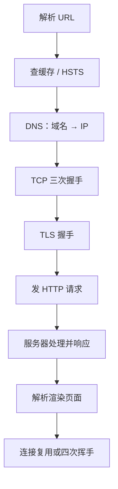
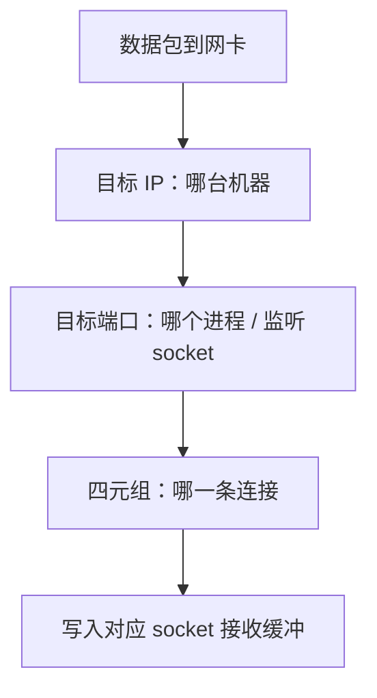

# 网络传输场景

面向高级 Java。按一条线背：**分层模型 → IP/TCP 在哪层 → 输入网址全过程 → DNS → 端口与四元组 → HTTP 跳 HTTPS → 排障与 ping 误区**。


---

## 一、OSI 七层

OSI 是 ISO 提出的**理论参考模型**，把通信从电信号到应用程序分成七层。面试答职责和数据单位即可，不必背年份。

| 层 | 名称 | 干什么 | 数据单位 | 常考协议 / 技术 |
|----|------|--------|----------|-----------------|
| 7 | 应用层 | 给应用提供网络服务 | 报文 | HTTP、HTTPS、DNS、FTP、SMTP、SSH、DHCP |
| 6 | 表示层 | 格式转换、加解密、压缩 | 报文 | TLS 相关、JPEG、ASCII（TLS 也常被归到应用层讲） |
| 5 | 会话层 | 建立 / 管理 / 结束会话 | 报文 | RPC、SOCKS |
| 4 | 传输层 | 端到端、可靠与否、流量控制 | 段 Segment | **TCP**、**UDP** |
| 3 | 网络层 | 跨网寻路、逻辑寻址 | 包 Packet | **IP**、ICMP、OSPF、BGP |
| 2 | 数据链路层 | 相邻节点、MAC、差错检测 | 帧 Frame | 以太网、PPP、ARP、VLAN、Wi-Fi |
| 1 | 物理层 | 比特怎么在介质上跑 | 比特 Bit | 网线、光纤、Hub、中继器 |

**口诀（7→1）**：应表会传网数物。

**快递类比**：

| 层 | 类比 |
|----|------|
| 应用层 | 信的正文 |
| 表示层 | 翻译、加密、压缩 |
| 会话层 | 约定什么时候开始寄、寄几次 |
| 传输层 | 挂号信 TCP / 平信 UDP，信封上写**端口号** |
| 网络层 | 收件地址 **IP**，选路线 |
| 数据链路层 | 每一段中转的门牌 **MAC** |
| 物理层 | 卡车和公路 |

> 上三层管「数据长什么样」，下三层管「怎么运过去」，传输层在中间衔接。

---

## 二、TCP/IP 模型

这是**互联网真正在用的模型**，常见四层；有的教材把网络接口层拆开成「链路 + 物理」，变成五层。

| TCP/IP 四层 | 对应 OSI | 典型协议 |
|-------------|----------|----------|
| 应用层 | 应用 + 表示 + 会话 | HTTP、DNS、FTP、SSH、DHCP |
| 传输层 | 传输层 | TCP、UDP |
| 网络层（网际层） | 网络层 | IP、ICMP、路由协议 |
| 网络接口层 | 数据链路 + 物理 | 以太网、Wi-Fi、PPP |

> OSI 偏理想标准；TCP/IP 先有协议后有模型。面试答四层；问到五层时补一句：接口层拆成链路层和物理层。

ARP 常说在链路层与网络层之间，答「链路层相关 / 为 IP 找 MAC」即可。

---

## 三、IP 和 TCP 各在哪一层？

| 协议 | 层 | 一句话 |
|------|----|--------|
| **IP** | 网络层 | 按 IP 寻址把包送到主机，**不保证**可靠（可丢、乱序、重复） |
| **TCP** | 传输层 | 面向连接的可靠字节流：端口、握手、序号确认、重传、滑动窗口、拥塞控制 |
| **UDP** | 传输层 | 无连接、不管可靠，快 |
| **ICMP** | 网络层 | ping 走的就是它 |
| **DNS** | 应用层 | 域名 → IP |

类比：IP 把信送到大楼；TCP 是前台签收核对，再交到正确房间（端口）。

---

## 四、网络为什么要分层？

本质是**高内聚、低耦合**：

1. **拆问题**：每层只干一件事（传输管可靠，网络管寻路）。
2. **独立演进**：换 IPv6、换光纤，相邻层接口不变，上层无感。
3. **标准化互通**：不同厂商设备按同一层协议对接。
4. **好排障**：从物理到应用逐层往上查。
5. **复用**：TCP 之上可以跑 HTTP、FTP、SMTP，不用每个应用重造可靠传输。

> 分层 = 分工 + 解耦 + 标准化，每层主要只和相邻层说话。

---

## 五、浏览器输入网址后发生了什么？

以 `https://www.example.com/index.html` 为例，按时间线答。



### 1. 解析 URL

拆出协议、域名、端口、路径、参数。不像合法 URL（例如纯中文），常当搜索词交给搜索引擎。

### 2. 查缓存

强缓存未过期（Cache-Control / Expires）可直接用。HSTS 列表决定是否强制 HTTPS。

### 3. DNS 解析

域名换成 IP，细节见下一节。

### 4. TCP 三次握手

1. 客户端 **SYN**（seq=x）
2. 服务端 **SYN+ACK**（seq=y, ack=x+1）
3. 客户端 **ACK**（ack=y+1）

为什么三次不是两次：双方都要确认对方「能收也能发」；也能挡掉已失效的历史 SYN 突然到达造成服务端白建连接。三次是最小够用的次数。

### 5. TLS 握手（HTTPS）

TCP 之上协商证书、算法、会话密钥。TLS 1.2 大约 2-RTT，TLS 1.3 大约 1-RTT。之后 HTTP 内容加密传。

### 6. 发 HTTP 请求

请求行 + 头（Host、Cookie、User-Agent…）+ 体，走已建好的通道。

### 7. 服务器处理并响应

常经反向代理 → 应用 → 存储，返回状态行、响应头、响应体。

### 8. 浏览器渲染

解析 HTML 建 DOM；CSS 建 CSSOM；脚本默认可能阻塞（async / defer 另说）。DOM + CSSOM → 渲染树 → 布局 → 绘制 → 合成。子资源再走「缓存 → 请求」；HTTP/1.1 同域连接数有限，HTTP/2 可在一条连接上多路复用。

### 9. 连接关闭或复用

HTTP/1.1 默认 keep-alive，后续请求可复用；结束时 **四次挥手**。

> 口述版：URL → 缓存 → DNS → 三次握手 →（HTTPS 再 TLS）→ 请求 → 响应 → 渲染 → 复用或挥手。

---

## 六、DNS 怎么解析？在哪一层？

DNS 在**应用层**：域名 → IP。几乎所有上层访问的前置步骤。

### 层级

```text
根（.）
 └─ 顶级域（.com / .cn …）
      └─ 权威域名服务器（example.com 的记录）
```

### 无缓存时的流程

1. 浏览器 DNS 缓存
2. 系统缓存（**hosts 优先**，再系统 DNS 缓存）
3. 未命中 → 本地域名服务器 **LDNS**（运营商或你配置的 DNS）：客户端对它是**递归**（要最终答案）
4. LDNS 向根 **迭代**：根告诉找 .com
5. LDNS 问顶级域：告诉找 example.com 权威
6. LDNS 问权威：拿到 A / AAAA
7. LDNS 按 TTL 缓存并返回，客户端也缓存

| 方式 | 谁对谁 | 含义 |
|------|--------|------|
| 递归 | 客户端 → LDNS | 替我查到底 |
| 迭代 | LDNS → 根 / 顶级 / 权威 | 告诉我下一步找谁 |

> 口诀：浏览器 → 系统 / hosts → 本地 DNS；本地 DNS 迭代问：根 → 顶级 → 权威。

### 常见记录类型

| 记录 | 作用 |
|------|------|
| A | 域名 → IPv4 |
| AAAA | 域名 → IPv6 |
| CNAME | 域名 → 另一域名 |
| MX | 邮件服务器 |
| NS | 该域权威 DNS |
| TXT | 文本（所有权验证、SPF 等） |

---

## 七、DNS 用什么协议？

**默认 UDP 53**；**特定情况 TCP 53**。

| 场景 | 协议 | 原因 |
|------|------|------|
| 普通查询 | UDP | 一问一答，无连接、开销小 |
| 响应过大 / UDP 被截断 | TCP | Truncation 后客户端改用 TCP 重查 |
| 区域传送 AXFR / IXFR | TCP | 数据量大且要可靠 |

另外还有加密 DNS：DoH（HTTPS 443）、DoT（TLS 853），防窃听和篡改。

> 标准答法：DNS 用 UDP/TCP 的 53；普通查询 UDP，过大或区域传送用 TCP。

---

## 八、域名怎么知道端口？

**域名不含端口。** 端口来自：

1. URL 里显式写的 `:8080`
2. 没写时，按 **scheme 默认端口**：`http→80`，`https→443`，`ftp→21`，`ssh→22`

所以 `https://www.example.com` = `https://www.example.com:443`。DNS 只出 IP，浏览器按协议补端口。

DNS 有 **SRV** 记录可以带端口（某些非 Web 服务），**浏览器访问网站不用 SRV**。

---

## 九、数据到了服务器，怎么交给正确的进程？

靠 **IP + 端口 +（TCP 时）四元组**。



1. **网络层**：目标 IP → 哪台主机。
2. **传输层**：目标端口 → 哪个监听进程（Nginx bind 80，MySQL 3306…）。内核拆包后按端口找到 socket，数据进接收缓冲，唤醒进程。
3. **连接级**：同端口上万客户端靠 **四元组** 区分：

```text
(源IP, 源端口, 目标IP, 目标端口)
```

每个四元组一条 TCP 连接、一个连接级 socket。源不同就是不同连接。

> IP 是大楼，端口是房间号，四元组是「哪个访客正在和哪个房间通话」。

---

## 十、HTTP 怎么自动跳到 HTTPS？

### 方案一：301 / 302（最常见）

1. 浏览器打 80 明文 HTTP
2. 服务器返回 **301**（永久）或 302，`Location: https://...`
3. 浏览器再请求 HTTPS（443 + TLS）
4. 301 会被浏览器缓存，下次往往直接走 HTTPS

```nginx
server {
    listen 80;
    server_name example.com;
    return 301 https://$host$request_uri;
}
```

### 方案二：HSTS（更彻底）

301 的漏洞：**第一次**仍是明文，可被中间人降级（SSL Stripping）。

- HTTPS 响应头：`Strict-Transport-Security: max-age=...; includeSubDomains`
- 有效期内浏览器在发请求前就把 http 改成 https，**根本不发明文**
- **HSTS Preload**：域名进浏览器内置列表，连首次也强制 HTTPS

> 80 回 301 指到 443；HSTS 让浏览器记住以后只走 HTTPS。

---

## 十一、页面出不来怎么查？

自底向上，和排障顺序一致。

| 层级 | 可能原因 | 常见表现 |
|------|----------|----------|
| 物理 / 本地网络 | 断网、Wi-Fi、代理错、防火墙 | 完全无网 |
| DNS | 服务器挂、域名错、劫持、hosts 被改 | DNS_PROBE_FINISHED_NXDOMAIN |
| TCP / TLS | 进程未听、端口未放行、超时、证书过期 / 不匹配 | 连接拒绝、超时、证书警告 |
| HTTP | 4xx / 5xx、空体、Content-Type 错 | 状态码不对 |
| 浏览器渲染 | JS 白屏、关键资源失败、缓存坏、插件拦截 | 有状态码但白屏 |
| 其他 | CORS、CDN、地域屏蔽 | 框架在、数据没 |

> 口诀：先 ping / 连通性 → nslookup 看 DNS → telnet/nc 测端口 → curl 看状态码 → F12 看控制台。

---

## 十二、ping 不通，但 HTTP 能通？

**会，而且很常见。** 协议不同：

| | ping | HTTP |
|--|------|------|
| 协议 | **ICMP**（网络层） | **TCP**（传输层，80/443） |
| 防火墙 | 常被故意丢弃 | 业务口常放行 |

常见原因：安全组 / iptables 禁 ICMP（防探测、防 ping flood），但放行 TCP 业务口；中间设备丢 ICMP；高负载时 ICMP 被限速。

反过来：**ping 通但 HTTP 失败**也常见——只能说明网络层大致可达，Web 进程可能没起来、端口没听、应用层 5xx。

排查 Web 时更靠谱：

- `nc -zv IP 443` / `telnet IP 80`：传输层端口
- `curl -v https://...`：应用层

> ping 测 ICMP；HTTP 走 TCP。两者不充分也不必要。

---

## 口述模板与速查

| 问题 | 开口 |
|------|------|
| OSI | 应表会传网数物；传输段、网络包、链路帧 |
| TCP/IP | 四层：接口、网络、传输、应用；互联网实际模型 |
| IP / TCP | IP 网络层不可靠寻址；TCP 传输层可靠 + 端口 |
| 为何分层 | 分工、解耦、标准、排障、复用 |
| 输入网址 | URL→缓存→DNS→握手→TLS→请求→响应→渲染 |
| DNS | 应用层；递归找 LDNS，迭代问根→顶级→权威；UDP 53 为主 |
| 端口 | 协议默认或 URL 显式；DNS 不带 Web 端口 |
| 谁收数据 | IP→主机，端口→进程，四元组→连接 |
| HTTP→HTTPS | 301 + HSTS |
| ping 不通 HTTP 通 | ICMP 禁了，TCP 业务口还开着 |
