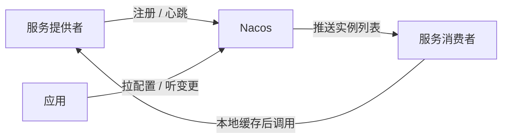
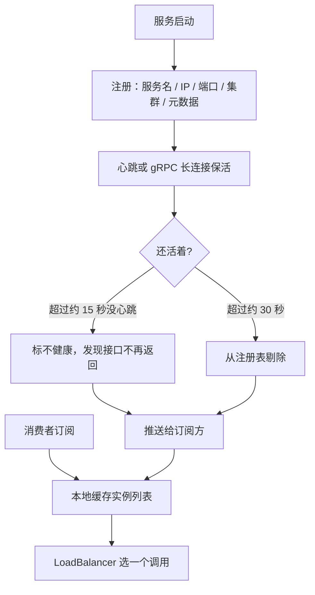
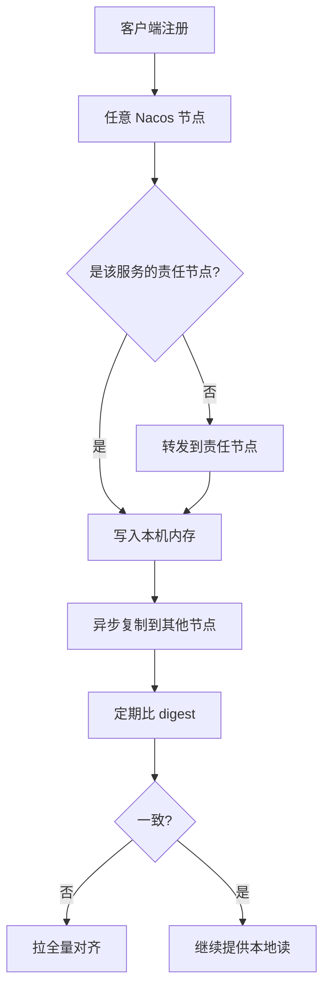
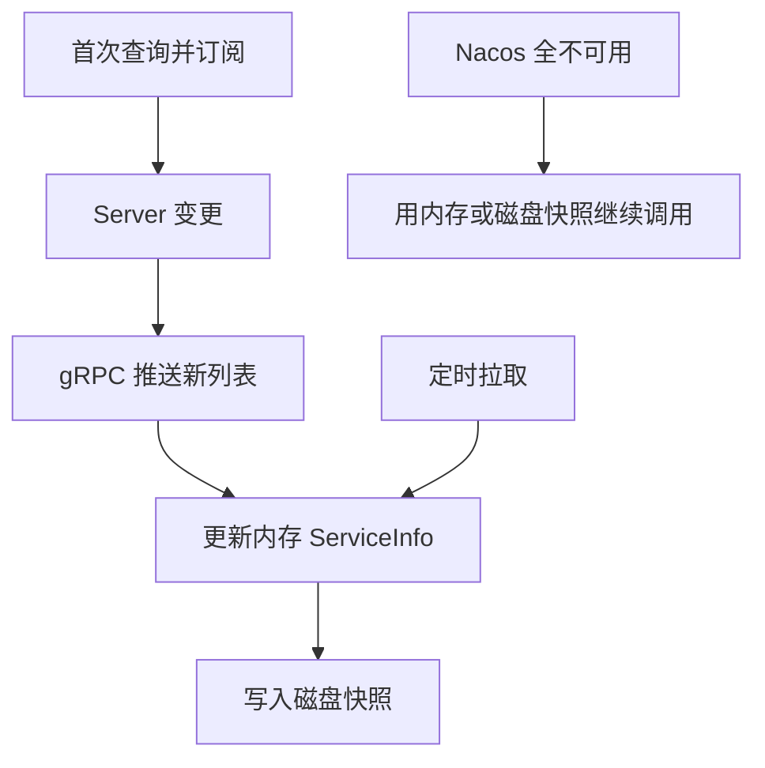
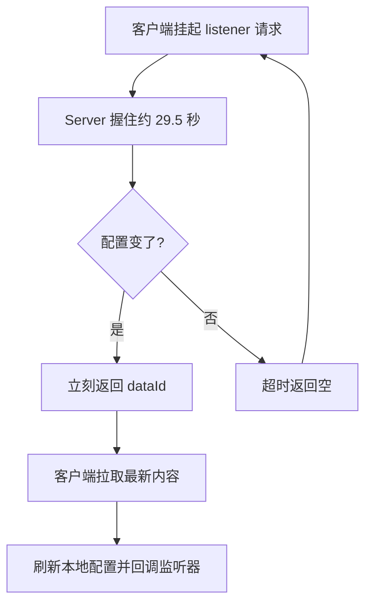
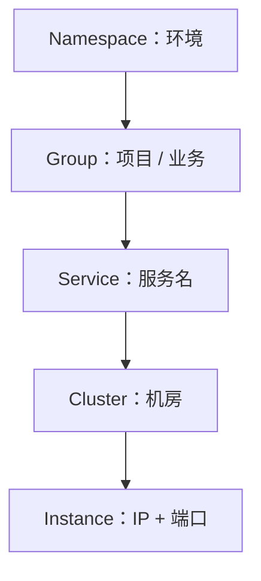
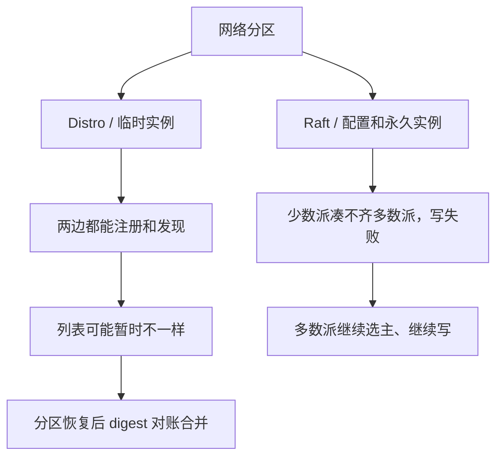
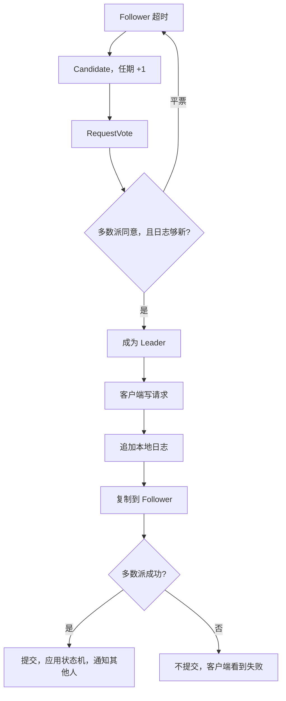
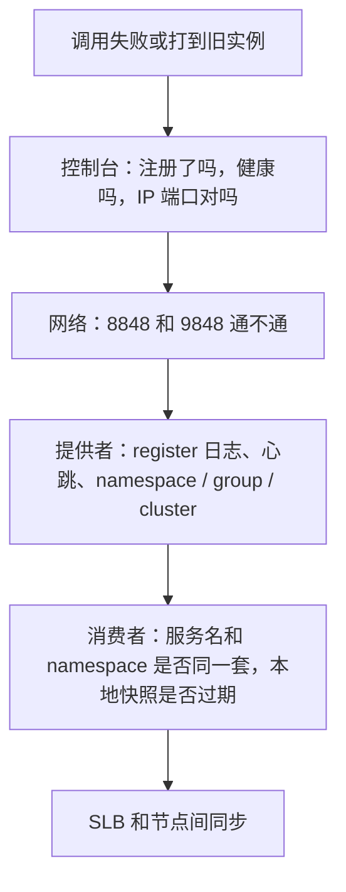

# Nacos

面向高级 Java。按一条线背：**注册发现闭环 → 临时/永久 → AP/CP → Distro/Raft → 推送和缓存 → 配置刷新 → 三级隔离 → 故障排查**。

CAP 的取舍见 [分布式](./distributed)。它在调用链里的位置见 [Spring Cloud Alibaba](./spring-cloud-alibaba)。



---

## 一、注册、心跳、发现、剔除

这四步是注册中心的基本闭环，面试按顺序讲。

1. **注册**：进程起来后，Client 把 `serviceName / IP / port / weight / cluster / metadata` 报给 Server。Server 写入注册表，再同步给其他节点。
2. **心跳**：临时实例要持续报活。1.x 大约 **5 秒**一次 HTTP 心跳；2.x 改成 **gRPC 长连接**，连接还在就视为活着，断连会触发摘除。
3. **发现**：消费者订阅服务名，拿到健康实例列表，缓存在本地，再交给 LoadBalancer 选一个去调。
4. **剔除**：临时实例心跳超时就标不健康，再超时就从注册表删掉，避免流量打到死节点。



两个时间直接背：**15 秒不健康，30 秒剔除**。1.x 是短连接心跳 + UDP 推送；2.x 是 gRPC，客户端端口是 **9848（8848 + 1000）**。

永久实例走另一条路：服务端主动探测，探测失败只标不健康，实例还留在注册表里。

---

## 二、临时实例和永久实例

默认 `ephemeral=true`，普通微服务都是临时实例。要改成永久：`spring.cloud.nacos.discovery.ephemeral=false`，或在控制台 / OpenAPI 手工登记。

| | 临时实例 | 永久实例 |
|--|----------|----------|
| 谁注册 | 客户端启动时自己注册 | 控制台或 OpenAPI，适合自己不会注册的地址 |
| 怎么保活 | 客户端心跳 / gRPC 连接 | 服务端探测 TCP、HTTP、MySQL |
| 挂了以后 | 超时剔除 | 只标不健康，元数据留着 |
| 存在哪 | 内存，节点间 Distro 同步 | 持久化，Raft 复制 |
| 一致性 | **AP** | **CP** |
| 典型场景 | 可扩缩容的微服务 | 数据库、网关、第三方固定地址 |

> 临时 = 心跳维持、挂了就摘、走 Distro。永久 = 服务端探测、只改健康状态、走 Raft。

面试收尾一句：Nacos 说自己同时支持 AP 和 CP，指的就是**按实例类型选协议**，整集群仍然是同一套节点。

---

## 三、服务发现为什么走 AP

网络分区躲不开，P 必须有。分区发生时，C 和 A 只能保一个：

| | 分区时做什么 | 典型 |
|--|----------------|------|
| **CP** | 凑不齐多数派就拒绝写，保证大家看到的一样 | ZooKeeper、Nacos 的 Raft |
| **AP** | 各节点继续干活，数据可能短暂不一样，恢复后对齐 | Eureka、Nacos 的 Distro |

Nacos 按数据选：

- 临时实例（日常服务发现）→ Distro，**AP**。列表短暂不一致，调用方重试就行。
- 永久实例、配置 → Raft，**CP**。配置改错了，全集群必须是同一份。

服务发现选 AP 的原因很具体：注册中心不可用，所有服务都互相找不到；偶尔打到一个刚下线的实例，重试就能过去。

---

## 四、Distro 和 Raft

| | Distro | Raft |
|--|--------|------|
| 谁用 | Nacos 自己做的 AP 协议 | 经典 CP 共识，Nacos 用 JRaft |
| 放什么数据 | 临时实例 | 永久实例、配置元数据、集群成员 |
| 一致到什么程度 | 最终一致 | 多数派提交后强一致 |
| 有没有 Leader | 没有。按服务名哈希选出责任节点 | Leader / Follower / Candidate |
| 写 | 打到任意节点，转到责任节点，再异步复制 | 全部经 Leader，复制到多数派才提交 |
| 读 | 各节点读本地 | 默认经 Leader，读到已提交数据 |
| 怎么对齐 | 交换 digest，对不上就拉全量 | 日志一条条复制（AppendEntries） |
| 分区时 | 两边都能注册、都能发现 | 少数派写不进去，多数派照常 |

### Distro 怎么跑

每个服务名哈希到一台**责任节点**。客户端可以连任意 Nacos，非责任节点把注册转过去。责任节点写入内存，再异步同步给其他节点。节点之间定期对 digest，不一致就拉全量。新节点加入也是先拉全量。某个节点挂了，它负责的服务重新哈希，数据从其他节点的副本补回来。



> Distro：无 Leader、按服务分片、异步复制、digest 对账、最终一致。

Raft 的选举和复制放在后面单独讲。这里先记住写路径的差别：**Distro 责任节点异步扩散，Raft 必须多数派点头。**

---

## 五、订阅、推送、本地缓存

消费者第一次拿到列表后会**订阅**。之后实例上下线、健康变化、元数据变化，Server **主动推**给订阅方。

- 2.x：gRPC 长连接推 `NotifySubscriberRequest`，延迟通常在毫秒到秒。
- 1.x：UDP 通知，客户端收到后再拉一次全量确认。UDP 可能丢，所以本来就要有兜底拉取。

客户端拿到列表做两件事：

1. 更新内存里的 `ServiceInfo`，调用走内存。
2. 写到本地磁盘，默认 `~/nacos/naming/{namespace}/`。

Nacos 全挂时，进程用内存列表；重启后读磁盘快照，已经在跑的调用还能继续。另外还有定时拉取（UpdateTask）补推送丢失。配置同样有本地 snapshot，目录在 `~/nacos/config/`。



> 推送管时效，内存加磁盘快照管「注册中心挂了业务还能跑」。

---

## 六、配置怎么推到应用里

### 长轮询（1.x 的讲法，面试还常问）

客户端发一个挂起的 HTTP 请求：`POST /nacos/v1/cs/configs/listener`。Server 先不回，默认握大约 **29.5 秒**（留半秒，躲开网关 30 秒超时）。

- 这段时间配置变了：马上返回变更的 dataId，客户端再拉正文。
- 没变：超时返回空，客户端立刻再挂下一轮。

比每隔 1 秒打一次轻，又比纯推送好穿过负载均衡和网关。2.x 配置通道改成 gRPC 长连接，服务端直接推；老客户端仍走长轮询。



### 应用到 Bean

| 写法 | 变更后 |
|------|--------|
| `@Value` + `@RefreshScope` | 这个 Bean 销毁重建，字段重新注入 |
| `@ConfigurationProperties` | Spring 会重新绑定，一般不用再套 `@RefreshScope` |
| `ConfigService.addListener()` | 回调里自己处理，不经过 Spring 刷新 |

链路：配置变更 → `NacosContextRefresher` 收到 → 发 `RefreshEvent` → RefreshScope 里的 Bean 重建。

---

## 七、Namespace、Group、Cluster

三层隔离，从大到小：**环境 → 项目 → 机房**。

| | 隔离什么 | 默认 | 配置 |
|--|----------|------|------|
| **Namespace** | 环境。dev / test / prod 互相看不见 | `public` | `spring.cloud.nacos.*.namespace` 填 **ID**，那串 UUID |
| **Group** | 同一环境下的项目或业务 | `DEFAULT_GROUP` | dataId + group 确定一份配置 |
| **Cluster** | 同一服务按机房分组，调用时同集群优先 | `DEFAULT` | `spring.cloud.nacos.discovery.cluster-name=BJ` |



最容易错的是 namespace 填了显示名。控制台名称给人看，客户端只认 ID。服务名也要大小写一致，`order-service` 和 `Order-Service` 是两个服务。

---

## 八、节点挂了、网络断开会怎样

生产一般 **3 或 5 台**（奇数），前面挂 VIP / SLB，客户端只配一个地址。

**一台挂了**

- SLB 健康检查把它摘掉，请求打到剩下的节点。
- 临时实例：这台负责的分片重新哈希，副本在别的节点上，可以补回来。
- 永久实例和配置：3 节点挂 1 台仍有多数派。挂的刚好是 Leader，就再选一轮。

**网络分成两半**



Distro 允许短暂不一致，这是 AP 的代价。Raft 少数派直接拒绝写，避免两边各写各的。

跨机房时先算 Raft：多数派必须能凑齐。两地各放一半节点，中间一断，两边都可能写不了配置。

---

## 九、Raft：选举、日志、多数派

时间按**任期 Term** 切，一个任期最多一个 Leader。角色只有三个：Follower → Candidate → Leader。

**选举**

1. Follower 在随机超时里没收到心跳，变成 Candidate，任期 +1，先投自己。
2. 向其他人发 `RequestVote`，带上自己的任期，以及最后一条日志的 index 和 term。
3. 对方投票的条件：你的任期不比我旧，日志也不比我旧，而且我这轮还没投过。日志更新的人优先，保证新 Leader 手里有已提交的记录。
4. 拿到 **多数派（N/2 + 1）** 就当 Leader，开始发心跳。
5. 票数打平就这轮作废，各自随机再等一会儿，避免一直对撞。

**复制**

1. 写请求到 Leader。Follower 收到写，转给 Leader。
2. Leader 先把操作追加到本地日志，此时还没提交。
3. 并行发给所有 Follower（`AppendEntries`）。
4. 多数派落盘成功，Leader 标成 committed，应用到状态机，再应答客户端。
5. 后面的心跳带上 commitIndex，Follower 跟上提交。



多数派的用处：任意两次多数派一定有交集，所以已提交的日志不会在换主时丢。**3 台忍 1 台故障，5 台忍 2 台**，也就是 2f+1 台忍 f 台。

Nacos 里永久实例、配置的核心元数据、集群成员走内嵌 JRaft。

---

## 十、健康检查和保护阈值

**临时实例**：客户端心跳。约 15 秒没心跳标不健康，约 30 秒删除。进程恢复心跳或重新注册后，再推一版健康列表。2.x 长连接断开，也会走进摘除。

**永久实例**：`HealthCheckTask` 周期探测。

| 探针 | 判断方式 |
|------|----------|
| TCP | 端口能不能连上 |
| HTTP | 打指定路径，看状态码 |
| MySQL | 跑一条 SQL，看库是否可用 |

失败只改成不健康；探测又通了就改回健康。地址还在，方便这种实例自己不会来注册。

**保护阈值**是服务级配置 `protectThreshold`，范围 0～1，**默认 0（等于没开）**。

触发：健康实例数 / 总实例数 **小于** 阈值。  
行为：不健康的实例也返回给消费者。

目的：网络抖动时一大片实例被标死，流量会全压到剩下那几个健康节点上，把它们打挂。这时候把请求散开，调用方自己有重试和熔断，比雪崩好。生产若要开，常见配 `0.5` 或 `0.7` 这种比例，确认过再开。

---

## 十一、Spring Cloud 里怎么接上

**注册发现**依赖 `spring-cloud-starter-alibaba-nacos-discovery`。

`NacosAutoServiceRegistration` 等 Web 容器端口就绪（`WebServerInitializedEvent`），再调 `registerInstance`。所以注册上去的端口是真实监听端口。消费端用 `@LoadBalanced RestTemplate` 或 OpenFeign，从本地实例列表里做负载均衡。Spring Cloud Alibaba 2.2 之后用 Spring Cloud LoadBalancer，老项目才是 Ribbon。

**配置**依赖 `spring-cloud-starter-alibaba-nacos-config`。

Spring Boot 2.4 起默认没有 bootstrap 上下文。两种接法：

- `spring.config.import=nacos:${spring.application.name}.yaml`
- 或者加上 `spring-cloud-starter-bootstrap`，继续用 `bootstrap.yml`

`@EnableDiscoveryClient` 新版本可以不写，依赖在就会自动装配。

一份能对上号的配置：

```yaml
spring:
  application:
    name: order-service
  profiles:
    active: prod
  config:
    import: nacos:order-service-prod.yaml
  cloud:
    nacos:
      server-addr: nacos:8848
      username: nacos
      password: nacos
      config:
        namespace: 7c2e0a1b-xxxx-xxxx-xxxx-xxxxxxxxxxxx
        group: DEFAULT_GROUP
        file-extension: yaml
      discovery:
        namespace: 7c2e0a1b-xxxx-xxxx-xxxx-xxxxxxxxxxxx
        group: DEFAULT_GROUP
        cluster-name: BJ
        ephemeral: true
```

dataId 默认是：

```text
${spring.application.name}-${profile}.${file-extension}
```

`file-extension` 默认 `properties`。控制台建成 `yaml`，客户端还是 `properties`，就会读不到。`yml` 和 `yaml` 也不是同一个 dataId。

---

## 十二、配置加载顺序，以及不生效

Nacos 里多份配置，**后加载的覆盖先加载的**：

```text
shared-configs  <  extension-configs  <  应用名.后缀  <  应用名-profile.后缀
```

> 共享 < 扩展 < 应用 < 应用+环境。远端配置后加载，通常盖过本地 `application.yml`。


读不到或改了不生效，按这个顺序看：

1. **namespace 填了名称**。要填 ID；空着就是 `public`。
2. **group 不一致**。一边 `DEFAULT_GROUP`，一边建在业务 group。
3. **dataId 拼错**。应用名、profile、后缀三者对一下控制台。
4. **内容不是合法 YAML / Properties**。解析失败会跳过，启动日志里搜加载了哪些 dataId。
5. **没进 Nacos 配置源**。Boot 2.4+ 既没有 `spring.config.import`，也没有 bootstrap starter。
6. **Bean 没刷新**。`@Value` 缺 `@RefreshScope`；`@ConfigurationProperties` 确认绑定的是刷新后的 Environment。
7. **同名 key 被更高优先级盖掉**。共享配置里改了，应用配置里还有旧值。
8. **网络或账号**。2.x 要通 **8848 和 9848**；开了鉴权就要对 username / password。

启动日志搜 `Loading nacos data`、`Located property source`，能看到实际加载的 dataId。

---

## 十三、服务发现异常怎么查

常见口误：`no instances available`、连接拒绝、打到已下线实例、控制台和客户端列表对不上。

先分清三层：**控制台看到的 Server 数据、推送链路、客户端本地缓存**。控制台正常，只说明 Server 有这份数据。



| 现象 | 先看什么 | 怎么处理 |
|------|----------|----------|
| 根本没注册上 | namespace / group，注册异常被吞 | 对 ID；打开 client 日志看 register 结果 |
| 注册了，消费者没有 | 两边 namespace、group、服务名大小写 | 配成同一套 |
| 实例时有时无 | 提供者 GC、CPU 打满、网络抖，心跳超时 | 先看提供者负载，再考虑调心跳 |
| 打到已下线实例 | 推送没到，本地列表是旧的 | 查 gRPC；必要时看 LoadBalancer 缓存 |
| 2.x 注册超时 | 9848 没放通 | 放通 9848，节点间还有 9849 |
| 控制台有，状态不健康 | 永久实例探针失败，或保护阈值把不健康的也返回了 | 对探针；看阈值是不是被打开 |

直接看 Server：

```text
curl "http://nacos:8848/nacos/v1/ns/instance/list?serviceName=order-service"
```

再对客户端机器上的 `~/nacos/naming/`。两边不一致，问题在推送或本地缓存，不在「服务没注册」。

---

## 十四、改配置和回滚

发布时按这个习惯走：

1. 先对死 dataId、group、namespace，别改到别的环境。
2. 测试环境验证过再上生产。开关、限流、连接池这类先评审。
3. 有条件用 **Beta 发布**：先推到指定 IP，没问题再全量。
4. 发布后看客户端有没有收到变更（`RefreshKeys` 一类日志），再看错误率和业务指标。

回滚用控制台历史版本，点回去就是一次新的变更，一样会推下去。重要配置改之前再导出一份。个别实例没刷新，先确认推送有没有到它；RefreshScope 没生效时，重启这台是最后手段。

---

## 十五、集群、端口、监控

| 项 | 做法 |
|----|------|
| 节点 | 至少 3 台，奇数，分机器 / 可用区 |
| 入口 | 前面放 VIP / SLB，客户端只配这一个地址 |
| 存储 | 单机可以用内置 Derby。集群把配置放到外置 MySQL，执行 `conf/mysql-schema.sql` |
| 端口 | **8848** HTTP 控制台和 OpenAPI；**9848** 客户端 gRPC；**9849** 节点间 gRPC / Raft。1.x 还有 **7848** |
| 鉴权 | 生产打开 `nacos.core.auth.enabled=true`。2.2 起必须自定义 `nacos.core.auth.plugin.nacos.token.secret.key`，别用默认密钥 |
| 时钟 | 节点做 NTP。时钟差大会干扰选举和心跳判断 |

监控接 Prometheus（`/nacos/actuator/prometheus`）再上 Grafana。重点看：

- 服务数、实例数突然掉
- 推送失败率和延迟
- gRPC 连接数
- 配置读写、长轮询是否还在
- 节点 CPU、内存、GC，以及 Leader 是不是频繁换

实例数突降、推送失败升高、Leader 来回切，这三样优先告警。

---

## 十六、Nacos 全挂了，业务还能跑吗

已经在线上的调用，多数还能继续：

1. 消费者内存里有实例列表，磁盘上有快照，已知实例照常调。
2. 配置也停在当前快照上，只是改不了。
3. 配合 Sentinel / Resilience4j 的超时、重试、熔断，个别实例挂了不会把调用方拖死。
4. 提供者会一直重试注册。Nacos 恢复后自己补上，不用人去点。

这期间做不了的事：**新实例注册不上**。扩容、滚动发布先停。新进程没有本地快照时，也发现不了别人。

所以注册中心要集群、要跨可用区；客户端快照保持默认打开；告警要比业务报错更早出来。特别关键的调用，可以再准备一份地址兜底，但那是额外手段，日常仍以 Nacos 为准。

---

## 十七、一次服务发现故障怎么讲

面试用这个结构就够：**现象 → 三层分别看到什么 → 根因 → 当时怎么止住 → 后面怎么防**。

**现象**：大促前扩容库存服务。新实例在 Nacos 上是健康的，但订单服务只有一部分流量打到它们，错误率从 0.01% 升到 0.8%，少量请求超时。

**三层对一下**：

1. 控制台：4 个新实例都在，而且健康。注册没问题。
2. 在订单服务上调 instance/list，Server 返回的列表是全的。再看这台机器 `~/nacos/naming/` 的快照，里面还是扩容前的旧实例。
3. 订单服务日志里有 `Grpc client ... UNAVAILABLE`，打到集群里一台新换上的 Nacos。SLB 只放了 8848，**9848 没转到这台新机器**。客户端 gRPC 落到它上面之后，推送和查询都失败，本地一直吃旧列表，请求打到已经下线的实例上就超时。

**处理**：先放通 9848 / 9849，订单服务重建到 Nacos 的长连接，列表恢复，错误率回到基线。随后把端口检查写进变更清单，推送失败率接入告警，SLB 配置收进代码仓库，避免下次手工漏配。

这个案例要讲出的点：控制台健康，只代表 Server 有数据；2.x 的实例变更靠 9848 上的 gRPC；客户端真正用的是本地列表。

---

## 口述模板

| 问题 | 开口第一句 |
|------|------------|
| 注册发现 | 注册、心跳、本地缓存、变更推送。15 秒不健康，30 秒剔除 |
| 临时 / 永久 | 临时心跳 + Distro + AP，挂了就摘。永久探测 + Raft + CP，只改健康状态 |
| 为何 AP | 找不到人比偶尔打到旧实例严重。配置必须全集群一致，所以走 CP |
| Distro | 服务名哈希到责任节点，异步复制，digest 对账 |
| Raft | 随机超时选举，日志更新者优先，多数派提交。3 台忍 1 台 |
| 推送和缓存 | gRPC 推送更新内存和磁盘。Server 全挂用快照继续调 |
| 配置 | 1.x 长轮询 29.5 秒；2.x gRPC 推送。`@Value` 要 `@RefreshScope` |
| 隔离 | Namespace 是环境（填 ID），Group 是项目，Cluster 是机房，同集群优先 |
| 配置优先级 | 共享 < 扩展 < 应用 < 应用+profile |
| 不生效 | 先对 namespace ID、group、dataId 后缀，再看 9848 和刷新注解 |
| 发现异常 | 控制台、推送链路、本地快照三层分开看 |
| 端口 | 8848 HTTP，9848 客户端 gRPC，9849 节点间 |
| 全挂 | 老调用靠快照；新实例注册不上，暂停发布 |
